# 01 · The learner's journey: changes

## TL;DR

- **The page now remembers a learner across visits.** Two days later, the same link opens on "Welcome back · You
  stopped in Shuffle, step 10 of 27, in “One machine crashes” · 1 of 4 stories finished", with "Pick up where you left
  off" or "Start from the beginning". Finished stories carry a check. Under a deep link, in capture or without storage,
  none of this happens.
- **Four stories read as one course.** At a story's end the way on is "Next story: One machine crashes" (Replay stays,
  quiet). After the end check the panel offers "Try it yourself" (opens the knobs). After the last story it shows
  "Keep going": the lessons that follow, from `lesson.next`.
- **Arrival and every waiting state now say what is going on.** The start card promises "5 chapters · about 3 min ·
  3 questions · then 3 what-ifs" and gives one line on what the chosen level changes. While a question waits, the pill
  reads "Answer to go on", not a Play that does nothing. A summary held back for a question says so plainly. The chapter
  card's picture folds to a heading instead of vanishing. A lesson figure starts with Parameters folded, so the panel
  has room to teach.
- **`shoot --teach` now reaches the cards on a slow machine** (16× between cards, longer waits, the end check walked
  through), so the end states can be compared at all.

Branch **`product/01-learner-journey`**, 13 commits on `9c8b16d`. To try it:

```sh
git fetch origin && git checkout product/01-learner-journey   # in a clone of this repo
node scripts/build.mjs examples/mapreduce/figure.mjs --out /tmp/lj/mapreduce.html
# open /tmp/lj/mapreduce.html in Chrome: play "Everything works" to its end (or press End), take "Next story",
# stop somewhere in Shuffle, close the tab, open the same file again (no #hash) -> Welcome back
```

To see it fresh again, clear the site's storage (DevTools → Application → Local storage, keys `ix:*`).

---

## 1. Welcome back: the page remembers where you stopped

**The problem.** A second visit in the same browser opened on step 1 of 25, paused, with no card and no trace of the
chapter she reached or the story she finished. The start card opens once ever (`engine/runtime.mjs:518`,
`!hud.introSeen`). A link reopened from a chat message has no `#t=` hash, so for Sam, "back to the failure stories"
took a scenario hunt.

| Before: the second visit (baseline build) | Before: phone |
|---|---|
| 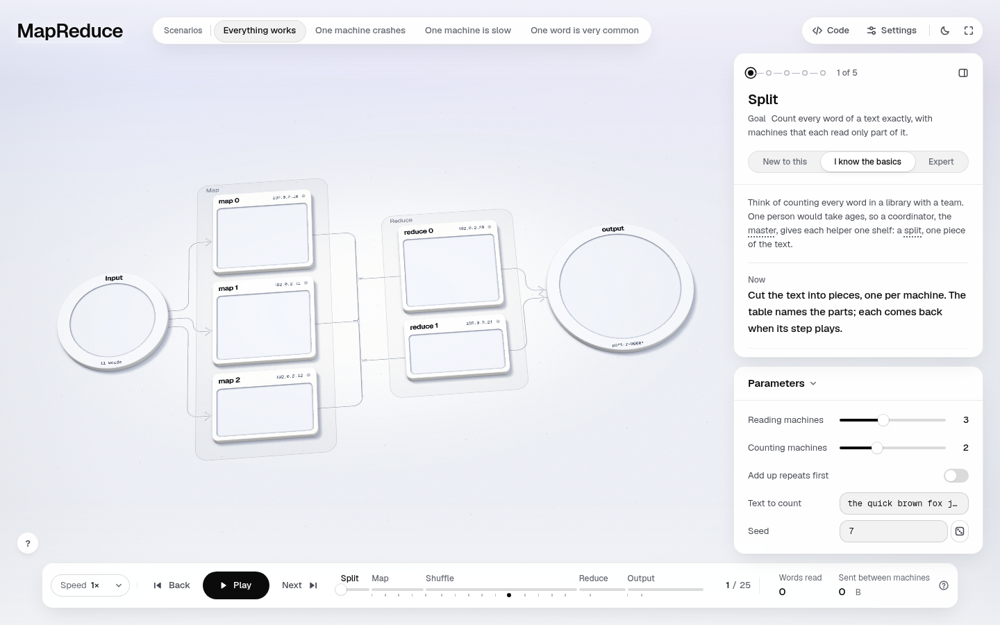 | 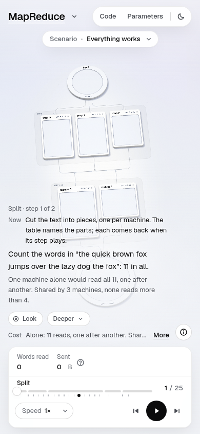 |

**What changed.** A new module, `engine/hud/journey.mjs`, keeps two things per viewer and per figure in the HUD's
existing localStorage wrapper: the stories played to their end (`ix:done:<figure>`) and where the reader is
(`ix:resume:<figure>`: story, time, step, chapter, knobs; once per step, on the main run only). On load, when there
is a place worth picking up, the start card opens again as **Welcome back**:

- "Welcome back" over the title, where they stopped in the hook's place, and "1 of 4 stories finished";
- **Pick up where you left off** (that story, its knobs, from the start of that step; a step that asks is picked up
  just before it, so the question opens again instead of its answer playing), or **Start from the beginning**;
- if the last visit ended a story, **Start One machine crashes** (the next unfinished story, from where it parts from
  the first);
- the level switch, as on a first visit.

Finished stories get a small `ok` check before their name in the stories strip and "Finished" in the menu (phone).

Why this design: the start card is already the place where the page waits for the reader, so a return is an offer
on that card, never an automatic seek. Nothing moves until they choose (DESIGN.md: the page waits). The check is
orientation ("what is left"), not a reward: no score, no streak (teaching.md §5.5).

Rules that keep it honest:
- **never under a deep link** (`#t=`, `#s=`, `#step-`, `#scenario-`, `#level-`): the link says where to start;
- **never in capture**: frozen pages do not write progress, never open the card, and hide the marks (`hud.css`
  `.ix-capture`), so a frame stays the same for the same `t`;
- **storage blocked** (a private window): every read and write is already wrapped; `journey.mjs` also distrusts what
  it reads (bad JSON, unknown stories, places older than 30 days, places in the first 2 s are ignored);
- **the level** chosen on any figure becomes the default on the next one the viewer opens (`level.mjs`), so a learner
  who chose New on MapReduce does not choose again on Raft.

After (desktop, from a live journey in one browser: story 1 played to its end, Next story, stopped in Shuffle, the same
link opened again):


Picked up: the crash story, in Shuffle, the check on "Everything works":

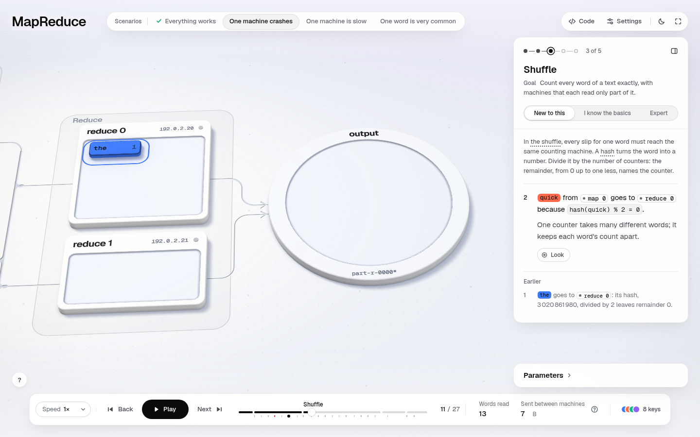

That story finished too, the next visit offers the next one:


A deep link skips the card and opens where the link says:

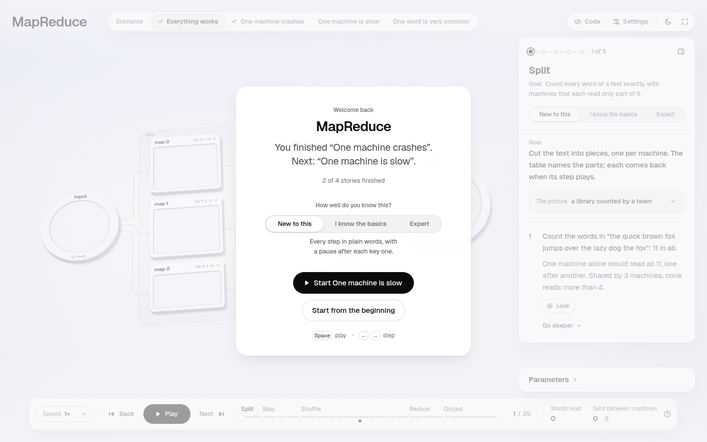

Phone:

| Welcome back | Picked up | Stories menu | Next story offered |
|---|---|---|---|
| 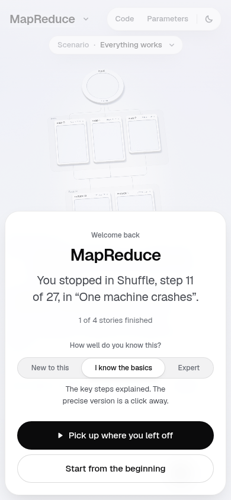 | 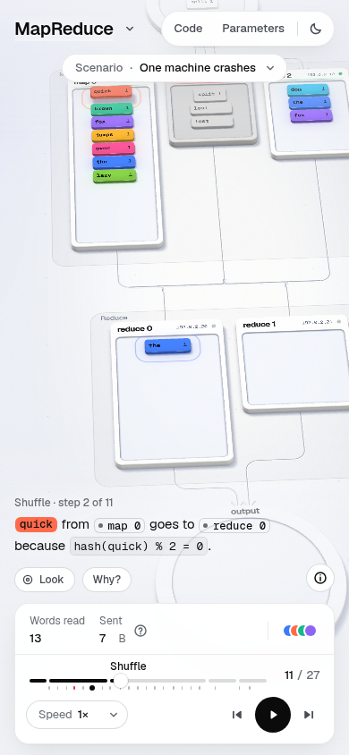 | 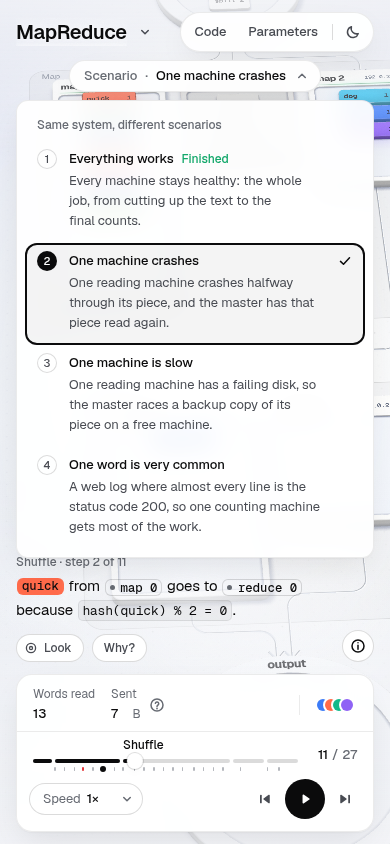 | 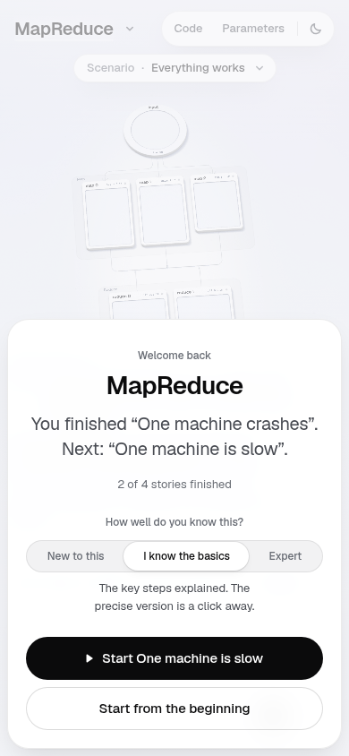 |

Storage blocked (`localStorage` throws on every access, injected before load): the page boots, plays, ends, and just
forgets. No page errors.

| First visit, storage blocked | Its end |
|---|---|
| 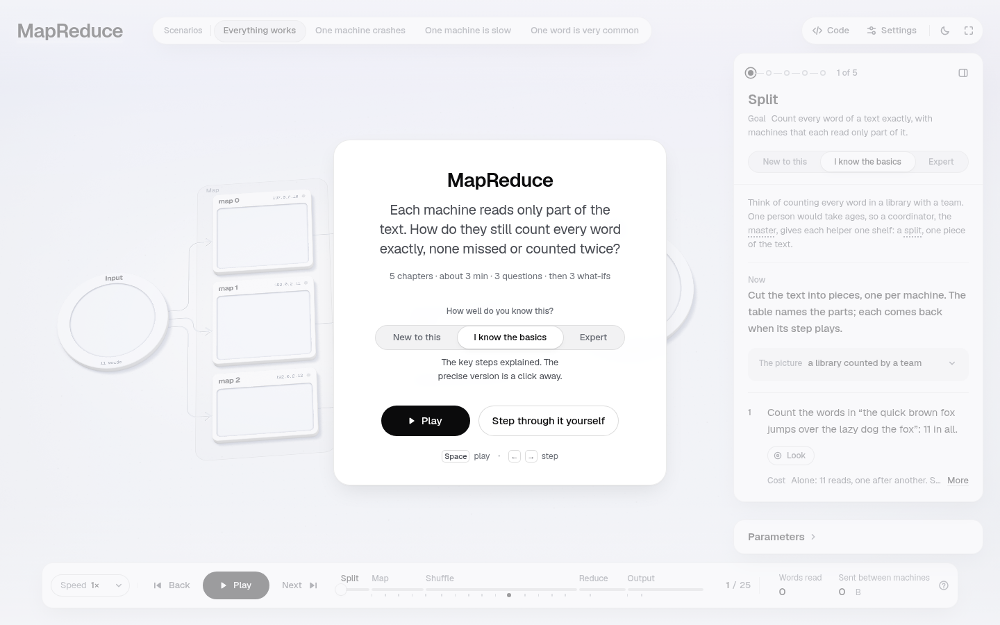 |  |

**Files.** `engine/hud/journey.mjs` (new), `engine/hud/journey.test.mjs` (new, 4 tests), `engine/hud/hud.mjs`
(`resumeOffer`, `renderIntro`, `closeIntro`, `saveProgress`, `renderStoryMarks`), `engine/runtime.mjs` (`onStart`
"resume" / "restart", `resume()`, the start card's open condition), `engine/hud/level.mjs`, `engine/hud/hud.css`.

**Verify by hand.** Build, open, play into Shuffle of any story past the first, close, reopen with no hash. Then
reopen with `#s=crash&t=12`: no card. Run `node --test engine/hud/journey.test.mjs`.

**Risks.** (1) A reader who shares a machine sees the other person's place. That is acceptable for per-browser storage,
and the card always offers "Start from the beginning". (2) The card now opens on later visits too, while there is a
place to pick up. A reader who closes it (Esc, or the scrim) keeps that place, and it is offered again next time. Once
every story is finished, the card stops opening. (3) `ix:level` is now shared across figures, which changes the
default for figures that never had a saved level. The per-figure choice still wins.

---

## 2. The way on at a story's end, and after the run

**The problem.** At the end of "One machine crashes", the dock's primary pill said **Replay**, the least useful next
step for a learner who just finished it. The next story was only a highlighted chip in the panel's "What if…" row,
under the end check. Nothing invited them to try the knobs, and after the last story there was nowhere to go.


**What changed.**
- At a story's end with a story after it, the pill reads **Next story: One machine crashes** (Enter), a phone "Next
  story". The quiet **Replay** beside it now replays this story. After the last story it is Replay, as before.
- **While the end check is still asking**, that pill waits in a quiet raised form (no ring), so the check's own "Next
  question" is the one way on. Once the check says "You can now…", the pill turns solid and calls.
- Under the takeaway and What if…: **Try it yourself**, "Change any input and the whole run is computed again. Open the
  parameters" (it unfolds the Parameters card, or opens the drawer on narrow screens).
- After the last story: **Keep going**, the lessons this one leads into, each with a line on why. They come from a new,
  optional `lesson.next` list (`CONTRACTS.md` §10). MapReduce names consistent hashing ("here `hash % R` picked each
  word's counter…") and Raft ("the master here has no backup…").
- The screen reader's live line follows: "Run complete. … Press Enter for the next story, One machine crashes."
- A story played to its end is marked finished (section 1).

| The end check asking: the pill waits, quiet | The end, check done: Next story is the way on |
|---|---|
| _Not captured._ | 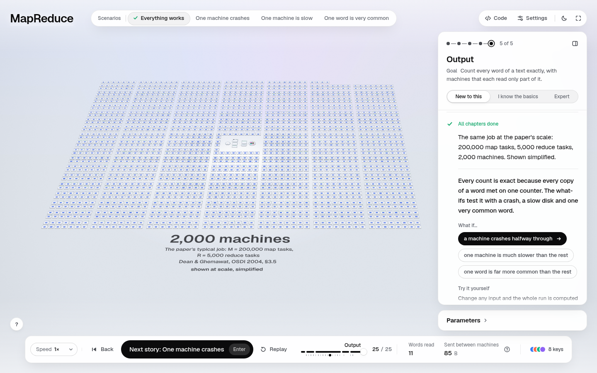 |

After the last story, Keep going:

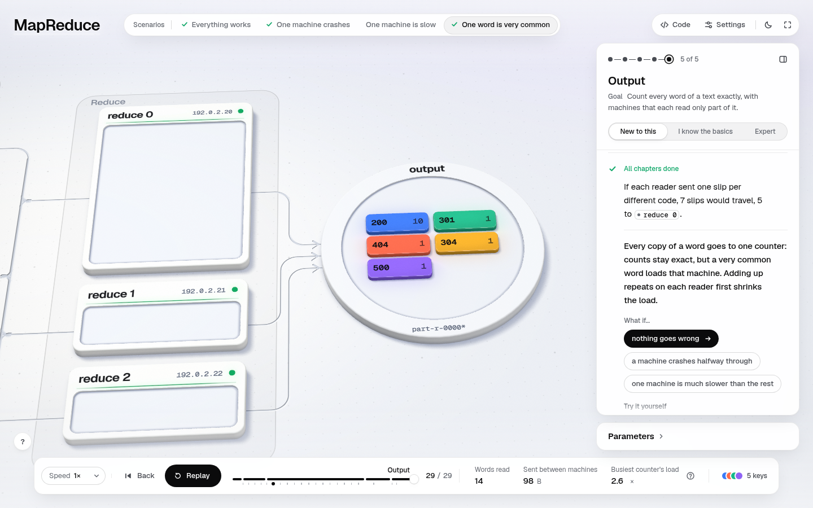

Phone, the end and its card:

| End | End card |
|---|---|
| 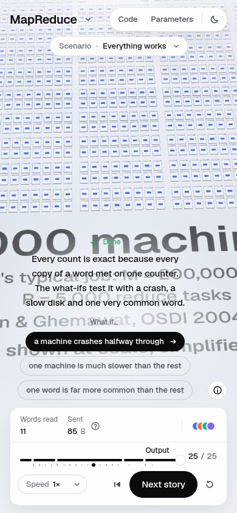 | 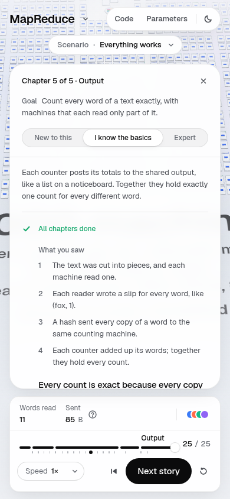 |

In the standard capture: `shots/after/*-end-check.png`, `*-end-cannow.png`, `*-end-card.png` (see Checks for which
ones the slow machine reached).

**Files.** `engine/hud/hud.mjs` (`renderPlay`, `heldAction`, `replayChapter`, `afterNode`, `openParams`,
`syncChecking`), `engine/hud/hud.css`, `engine/scene/lesson.mjs` (`next` in the lesson header),
`examples/mapreduce/lesson.mjs` (`next`), `scripts/lib/lesson.mjs` (prints "KEEP GOING" in the lesson script),
`CONTRACTS.md`, `DESIGN.md` §9.3.

**Verify by hand.** Play any story but the last to its end. The pill should say "Next story…" and stay quiet until the
check is done. Enter goes to the next story. Replay plays this one again. Play "One word is very common" to its end:
Replay, and "Keep going" under the what-ifs.

**Risks.** `lesson.next` links out to the published gallery pages, so offline they are dead links (the page itself stays
self-contained). The hrefs are absolute URLs in lesson data. If the gallery moves, they need editing.

---

## 3. Room to teach: the chapter card keeps its picture, Parameters start folded

**The problem.** At step 1 the panel says "Cut the text into pieces, one per machine. *The table names the parts*;
each comes back when its step plays." But no table was on screen, at Basics or at New. The Parameters card took about
270 px of the right column, and `fit()` dropped the entry card's So far / Done lines and the whole picture map. Where
the panel ran out of room, an empty "Earlier" heading also sat at its foot.

| Before: Basics, step 1 | Before: New, step 1 |
|---|---|
| 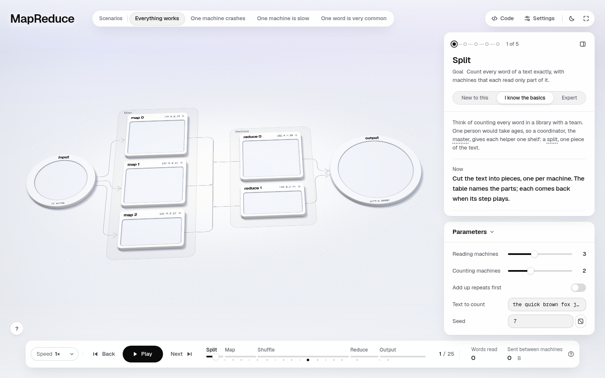 | 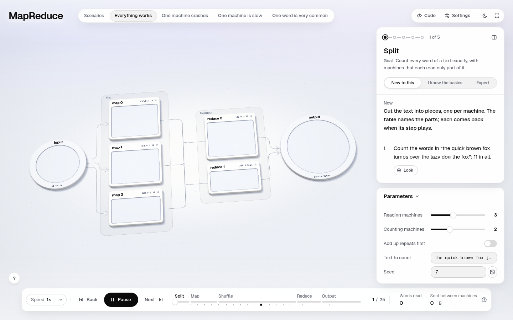 |

**What changed.**
- On a figure with a lesson, **Parameters start folded to their title** (the header still opens them, and the choice
  is remembered). The end's "Try it yourself" is the invitation to open them. A figure without a lesson keeps the old
  rule (open unless the screen is short).
- The entry card's picture **folds to its heading, a disclosure** ("The picture · a library counted by a team ⌄"),
  before So far and Done go, rather than vanishing. If the reader opens it, it stays open and the panel scrolls.
- `fit()` runs again whenever the room under the panel changes (the Parameters card folding or opening).

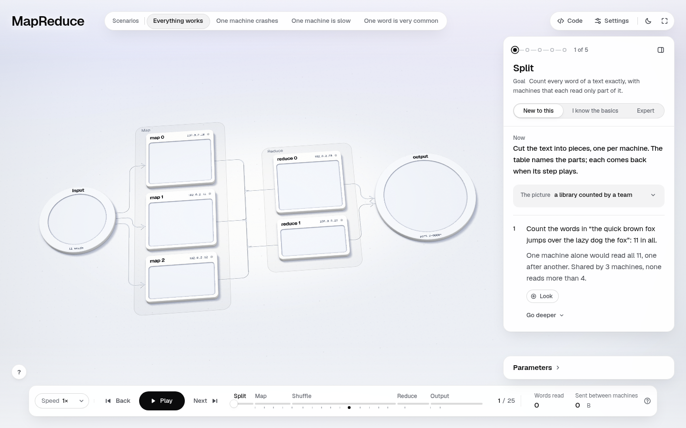

In the standard capture every desktop shot shows the panel with the step and the folded Parameters card
(`shots/after/*-1440x900-*.png`).

**Files.** `engine/hud/hud.mjs` (`syncParamsOpen`, `sizeParams`), `engine/hud/explain.mjs` (`fit`, `syncMap`,
`mapOpen`), `engine/hud/chapter-card.mjs`, `engine/hud/hud.css`, `DESIGN.md` §9.3.

**Verify by hand.** Open the page at 1440×900, Play. The first step shows the Now line, the picture's heading and the
step. Click the heading: the table opens.

**Risks.** This reverses an owner decision ("starts open"), but only for lesson figures. The trade-off is in DESIGN.md.
A learner who never reaches the end may never discover the knobs, though the header is always on screen.

---

## 4. Arrival: the promise and the level's meaning

**The problem.** The start card had a title, the hook, the level switch and two buttons. It said nothing on how long the
lesson takes, how many chapters it has, that there are questions, or that four stories follow. "How well do you know
this?" offered three labels and no word on what each changes. Picking Expert by mistake opens every deeper field and
makes predictions skippable.

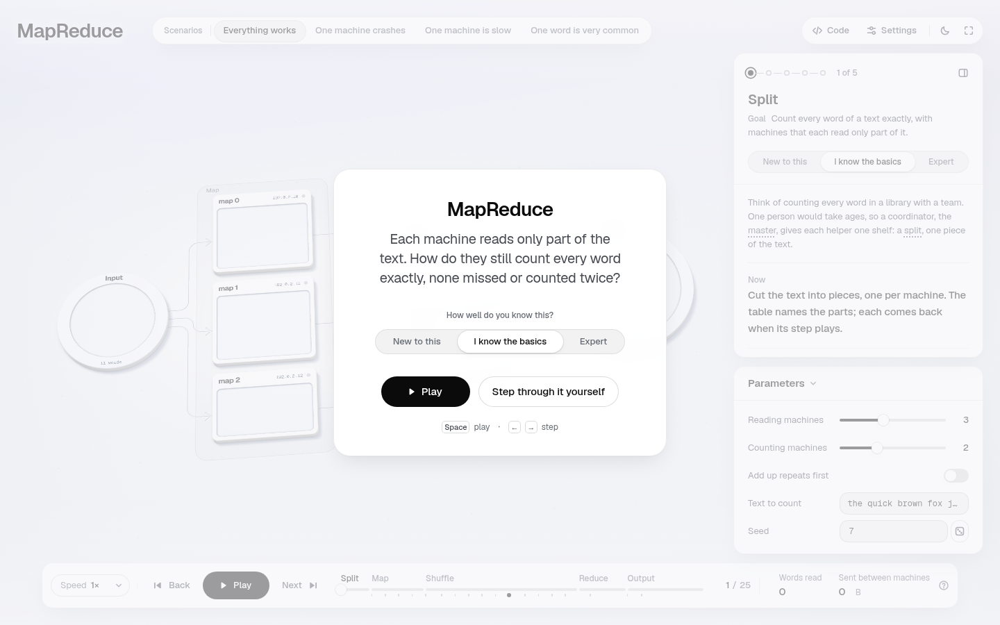

**What changed.** Under the hook, one quiet line computed from the run at the chosen level: **"5 chapters · about 3 min
· 3 questions · then 3 what-ifs"** (minutes at the level's reading pace; questions counted from the asks this level
poses plus its end check). Under the switch, one line on what the chosen level changes ("Every step in plain words,
with a pause after each key one." / "The key steps explained. The precise version is a click away." / "The run with
every detail open: cost, edge cases and sources."), updated live.

| First visit (default, Basics) | New to this |
|---|---|
|  |  |

Phone: 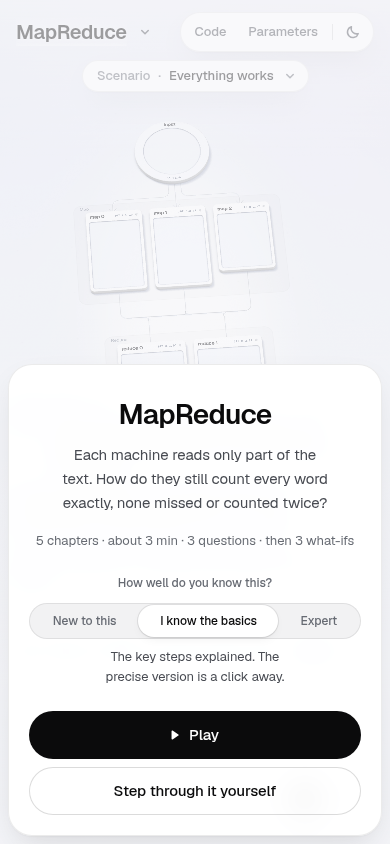

**Files.** `engine/hud/journey.mjs` (`promiseOf`), `engine/hud/hud.mjs` (`renderIntro`, `promise`),
`engine/hud/level.mjs` (`LEVELS[].note`), `engine/hud/hud.css`.

**Verify by hand.** Open the page fresh and switch levels on the start card: the question count and the line under the
switch change. With New the count rises (New asks every question and three end checks).

**Risks.** The minute count is the run at 1× and the level's pace. It does not count pauses for reading or answering, so
it is a floor ("about").

---

## 5. No ambiguous states

**The problem.** (a) While a prediction or a pick was open, the dock's pill still said **Play**. Pressing it played for
a frame and stopped at the same question, with nothing to say why (`before-pick-play-pressed.png` is the same picture
as `before-pick-open.png`). (b) "Explained once you have made your prediction." stood in for the chapter summary on
steps *before* any question had been asked (crash, step 6 of 27; the question opens at step 8). A first-time reader
reads that as "I missed something".

| Before: a question open, the pill says Play | Before: step 6, "once you have made your prediction" |
|---|---|
|  |  |

**What changed.** (a) While a question waits, the pill reads **Answer to go on** in a quiet raised form, and Next steps
aside. Pressing it (or Space) says "Pick an answer to go on." (a pick: "Pick one to go on: here, or click it in the
world.") and puts the keyboard on the first option. (b) Before the question opens: "A question about this chapter is
coming up. Its summary appears once you have answered, so it can't give the answer away." While it is open: "This
chapter's summary appears once you have answered."

| After: the question open | After: step 6 |
|---|---|
| 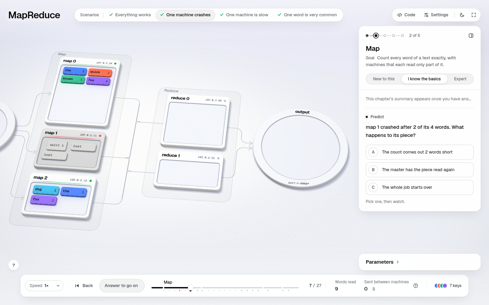 | 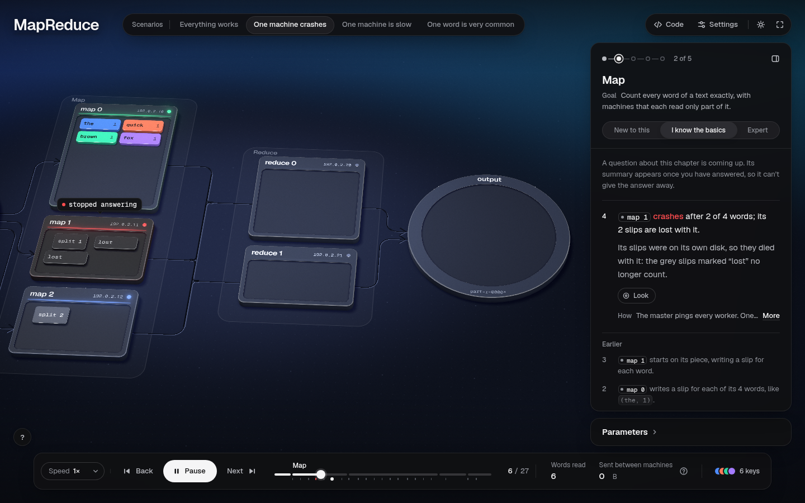 |

**Files.** `engine/hud/hud.mjs` (`syncAsk`, `pointToAnswer`, `renderPlay`, the Space key), `engine/hud/explain.mjs`
(`WITHHELD`, `WITHHELD_ASK`), `engine/hud/hud.css`, `references/builder.md`, `DESIGN.md` §9.2.

**Verify by hand.** Play "One machine crashes". At step 6 read the panel's summary line. At the question, press Space.

**Risks.** The withheld wording is longer, but it is one quiet line, and only on steps between a chapter's start and its
question.

---

## 6. A capture that reaches the cards (`shoot --teach`)

**The problem.** The baseline's `--teach` pass reported 23 page errors: questions never revealed, the pick never held,
and the run never reached its end card. I measured why. Under a load average of 17 on 4 cores, with software
rendering, a frame takes about 4 s. The runtime caps each frame's step at 1/20 s (`engine/runtime.mjs` `tick`), so 1×
live play ran at about 1/100 of real time and every 15–30 s wait expired. The page flows themselves work.

**What changed** (`scripts/shoot.mjs`, `references/tooling.md`). Live play runs at 16× between cards; questions, picks and
pauses still stop the run at their own step at any speed. Every wait is four times its nominal length. Each card is shot
with the dock showing 1×. The end now answers the end check, shoots it (`…-end-check.png`) and its "You can now…"
(`…-end-cannow.png`), then the end card under it.

**Risks.** This touches a shared script. Its outputs only add file names; existing names are unchanged. On an idle machine
the longer waits cost nothing (they are timeouts, not sleeps).

---

## Checks

- **verify, every example:** all 8 examples verify with `0 failing, 0 error(s), 0 warning(s)`; MapReduce is
  `26 run(s), 0 failing` (`verify-after.txt`). Re-run on the final commit: same result.
- **Unit tests:** 309 tests, 298 pass, **11 fail: the same 11 as on main**. The 4 extra tests are new and pass
  (`tests-after.txt`, re-run on the final commit).
- **Final capture:** `shoot.mjs --scenario all --teach`, giving 232 PNGs plus `contact.png` and `contact-2.png`, with
  **0 page errors**. The baseline's 23 `--teach` errors are gone, because this branch lets `shoot --teach` reach every
  card on a slow machine. The audit has 1 finding: focus-outside at steps 4, 19 and 22 on the 390×844 phone, the
  same as the baseline (left for the interface and accessibility branch, not pushed yet).
- **Lesson words:** `lesson-after.txt`.
- **Missing shot:** `end-check-quiet-pill.png` was referenced, but it was never captured. Its cell
  in section 2 says so.

## Merge notes

- **Shared files touched:** `engine/hud/hud.mjs` (the most: transport, start card, payoff, params, predict sync),
  `engine/hud/hud.css`, `engine/hud/explain.mjs`, `engine/hud/chapter-card.mjs`, `engine/hud/level.mjs`,
  `engine/runtime.mjs` (`onStart`, `resume()`, one condition at mount), `engine/scene/lesson.mjs` (one field),
  `scripts/shoot.mjs` (teach pass), `scripts/lib/lesson.mjs` (one block), `DESIGN.md`, `CONTRACTS.md`,
  `references/builder.md`, `references/tooling.md`. New: `engine/hud/journey.mjs` and its test.
- **Likely conflicts:** `hud.mjs` `renderPlay` and `renderIntro` (any lens that changes the transport or the start card:
  02 active learning, 03 interface/access, 05 share/teach); `explain.mjs` `fit()` and `WITHHELD`; `runtime.mjs`
  `onStart`; `shoot.mjs` `teachShots` (06 author pipeline may touch it too). They are small, local hunks, so resolving
  them should be mechanical.
- **Generalises:** everything works for all 8 examples with no per-figure work. Welcome back, finished marks, Next story,
  the promise, the level notes, Answer to go on, the withheld wording, the folded Parameters and the picture
  disclosure all come from the timeline and the lesson. `lesson.next` is optional and filled only for MapReduce. Verify
  passes on all 8 examples.

## Next (with another day, ranked)

1. **Fix the leaked Chrome profiles** in `scripts/lib/cdp.mjs` (`rmSync` in an `unref()`'d timer never runs when the
   script exits). Each run leaves ~150 MB in `/tmp`. Today they filled the per-user `/tmp` quota.
2. **`lesson.next` for the other 7 examples** (a few lines each), and a verify note when the last story has none.
3. **Show the place behind the Welcome back card.** The world behind it is still story 1, step 1. Rendering the saved
   step there (frozen, not playing) would make the card and the world agree.
4. **Remaining time in the dock** ("about 1 min left in this story"), if the dock owner finds room.
5. **The 1/20 s frame cap:** on a device drawing under 20 fps, playback runs slower than real time. That belongs to the
   motion owner.
