# 02 · Active learning: what changed

## TL;DR

- **The learner now decides more often, and right before the moment that settles it.** Everything works and One word
  is very common each ask twice at Basics (a pick plus a prediction, or two predictions), up from once. The new
  predictions are places where the naive answer is wrong: "how many totals will reduce 0 write?", "where do *all ten*
  200 slips go?", and "which fix takes the work off the busy counter?" (more counters, splitting the key, or adding up
  repeats first). The step after that last one runs the run's own hash with one more counter, so the learner sees the
  "more machines" fix fail with real numbers.
- **Each story ends with its own check, which tests transfer, not recall.** The baseline asked the same three questions
  (one was 10-digit arithmetic) after every story. Now the crash story asks about a machine that dies *after*
  finishing, the slow story asks about keeping both copies and about having one machine, and the common-word story asks
  about the combiner, a backup of the busy counter, and more reading machines. Each later story also brings back one of
  story 1's ideas at new numbers (spaced retrieval). "You can now…" lists only what that story taught.
- **Truth first.** No answer is given away by the setup any more. Two blind expert reads of the new lesson found 16
  problems (the worst: the master "cuts" the text, salting offered as a fix for medians, "a typical job" of 200,000
  maps). I checked each one against the paper or the Hadoop/Spark docs and fixed it.
- **The tools now see the active parts.** `lesson.mjs` and the blind readers' packet print the in-world pick, its real
  wrong branch and the end check. `verify` counts misconceptions named by picks and checks. `shoot --teach` now waits
  long enough on slow machines, so the ask, why, wrong, right and end-card shots exist.

Branch **`product/02-active-learning`** (15 commits on `9c8b16d`). To try it:

```sh
git fetch origin && git checkout product/02-active-learning   # in a clone of this repo
node scripts/verify.mjs examples/mapreduce/figure.mjs           # 26 runs, 0 failing
node scripts/lesson.mjs examples/mapreduce/figure.mjs           # the lesson, with YOUR TURN and END CHECK blocks
node scripts/build.mjs examples/mapreduce/figure.mjs --out /tmp/$USER-mr/mapreduce.html
# open it, pick a story, play to the end and answer "Check yourself"; try "One word is very common"
```

---

## 1. Story-specific end checks that test transfer, plus spaced retrieval

**The problem.** The end check was one `s.check` block for every scenario (`figure.mjs:588-605` at `9c8b16d`). After
"One machine crashes" the learner was asked about hashing and splitting, never about crashes. Its headline question
was `3 020 861 980 % 3`. The blind novice said: "I had to compute 3 020 861 980 mod 3, using the digit-sum trick,
which is outside the page", and "the same three questions were repeated word for word three times. The third and
fourth time tested nothing". The expert rated it "arithmetic". Because the questions were identical, `check.mjs` kept
the progress (`engine/hud/check.mjs:107-108`), so a learner who had finished story 1 met a done card, not a question.


**What changed.** Each story's check now tests that story's idea, at a setting the run did not show, and every answer
comes from the run's own rules (`figure.mjs`, the end-check block):

| Story | Basics asks (in order) | Transfer (the one Expert gets) |
|---|---|---|
| Everything works | counters: 3 instead of 2, where do the "the" slips go (no arithmetic now: "all on one counter, whichever the hash picks"); one more "the": how many totals | the counters question |
| One machine crashes | a machine that dies **after finishing** its piece; story 1's hash rule again, on another word ("fox") at 4 counters | the finished-map question (`m-done`) |
| One machine is slow | keep **both copies'** slips: what does the output say for "jumps"; the same disk with **one** reading machine; (New) a word the text doesn't have: how many totals | both copies (`m-both`) |
| One word is very common | combiner on: what does the output say for 200; would a **backup of the busy counter** finish sooner (new belief `m-backup`, which links back to the slow story); (New) 4 reading machines: how many slips does reduce 0 get | the combiner question (`m-combine`) |

"You can now…" now lists only the objectives the story taught (`objectives[].stories`, filtered in
`engine/scene/lesson.mjs` `headerOf`). The baseline listed all four after any story, including "say why a crashed or
slow reading task can simply run again" after the happy story.

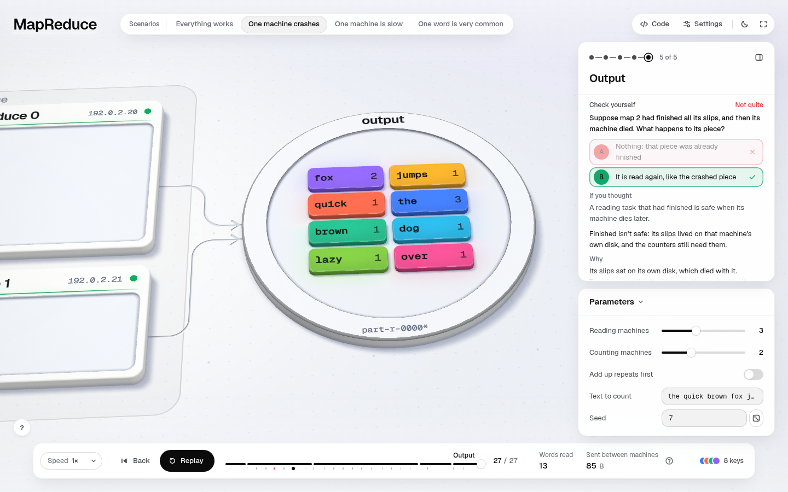
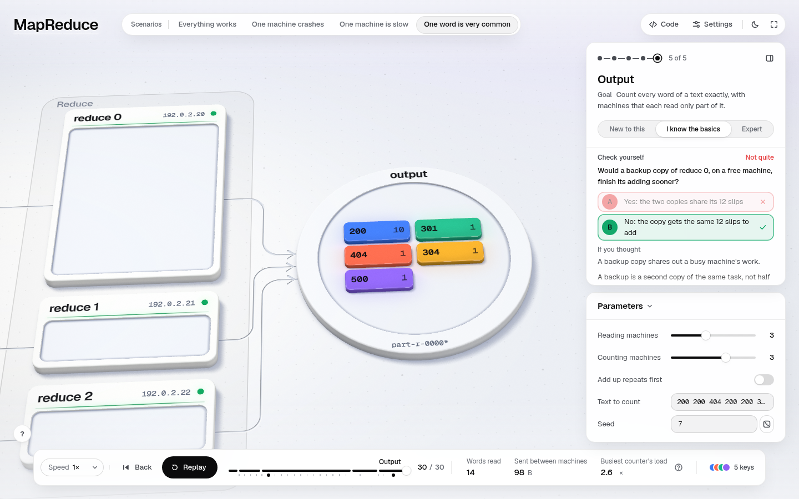
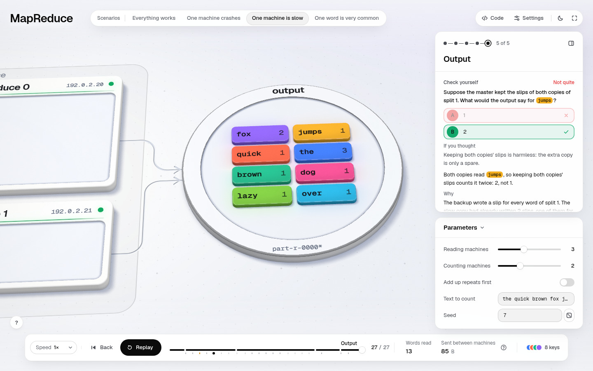
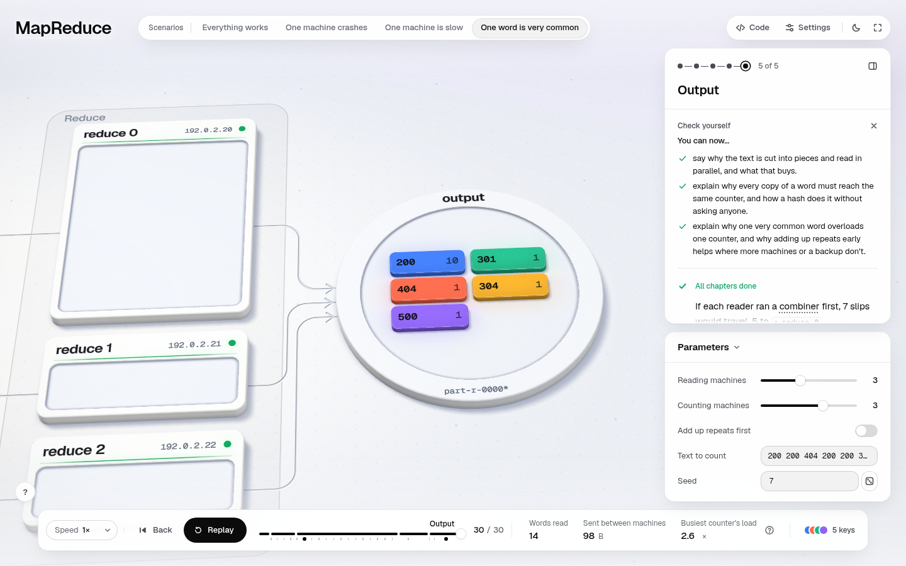
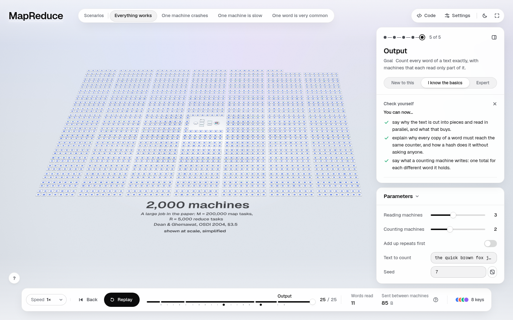

The standard capture's end card (it answers the first question with the first option):
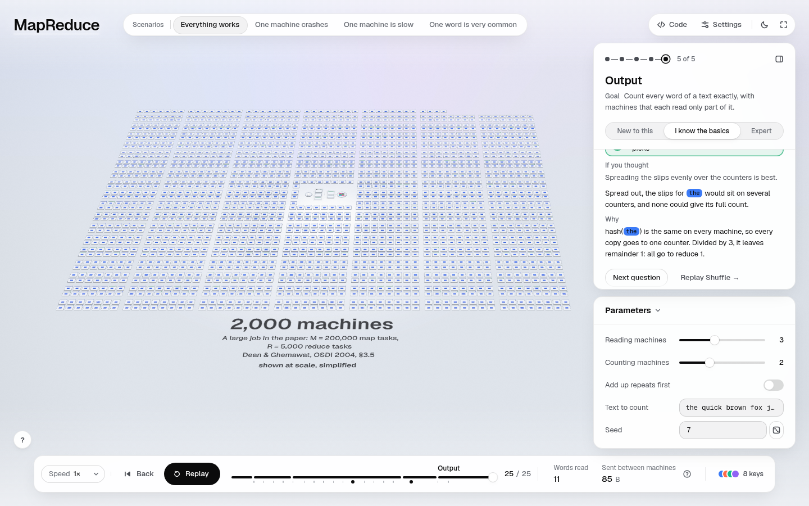

**Files.** `examples/mapreduce/figure.mjs` (end-check block), `examples/mapreduce/lesson.mjs` (`checks`, objectives with
`stories`, `m-backup`, `m-readers`, `m-combine`, `m-more`, `m-done`, `m-both`), `engine/scene/lesson.mjs` (objective
scoping, `wrong` option entries for checks), `scripts/verify.mjs` (misconception coverage counts picks and checks).

**Verify by hand.** Play "One machine crashes" to the end. The first question is about map 2 dying after it finished.
Pick A and the card names the belief ("A reading task that had finished is safe when its machine dies later"). Finish
it: "You can now…" lists the hash and the crash objectives only. `node scripts/lesson.mjs … --scenario skew` prints
the END CHECK block with every option's feedback.

**Risks.** The progress signature in `check.mjs` is unchanged. A learner who replays a story still keeps its progress,
and that is intended. A check is skipped when its numbers collapse (for example, `check.combine` needs three different
options), so a few knob settings ask fewer questions; verify runs every one.

## 2. New predictions where the naive answer is wrong

**The problem.** Each story had one interaction (`lesson.txt` at baseline), although Basics allows two per story
(`engine/hud/turn.mjs` `CAP`). The skew story's only question repeated story 1's ("Where does this 200 go?"), and the
blind novice called it "recall of the previous lesson".

**What changed.** These predictions sit inside the one-per-chapter cap, each right before the step that settles it:

- **Reduce (happy):** "reduce 0 holds 7 slips, sorted. How many totals will it write?" 1 / 4 / 7. Both wrong options
  name `m-one`, and the next step shows the four groups adding up.
- **Shuffle (skew):** "200 fills 10 of the 14 lines, and the first went to reduce 0. Where do *all 10* of its slips
  go?" The wrong options are "spread, about 4 each" (`m-even`) and "nowhere yet: one machine adds everything at the
  end" (`m-central`, which was never confronted before).
- **Output (skew):** "reduce 0 did the adding for 12 of the 14 slips. Which change takes most of that work off it, and
  keeps every count exact?" The options are a 4th counting machine (`m-more`), sending some 200s to a quieter counter
  (`m-even`), and adding up repeats first. Then **`skew.more` runs the real hash at R+1**: "With 4 counters, every 200
  would still go to one: 11 of 14 slips, 10 of them 200". And `skew.combine` computes what the combiner would send: 7
  slips, 5 to reduce 0, with `(200, 4)` as the worked example of a slip that carries a count.

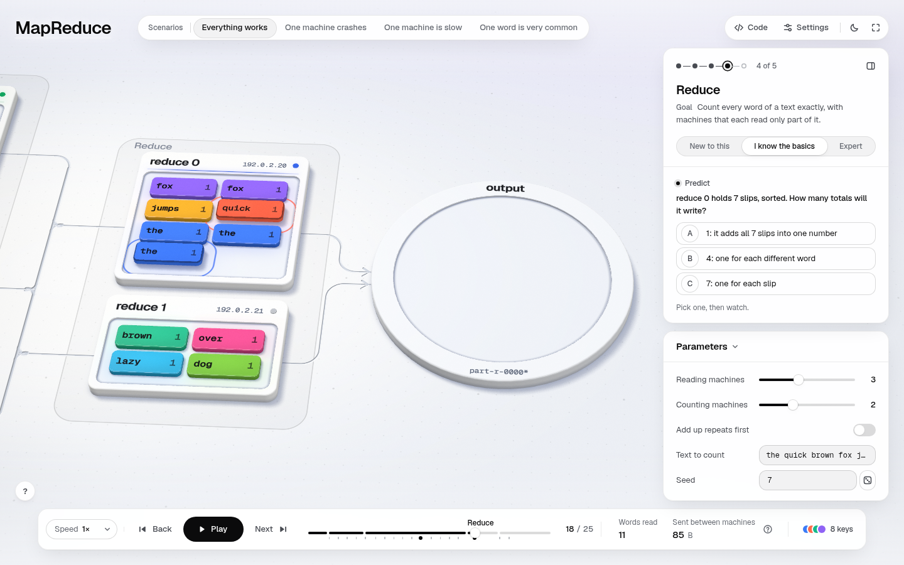
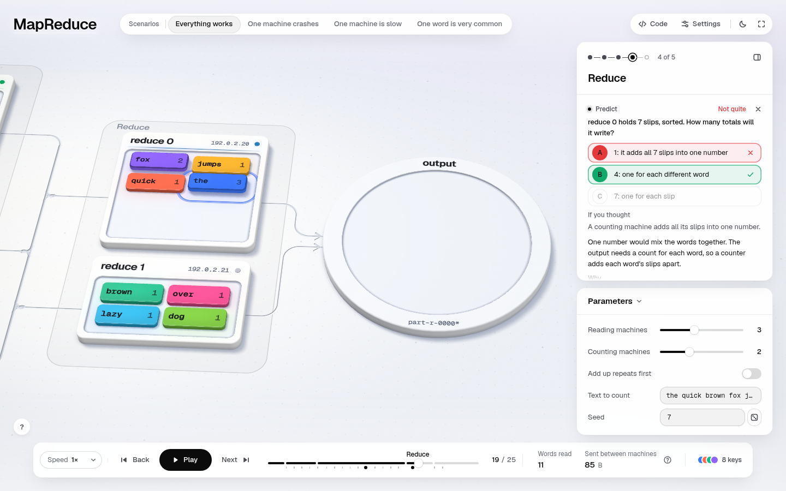

Before, the skew story's only question repeated story 1's (and the baseline capture never revealed it):


After:
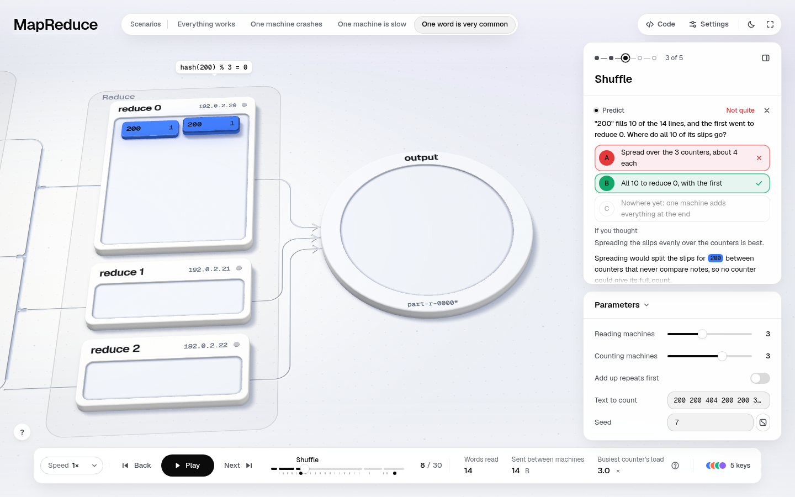
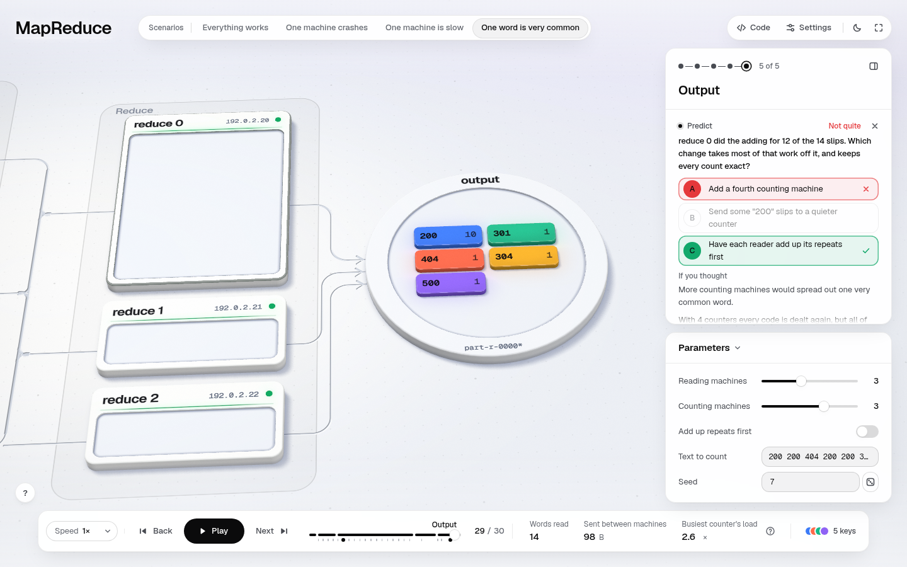
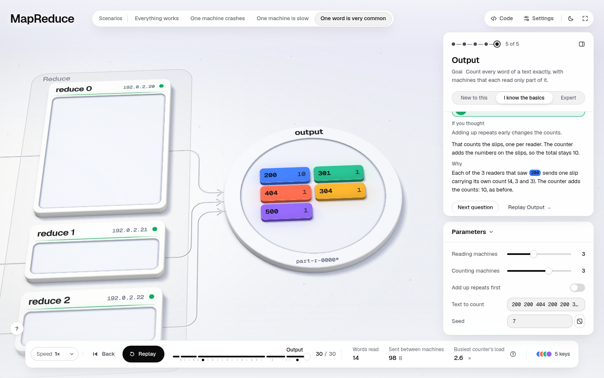

**Files.** `figure.mjs` (`reduce.how-many`, `skew.where`, `skew.fix`, steps `skew.more` and `skew.combine`),
`lesson.mjs` (`asks`, steps).

**Verify by hand.** Play "One word is very common" to the end and pick "Add a fourth counting machine". The feedback
gives the real 11-of-14 load, and the next step shows `hash(200) % 4 = 1`.

**Risks.** A New-level reader of the skew story now meets three questions (two predictions and the end check). That is
inside `CAP.new = 3`.

## 3. Keep the answers out of the setup

**The problem.** The scenario descriptions, shown under the picker before a story starts, stated the answers. The
crash description said "…and the master has that piece read again", which is option B of the crash prediction. The
straggler description said "…so the master races a backup copy". The blind novice: "Given away by the scenario
description. No thinking needed." The Shuffle chapter's "done when" line stated the rule that the pick asks for.

**What changed.** The descriptions now set up the event without its resolution: "…and the slips it wrote are lost with
it", and "…falls far behind, while the others finish". The crash and straggler Map "about" lines no longer state the
cure. The skew Shuffle "about" no longer says "one machine receives every one of those slips". The skew map step no
longer hints at the combiner ("travels alone unless its reader adds them up first" became "every `(200, 1)` is a slip
of its own"). The after-novice had flagged that hint as giving away the skew fix.

**Evidence it worked.** In the after read (at `0c84f56`), the crash prediction was "given away by the master's definition" (a weaker
leak, and it remains). The finished-map transfer was a real miss ("I really guessed and got it wrong"). That is the
first wrong guess in any of my blind reads, and the card answers it with the belief and the fix.

## 4. The expert layer, made true

Three blind expert reads, of the baseline, of the branch at `0c84f56` and of the branch at `c4f94cf`. I checked every
finding against the paper or the Apache docs; the second and third reads' findings are all fixed (`a671103`,
`e5e6ea5`). The main fixes:

| Was | Now | Source |
|---|---|---|
| "The master cuts the text into 3 pieces" | "The master hands out the text in 3 pieces" (the library splits; the master assigns) | §3.1 step 1 |
| "Each record … is read by exactly one machine" (the crash and slow stories show two reads) | "belongs to exactly one piece; a piece may be read twice, but only one reading counts" | §3.3, §3.6 |
| Hadoop's reader "skips the part line at its start" | "every reader but the first throws away everything up to its first line break…" | LineRecordReader |
| Hadoop backs up "any attempt it estimates will finish late" | "…the attempts it estimates will finish latest, up to a cap (10% of running tasks)" | `mapreduce.job.speculative.speculative-cap-running-tasks` |
| Salting fixes a median by "adding up the parts" | salting works when parts merge; a true median needs a histogram or range partitioning | §4.3 |
| "a typical job" is M = 200,000 on 2,000 machines (also in the world's label) | "often ran jobs as large as…"; the average job in Aug 2004 used 157 machines, 3,351 maps, 55 reduces | §3.5, Table 1 |
| "the paper doesn't name its output files" | the user names them; the paper's word count writes `/gfs/test/freq-00000-of-00100` | §3.1, Appendix A |
| "one file per counting machine" | "one file per reduce task" | §3.1 |
| "In a cluster, network bandwidth is the scarce resource" | "In the paper's clusters, … was" | §3.4 |
| — | Hadoop re-runs a live node's finished map on repeated fetch failures; Spark's external shuffle service keeps map output | Hadoop/Spark docs |
| — | a combiner may run 0..n times; its output must be reduce's input type; an average travels as (sum, count) | White ch. 2; §4.3 |
| — | Spark `reduceByKey` vs `groupByKey`; Hadoop sorts map-side; committer v1 vs v2; S3A committers | Spark, Hadoop docs |

The brief's citations are all present: §3.6 backup tasks (the 44% sort result from §5.3), §4.1 partitioning (with the
`hash(Hostname(urlkey))` example), §4.3 combiner, and Hadoop/Spark speculation defaults.

**Files.** `examples/mapreduce/lesson.mjs` (deeper layers), `figure.mjs` (the at-scale label, split caption).

## 5. The tools see the active parts

**The problem.** `scripts/lesson.mjs`, the "read it as a beginner" tool, printed neither the in-world pick nor the end
check, and `review-packet.mjs` left both out of the blind readers' packet (`00-baseline/lesson.txt` has no line for
the pick and no check). The pipeline meant to judge the teaching could not see its main active moments.

**What changed.** `scripts/lib/lesson.mjs` compiles each wrong pick's **real branch** and prints what it plays
("plays: reduce 0 counts the = 2, reduce 1 counts the = 1. The text has 3."). It also prints each story's END CHECK
with every option's feedback, the "a miss offers: replay <chapter>" link, and CAN NOW (the scoped objectives).
`review-packet.mjs` puts the pick, as a commit-then-reveal chunk, and each story's check into the packet.
See `lesson-after.txt`, story 1, `YOUR TURN` and `END CHECK`.

**Files.** `scripts/lib/lesson.mjs`, `scripts/review-packet.mjs`, `references/tooling.md`, `CONTRACTS.md`,
`references/teaching.md`.

## 6. `shoot --teach` on slow machines, and what the baseline's 23 errors were

**The question.** The baseline `--teach` capture reported "questions at steps 6 and 7 never revealed", "the pick at
step 12 never opened/held" and "the run never reached its end card" (`00-baseline/shoot-log.txt`). Was that a timeout
or a bug?

**Answer: a capture timeout, not a page bug.** The runtime advances the clock by at most 1/20 s per drawn frame
(`engine/runtime.mjs` `tick`). Under software rendering on this loaded box, the page draws 0.25–0.5 frames per second.
So a prediction's reveal, at 70% of a 4–5 s step, takes minutes of wall time, while `shoot.mjs` waited 10–20 s. In a
fresh page the pick opened after 1.5 s. Under the shoot's exact sequence with load it opened after 20.5 s, past the
15 s timeout. A second, smaller cause: once a card was revealed, the run played on and the card left before the next
80 ms poll, so even a successful reveal could be missed.

**What changed.** `--teach` measures the frame rate first and scales every wait to it (up to 12×). It plays at 6× to
reach each moment, and shoots paused at 1×. It pauses in the same `evaluate` that sees the reveal. With that, the
capture reaches every card the baseline missed: the pick's wrong branch and right answer, each prediction's reveal,
and every story's end card.

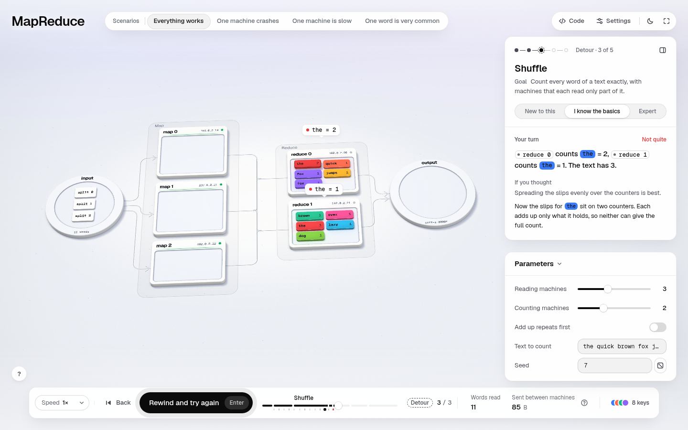
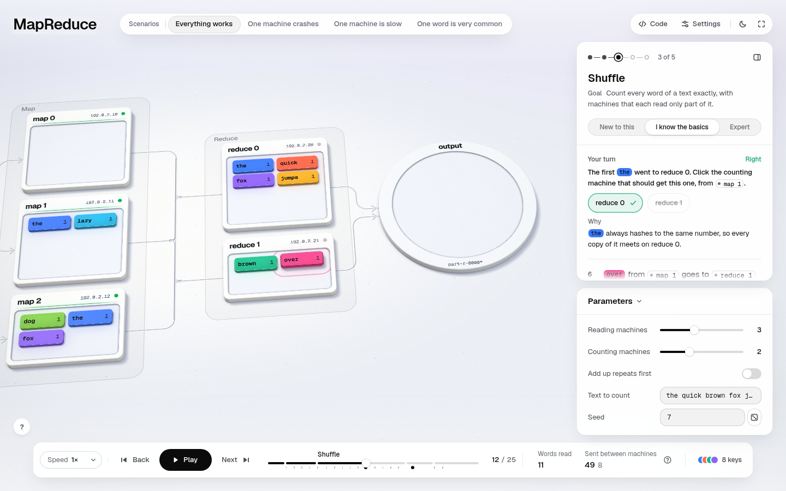
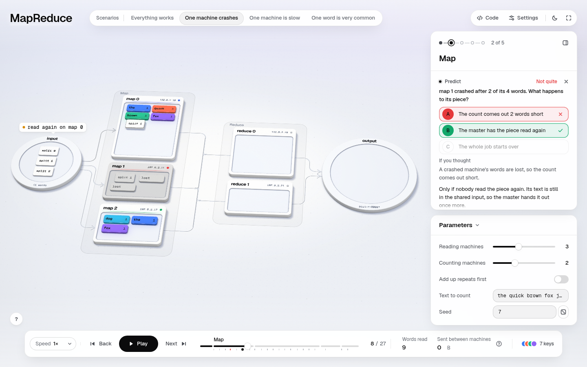

**Files.** `scripts/shoot.mjs`, `references/tooling.md`.

**Risks.** A slow box now takes longer, but it finishes; the wall time of the after capture is in `shoot-log-after.txt`.
On a fast machine the scale is 1 and nothing changes.

---

## Checks

- **verify, mapreduce:** `26 run(s), 0 failing, 0 error(s), 0 warning(s)` (`verify-after.txt`). Its note "lesson.steps
  names 2 step id(s) no run here reaches" was there at baseline too.
- **verify, the other 7 examples:** all `0 failing, 0 warning(s)` (`verify-after.txt`). Shared code changed:
  `engine/scene/lesson.mjs`, `scripts/verify.mjs`, `scripts/lib/lesson.mjs`, `scripts/review-packet.mjs`,
  `scripts/shoot.mjs`.
- **Unit tests:** 293 pass, 12 fail (`tests-after.txt`). 11 are the known baseline failures, the same test numbers on a
  clean export of `9c8b16d` run the same hour. The 12th is test 166, the sampler's wall-clock `<= 2 ms per sample`.
  It flips between pass and fail under this machine's load, **on the baseline export too** (2 of 3 runs failed there,
  1 of 3 passed; the log is in `tests-after.txt`). No new failure comes from this branch.
- **Blind reads** (raw reports, packets and `review-check.mjs` output in `evidence/`): every report was valid and
  caught its canary. Summary:

| | Before (baseline lesson) | After |
|---|---|---|
| Novice guesses | 11, **0 wrong**; 2 of 4 predictions "given away by the scenario description"; repeated checks "tested nothing" | 17, **1 wrong** (the finished-map transfer, a real misconception met and answered); "Applied the rule. Good thinking check"; "Needed to separate this from the slow-machine backup idea" |
| Novice blocked | 2 (the combiner "arrives as a final line"; "You can now… name what the shuffle costs") | **0** |
| Expert, how the questions test (as the expert rated them) | 0 transfer, 1 understanding, 3 recall, 2 arithmetic | 2 transfer, 7 understanding, 1 recall |
| Expert wrong/misleading (excluding the canary) | 3 misleading | round 2 (`0c84f56`): 3 misleading, all fixed in `a671103`; round 3 (`c4f94cf`): 1 wrong + 1 misleading (plus 2 missing, 2 nits), all fixed in `e5e6ea5` |

- **Audit** was not re-run: this lens did not touch layout or focus. The baseline's phone focus-outside findings belong to the interface and accessibility branch (not pushed yet).

## Merge notes

- **Shared files touched:** `engine/scene/lesson.mjs` (objective `stories` filter; the `wrong` entry for asks and
  checks), `scripts/lib/lesson.mjs`, `scripts/review-packet.mjs`, `scripts/verify.mjs`, `scripts/shoot.mjs`,
  `CONTRACTS.md`, `references/tooling.md`, `references/teaching.md`. All changes are additive and backwards compatible:
  an objective without `stories` shows in every story, as before.
- **Likely conflicts:** `examples/mapreduce/lesson.mjs` and `figure.mjs` with every lens that edits words (01, 04);
  `scripts/shoot.mjs` with 06 (author pipeline) and with any lens that changes `--teach`; `engine/scene/lesson.mjs` with
  any HUD/lesson work. I did not touch `engine/runtime.mjs` or `engine/hud/*`.
- **Generalises:** the tooling (picks and checks in `lesson.mjs` and the packet, verify's coverage, objective scoping,
  `--teach` timing) works for all 8 examples. The new questions are MapReduce-only by nature, but the pattern (one
  check block per scenario, a transfer question, one spaced item from story 1) is a recipe any example can follow.

## Next (ranked)

1. **A faded worked example in the world:** after the "the" pick, let the learner route a *new* word given its
   remainder. This needs a second pick kind or a relaxed one-per-chapter cap, so it is a HUD decision.
2. **A crash-at-another-moment knob,** so "a finished map re-runs" plays for real instead of only as a check.
3. **An objective-coverage lint:** warn when an objective has no question that tests it in a story that claims it.
4. **Spread the "spaced" item over a session:** ask story 1's idea on the *second* visit of a story, not only at its
   end. This needs check state across stories in `check.mjs`.
5. **The crash prediction's remaining leak:** the master's glossary definition ("notices when a machine fails") still
   hints at B. Reword the term, or move the prediction one beat earlier.
6. **"Average with a combiner"** as a runnable wrong branch (a second reduce function).
