# Interface and access: the MapReduce page for every reader, input and screen

## TL;DR

- **A blind reader now hears the lesson, not just the steps.** The screen reader says the chapter when one starts,
  the step's why wherever the reader's level shows it, and a prediction in whole sentences (the question and its
  options, your guess, the result and why). The explain panel comes right after the header in Tab and reading
  order. Before, it came after all seven parameters.
- **No GPU no longer means an empty page.** The run's world is shown in words: a typographic board, live with the
  run, built from the same described scene the screen reader uses.
- **Every screen has room for the teacher.** On a 1440 × 900 laptop the parameters start folded while a lesson
  teaches, so the end of the run is no longer cut off. Help moves into the toolbar where the corner circle used to
  cover the Look chip (200 % zoom, landscape phones). A one-time hint says "Press ? for every shortcut". The phone's
  numbers take one line.
- **Authors can measure accessibility.** `audit.mjs --a11y` checks WCAG 2.2 AA in the real page: text contrast
  against the pixels behind it, target size, accessible names and visible focus. Its findings are fixed here:
  status words such as "crashes" were 3.9:1 in light, the phone caption's first line fell to 1.09:1 over a tile, and
  the sliders and switches were 20 px targets. On the baseline it reports 8 distinct accessibility problems; on this
  branch, none.
- Branch **`product/03-interface-access`**, 7 commits on `9c8b16d`. All of it is engine-wide, so all 8 examples
  get it.

Try it:

```sh
git fetch origin && git checkout product/03-interface-access
node scripts/build.mjs examples/mapreduce/figure.mjs --out /tmp/mr/mapreduce.html
open /tmp/mr/mapreduce.html                                     # Tab once: the shortcut hint; ? opens help
node scripts/audit.mjs /tmp/mr/mapreduce.html --a11y --at phases --themes light,dark
# no GPU: start Chrome with --disable-3d-apis and open the same page
```

---

## 1. Narration that teaches, and the teacher first in reading order

**The problem.** A screen-reader user stepping through the lesson heard each step's plain line and what changed
in the world, which was a good base. But they never heard:
- **which chapter they were in.** A sighted reader sees "Shuffle · 3 of 5" and the chapter's about. The listener
  went from "map 2 writes a slip…" straight to "the goes to reduce 0…" (`narration-before.txt`, steps 6 to 7).
- **the why**, even at New, where it is on screen for every step. The live region read `S.capText`, the plain
  layer only.
- **a prediction as one clear sentence.** The predict card was one large `aria-live` dialog, so every change inside
  it (status, foot, feedback) was spoken piecemeal.

And the explain panel, the page's teacher, was **last** in Tab and reading order: header, world, dock, all seven
parameter controls, the help button, and only then the chapter dots and the level switch
(`focus-order-before.txt`).

**What changed.**
- Each step is spoken the way it is shown at the reader's level (`spokenStep`, `engine/hud/hud.mjs`). On entering a
  chapter: "Chapter 3 of 5, Shuffle." and its about (its first sentence where the level shows only that). Then the
  plain line, then the why wherever the level shows it (`level.policy.why`). The same step said again (a level
  change, a reveal) keeps its chapter lead. A detour in a pick keeps its chapter.
- A prediction speaks from a live region of its own (`askLive`, `sayAsk`): "Predict: *question* A: … B: … Pick
  one, with 1 to 2 or Tab." Then "Your guess: B. Watch the next step." Then "Correct: A, …" or "Not quite. The run
  shows A, …", followed by the feedback for the reader's own wrong belief and "Why: …". The card itself stops being
  live while a prediction is open, so nothing is read twice. Picks and the end check still speak from the card.
- The start card now speaks first. The step is announced when it closes, not underneath it.
- Reading and Tab order: header, **explain panel**, parameters, the world (the described scene), the dock
  (`engine/hud/explain.mjs`, `engine/a11y/scene.mjs`, the `hud.append` order in `hud.mjs`). Nothing moves on screen.

**After.** Recorded from the live regions while stepping through "Everything works" (`narration-after.txt`):

> Chapter 3 of 5, Shuffle. In the shuffle, every slip for one word must reach the same counting machine. A hash
> turns the word into a number. […] the goes to reduce 0: its hash, 3 020 861 980, divided by 2 leaves remainder 0.
> Taking turns would scatter one word's slips over several counters, and counters never compare notes, so none
> would hold the full count.

And a prediction, in "One machine crashes" (`narration-after-crash.txt`), in the order it is spoken:

> Predict: map 1 crashed after 2 of its 4 words. What happens to its piece? A: The count comes out 2 words short.
> B: The master has the piece read again. C: The whole job starts over. Pick one, with 1 to 3 or Tab.
>
> Your guess: A. Watch the next step.
>
> Not quite. The run shows B, The master has the piece read again. Only if nobody read the piece again. Its text
> is still in the shared input, so the master hands it out once more. Why: The text is still in the shared input,
> and reading it again gives the same slips, so redoing just that piece is safe.

(These logs record what the page puts in its live regions. On this slow machine a step's lines sometimes land in the
next step's group of the log. The order is right.)

The Tab order now reaches the chapter dots, the level switch, the explain panel's words and its Look chip before
the parameters (`focus-order-after.txt`). The focus ring stays visible on each stop:

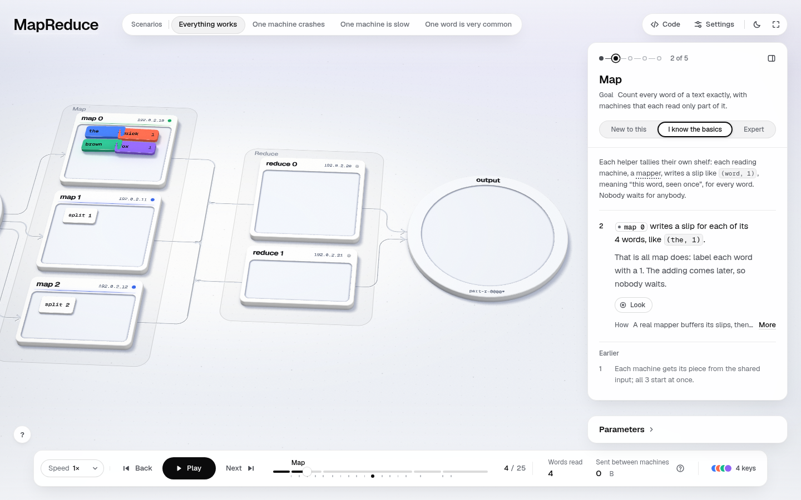

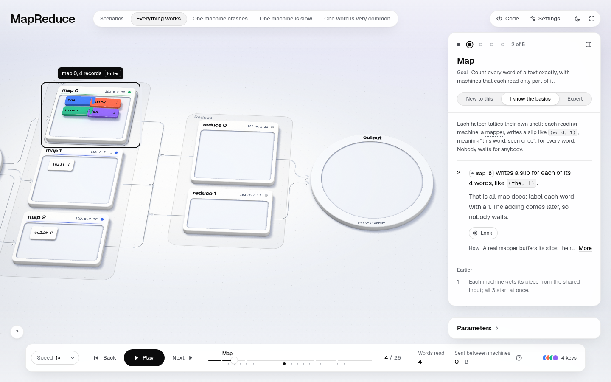

**Files.** `engine/hud/hud.mjs`, `engine/hud/explain.mjs`, `engine/a11y/scene.mjs`.

**Verify by hand.** Turn on VoiceOver (macOS) or NVDA (Windows), open the page, choose "Step through it
yourself" and press →. Each chapter's first step starts with "Chapter N of 5". Switch to "New to this" and the whys
are read too. In "One machine crashes", answer the question at step 7 with a number key.

**Risks.** More words per step at New and Basics. This is deliberate, because the eye gets the same words, and
Expert stays terse. The chapter lead is spoken once per chapter entry, so rewinding into a chapter says it again,
which is the right cue after a jump.

---

## 2. The world in words when there is no GPU

**The problem.** With WebGL and WebGPU unavailable (an old school laptop, a locked-down lab, remote desktop), the
stage was blank paper with a toast: "WebGL is unavailable here, so the world can't be drawn." The graceful fallback
rule was met only on paper. Meanwhile `engine/a11y/scene.mjs` already held a complete, live, structured picture of
the world in words, visually hidden.

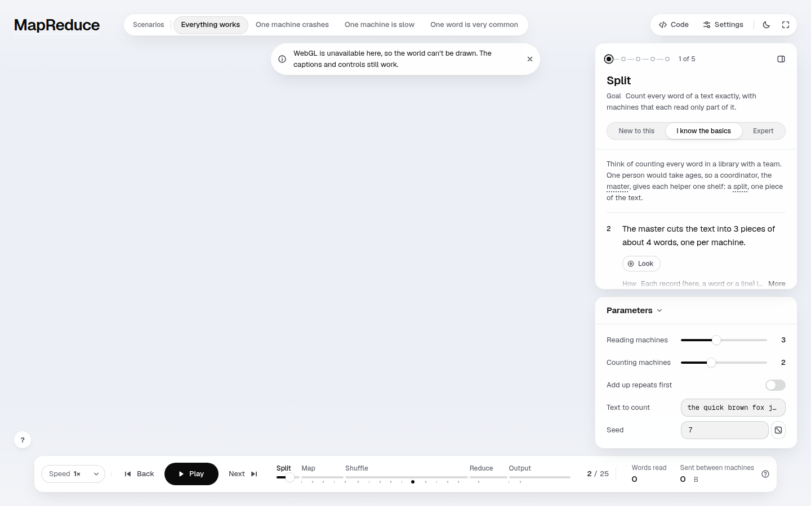

**What changed.** When the runtime has no renderer it adds `.ix-no-gfx` to the root (`engine/runtime.mjs`). The
described scene then steps out of hiding into the free stage, between the header, the dock and the explain panel
(`--ix-free-l/r`, set from the HUD's insets). It shows one column per titled group, left to right as the world lays
them out. Machines are set in Geist and the records in their trays in Geist Mono, each with its identity swatch
(`--k`, the same key colour the world would print). What the step says to watch is in ink, the rest muted. A group
with no title starts level with the titled groups' first row. Overflow fades out at the bottom until scrolled to.
The arrows walk it in reading order, Enter opens a thing's details, as in the world. The toast now says what is
happening: "This device can't draw the 3D world, so it is shown here in words. Everything else works."

Nothing is drawn or invented. It is the same list the screen reader walks, updated by the same run.

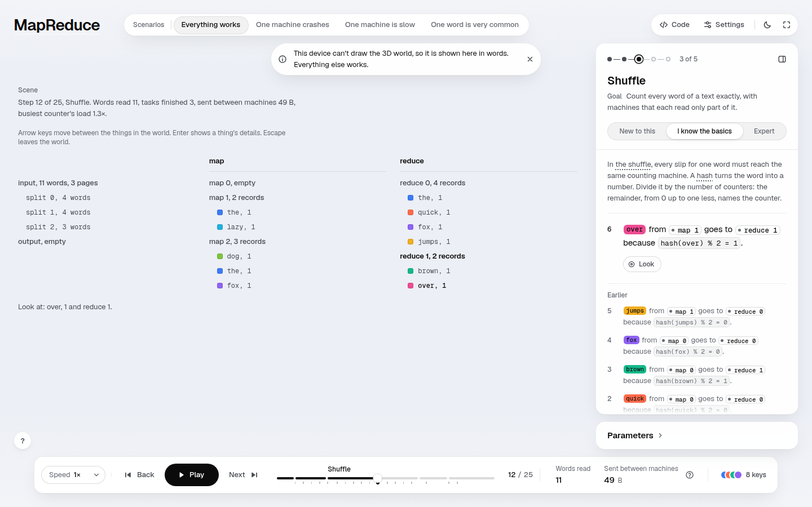

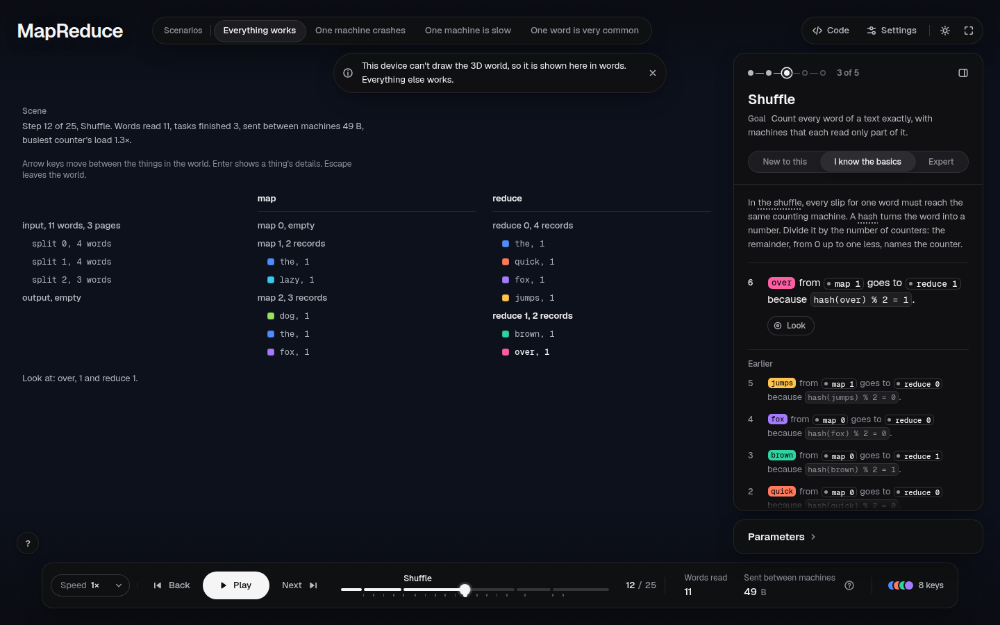

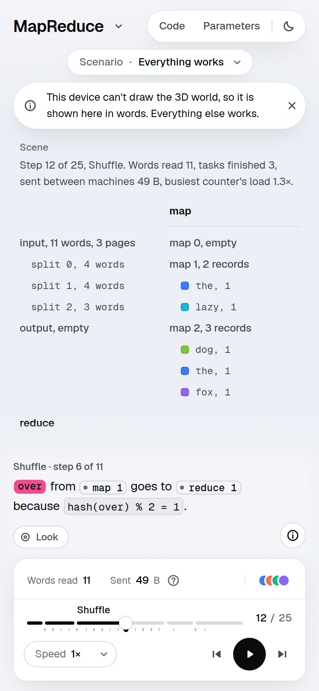

**Files.** `engine/runtime.mjs`, `engine/a11y/scene.mjs` (keyed swatch, watched items, reading-order arrows when
nothing is on screen to measure), `engine/hud/hud.css` (the `.ix-no-gfx` block), `engine/hud/hud.mjs` (free-stage
insets).

**Verify by hand.** Start Chrome with `--disable-3d-apis` and open the page, then step and watch the board change.
Try the arrow keys after tabbing into it.

**Risks.** On a phone the board has about 200 px between the header and the caption, so it scrolls. The fade shows
that there is more. A world with very many things (a large B-tree) makes a long board. It stays readable but is not
a picture.

---

## 3. Room for the teacher, help that never collides, and keys you can find

**The problems.**
- On a 1440 × 900 laptop the parameters card (about 270 px) shared the right column with the explain panel, which
  got about 430 px. At the end of a run, the "Next question / Replay Shuffle" row was cut off by the panel's edge.

  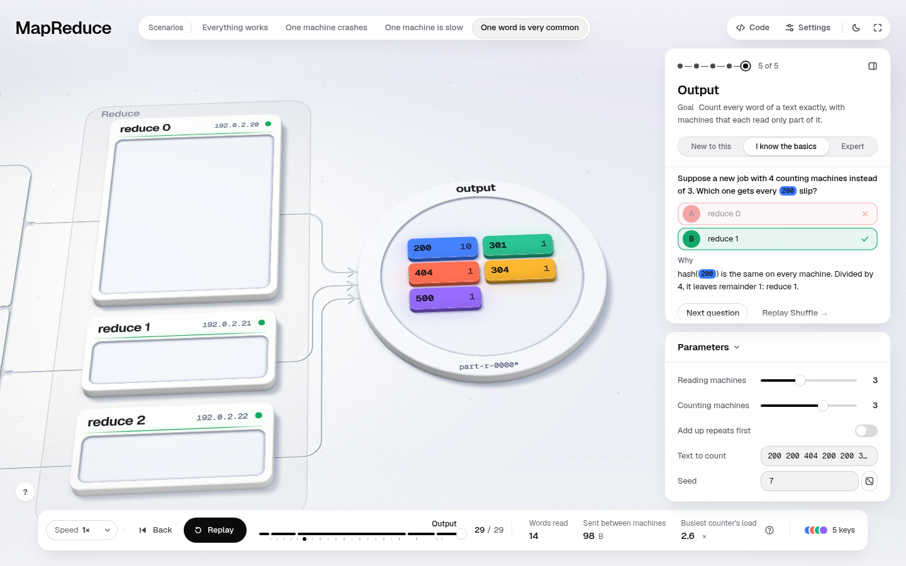
- At 200 % zoom (720 × 450 CSS px) the help circle sat **on top of** the Look chip. On a landscape phone it
  crowded it.

  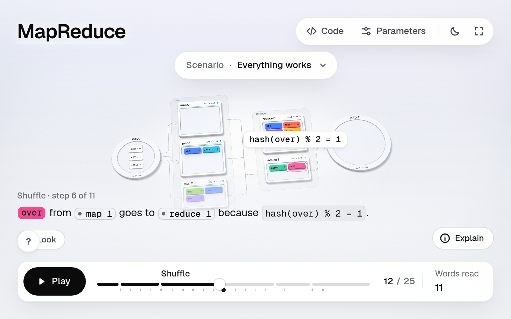
- The shortcuts (P presenter, T theme, L level, E explain) could be found only by opening help or hovering a
  control. Help did not explain the coloured ticks and the dots under the timeline.
- On a phone the readout ("Words read / 11") stacked name over value, a 44 px row of its own.

**What changed.**
- While a lesson teaches, the parameters card starts folded to its one-line header unless the screen is at least
  1040 px tall (`PARAMS_TALL_LESSON`). Without a lesson the knobs are the page's main input and start open as before.
  The reader's own choice is remembered as before.
- Where the explain panel does not dock (compact, landscape-phone and zoomed screens), the caption's chips own the
  bottom-left. There, help is a toolbar button beside the theme (`.ix-help-tool`), and the corner circle is hidden.
  Phones keep help in the about card, and embeds keep their corner.
- The first time someone presses Tab, a quiet one-time coach hint appears: "Press ? for every shortcut. Space plays,
  ← → step, E hides the explanation." It is remembered and never shown on phones.
- Help's timeline entry now says: "The ticks under it are the run's events: grey, or green when something
  succeeds, amber for a warning, red for a failure. A dot is a question for you."
- On phones the numbers sit on one line, name and value on one baseline (44 → 36 px).
- `lang` on the figure root (from `meta.lang`, else `en` when the host page says nothing), so screen readers pick
  the right voice.

**After.**

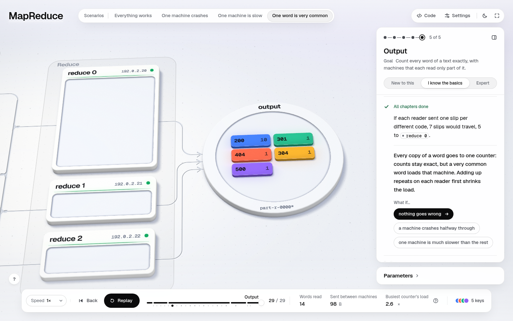

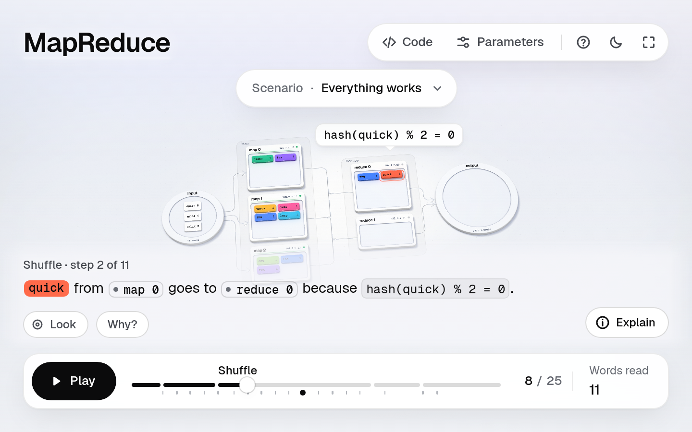

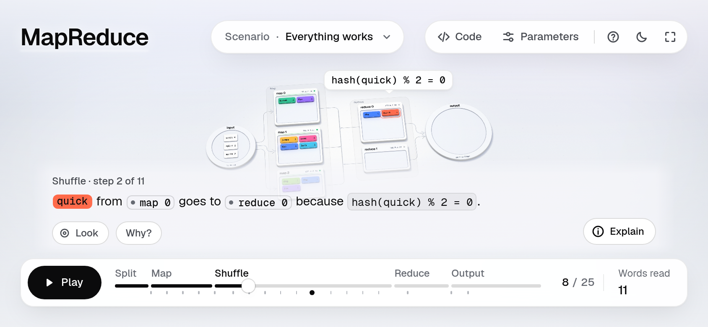

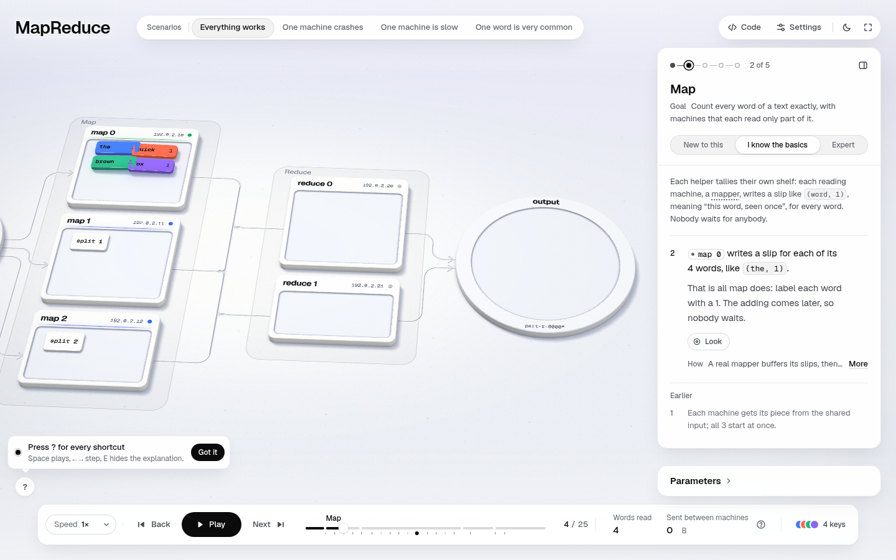

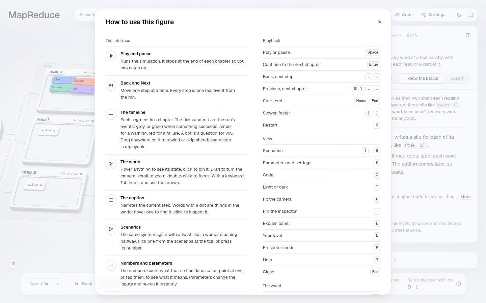

**Files.** `engine/hud/hud.mjs`, `engine/hud/hud.css`.

**Verify by hand.** Open the page at 1440 × 900 with a cleared `localStorage`: Parameters is a closed header. Zoom
the browser to 200 %: the "?" is in the toolbar. Press Tab once: the hint appears bottom-left, once.

**Risks.** A reader who wants to change a knob during a lesson needs one more click (the header, or S). Main now
folds the card during every lesson whatever the height (see Merge notes). The hint is a coach card, so it waits
while another card (a question, a pause) is on screen, and comes on a later Tab.

---

## 4. `audit.mjs --a11y`, and the contrast it found

**The problem.** `audit.mjs` checked the world (label overflow, tags, focus framing) but nothing about the
interface. An author could not know whether their page was accessible, and no change could be measured.

**What changed.** `--a11y` (`scripts/lib/a11y.mjs`) measures every frame the audit renders:
- **contrast (1.4.3).** Every line of HUD text on screen is compared with the pixels actually behind it. The frame
  is shot a second time with the HUD's glyphs transparent, so plates, halos and the world stay. 90 % of the
  sampled pixels must pass 4.5:1 (3:1 for large text). Over the world this is the honest number, not the token's.
  Each finding names both colours. Text clipped out of view (a scrolled list, a line-clamped third line) or inside
  a scroll edge's fade is judged once it is scrolled in.
- **target size (2.5.8)**: controls under 24 × 24 px whose 24 px square reaches another control. Inline chips
  in a sentence are exempt.
- **names (4.1.2)**: buttons, links, inputs and widgets with no accessible name.
- **focus (2.4.7)**: controls that show nothing when focused from the keyboard.

The probe is injected, so it measures any built page, the baseline included. Findings fold to one line per
component with the worst value. It is documented in `references/tooling.md`.

**What it found, and the fixes.**
- **Status words** ("crashes", "Done", a right answer's tick, the presenter view's answer) used the world's tones as
  text colour. In light the tones are tuned for tiles: as text on paper `ok` is 2.7:1, `warn` 2.4:1, `busy` 3.9:1
  and `fail` 3.7:1. The audit saw "crashes" at 3.93:1. Now `--ix-<tone>-text` is the tone mixed a third of the way
  toward the ink in light (5.0:1 or better on paper and surfaces) and the tone itself in dark, where it already
  passes (5.1:1 or better). The hue still reads as the same status.

  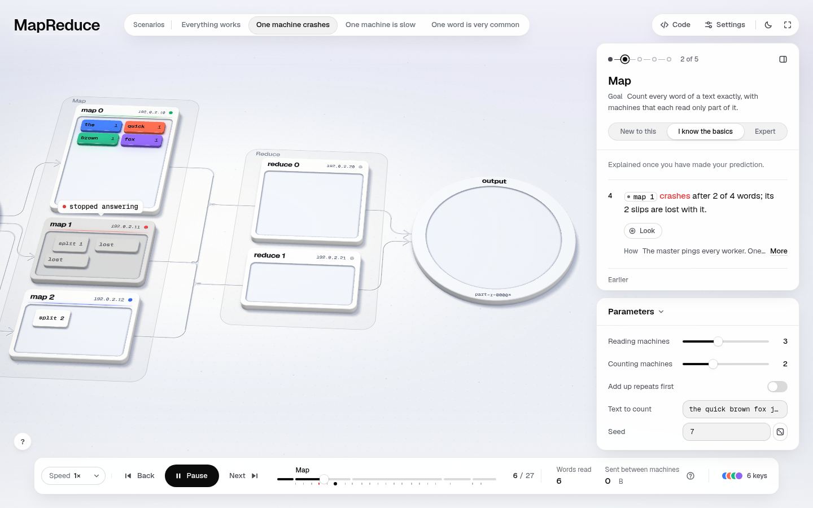

  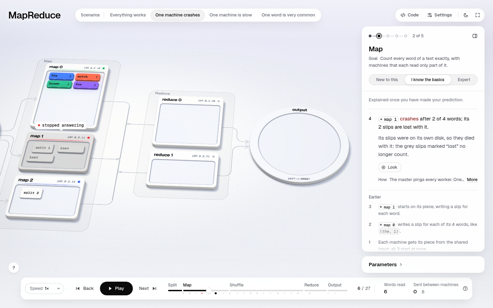
- **The phone caption's first line** ("Shuffle · step 6 of 11") was the faintest ink, at the edge of a radial plate,
  printed straight on a moving tile. It measured 1.09:1 in the worst frame and 3.30:1 in light. The layered caption
  (left-aligned, on narrow screens) now has a feathered rectangular plate under every line, and the meta line is one
  ink up (`ink-muted`).

  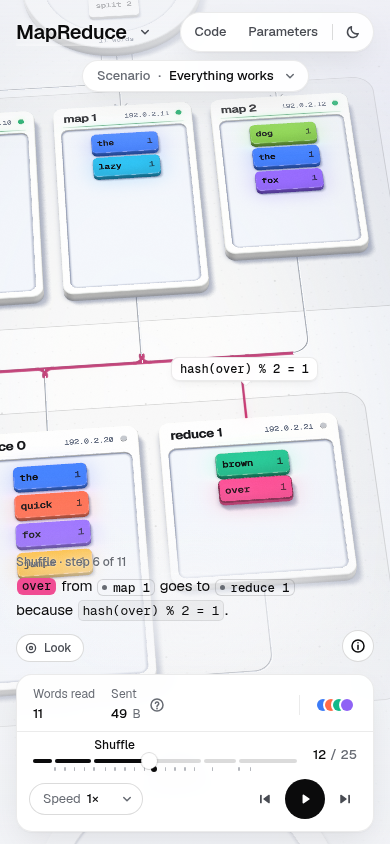

  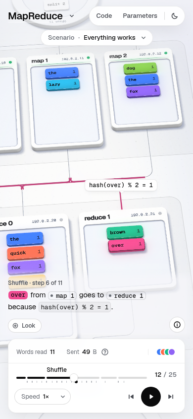
- **The sliders and switches** in the parameters card were 20 px tall, and the audit flagged the slider as a crowded
  target. They are now 24 px tall: the slider's track and thumb are unchanged, centred in a taller box, and the
  switch is 40 × 24 with a 20 px knob. With the card open, the baseline has this one finding and this branch none
  (`audit-a11y-before-params.txt`, `audit-a11y-after-params.txt`).

  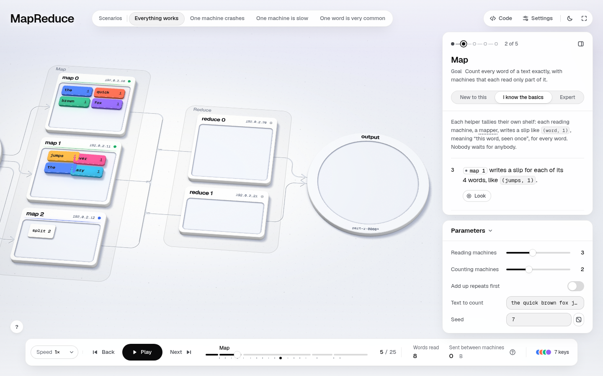
- Its first run also flagged the explain panel's "Earlier" list at 3.70:1. That was a false alarm: rows scrolled out
  of the panel were measured against whatever lay behind it. That is why the probe now clips to what is visible.

**Files.** `scripts/audit.mjs`, `scripts/lib/a11y.mjs`, `references/tooling.md`, `engine/hud/theme.mjs`,
`engine/hud/hud.css`.

**Verify by hand.** `node scripts/audit.mjs <page> --a11y --at phases --themes light,dark`. On this branch's page
it reports no contrast, target, name or focus problems (`audit-a11y-after.txt`). Run it on a build of `9c8b16d` to
see the before (`audit-a11y-before.txt`).

**Risks.** It is a measurement, not a proof. It cannot judge reading order, meaning or motion. A second screenshot
per frame makes `--a11y` slower, so it is opt-in. Text over an animating world is judged at settled frames only.

---

## Checks

All run on this branch's final commit unless noted. Raw output is in this folder.

| Check | Before (`9c8b16d`) | After |
|---|---|---|
| `verify.mjs`, mapreduce | 0 failing | **0 failing** (`verify-after.txt`) |
| `verify.mjs`, the other 7 examples | 0 failing | **0 failing** each |
| Unit tests | 305 tests, 294 pass, 11 fail | **305, 294 pass, 11 fail: the same 11**, no new failures (`tests-after.txt`) |
| `audit.mjs` (every step, 4 stories, 1440 × 900 and 390 × 844) | 1 problem: focus-outside at steps 6, 7, 9, 12, 15 | **the same 1 problem**, unchanged (`audit-before.txt`, `audit-after.txt`) |
| `audit.mjs --a11y --at phases --themes light,dark` (160 frames) | **8 a11y problems** (below), plus focus-outside on phones at steps 4, 19, 22 | **0 a11y problems**, plus the same focus-outside (`audit-a11y-before.txt`, `audit-a11y-after.txt`) |
| `--a11y` with the parameters card open | 1 (slider target) | **0** |

The baseline's 8 accessibility findings, all gone on this branch: the phone caption's meta line (1.08:1 over a tile);
the phone's "How" label (3.64:1); the slider and the switch (20 px targets); the step text and an inline code chip
over a bright tile in skew dark on phones (4.47:1, 3.78:1); "crashes" (3.96:1); and "More" in straggler dark on phones
(2.85:1). The plate under the layered caption, with one ink up for its meta line, fixed the five findings over the world together. The before audit
used this branch's `audit.mjs` on the baseline page, since the probe is injected.

`focus-outside` (part of a step's focus outside the frame) and the frame-time warnings come from the world's camera
and software rendering on this machine. They are the same before and after, and outside this branch's scope.

**The final capture** used `main`'s `scripts/shoot.mjs` (with its `scripts/lib/`), whose teach pass is fixed for
slow machines, against this branch's built page: `shoot.mjs mapreduce.html --scenario all --teach --out
shots/after`. It made 232 PNGs with no page errors and no teaching timeouts: 64 teaching cards (ask, why, wrong,
right, end check, end card) against 19 in the baseline, where many timed out. So 51 "new" shots in `COMPARE.md` are
cards the baseline never reached, not new states. Every pair differs at the pixel level, mostly from the folded
parameters on desktop and the plate under the phone caption (`compare.html` shows them side by side). The capture
was made at `41daa15`. The last commit (`5fdacda`) changes only the sliders' and switches' size, which the standard
capture never shows open; see `shots/extra/after-params-open-*.png`.

## Merge notes

Files this branch touches, and whether `main` has also changed them since `9c8b16d`
(`git diff --stat 9c8b16d origin/main`):

| File | Also changed on main | Likely conflict |
|---|---|---|
| `engine/hud/hud.mjs` | yes (+191 −33) | **Yes, in three places.** (1) `syncParamsOpen`: main folds the parameters during *every* lesson (`!S.lesson && S.H >= PARAMS_TALL`) and adds `syncParamsOpen()` when a timeline is set; this branch folds them unless the screen is 1040 px tall (`PARAMS_TALL_LESSON`) and adds the same call. Keep one rule: main's is simpler, this branch's keeps the knobs open on tall monitors. (2) `closeIntro`: main changed the start card (resume, `onStart(mode, where)`); this branch adds `announce()` after `fire("onStart", …)`. Keep both. (3) The `hud.append(…)` order and the `GUIDE` timeline text sit near main's edits; mechanical. |
| `engine/hud/hud.css` | yes (+51 −1) | Probably small: main's additions are separate rules. This branch replaces `color: var(--ix-ok/warn/fail/busy)` with `var(--ix-*-text)` everywhere; any new tone-coloured text main added should use the `-text` tokens too. |
| `engine/hud/explain.mjs` | yes (+26 −6) | Small. This branch only moves `parent.append(panel, tab)` to right after the header. |
| `engine/runtime.mjs` | yes (+23 −2) | Unlikely: this branch changes only the no-GPU notice (`ix-no-gfx`); main's changes are in `onStart` and the resume path. |
| `references/tooling.md` | yes (+15 −3) | Unlikely: this branch adds `--a11y` to the audit section only. |
| `engine/hud/theme.mjs` | no | none |
| `engine/a11y/scene.mjs` | no | none |
| `scripts/audit.mjs`, `scripts/lib/a11y.mjs` | no | none (a11y.mjs is new) |

**Generalises?** Yes, all of it is engine-wide. The raft example, built from this branch, shows the folded parameters, the
phone caption's plate and its own no-GPU board:

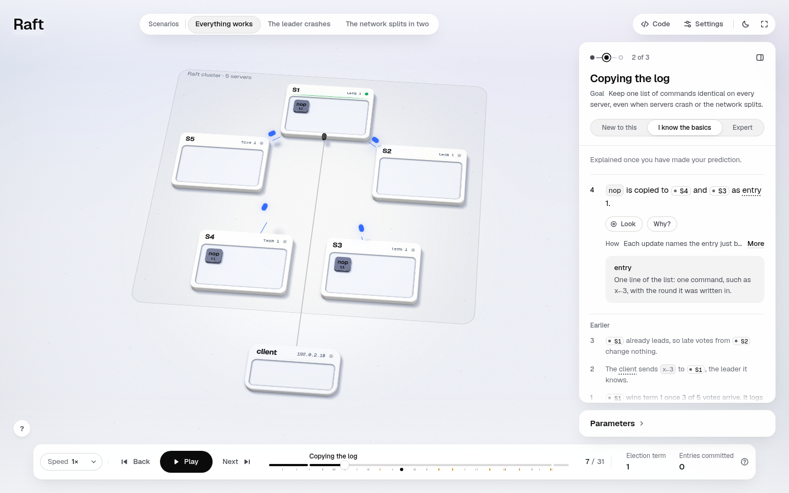

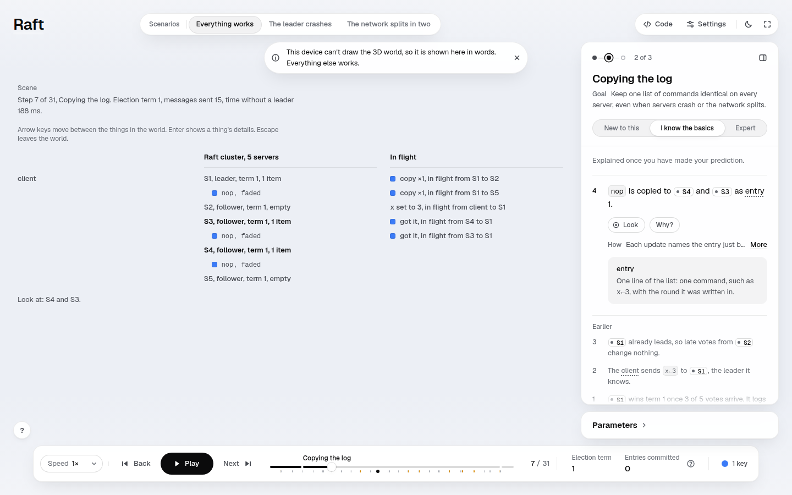

All 8 examples verify `0 failing` (see Checks). No lesson words changed, so `lesson-after.txt` is not included. The
only new words are the HUD's: the help text, the hint, the no-GPU notice and the spoken lines.

## Next

1. **Run `--a11y` in CI** over all 8 examples at `--at phases`, and fail on new findings. It is already cheap
   enough at about 160 frames.
2. **A real screen-reader pass** (VoiceOver and NVDA) through one story at each level. The logs here record the
   live regions, which is what assistive tech is given, not what it says or when it interrupts.
3. **Non-text contrast (1.4.11)** of hairline pills and the timeline's grey ticks (`ink-4`). They are a deliberate
   part of the style, so this is a design decision before it is a fix.
4. **Reduced motion for the camera.** `prefers-reduced-motion` already shortens HUD motion; the world's camera
   springs could cut instead of glide.
5. **String extraction for translation** (`strings.mjs`, `t()`), once the product branches have merged, since it
   touches nearly every line of `hud.mjs`.
6. **The no-GPU board as a choice.** Some readers may prefer the words over the 3D world even with a GPU (low vision,
   a slow machine). A "Show as text" toggle in Settings would reuse everything built here.
