# 04 · The world as the teacher: changes

## TL;DR

- **The 3D world now carries the story on its own.** Slip words print up to 11.5 u (they were 9 u, about 8 to 10 px on
  screen), the stage names "Map" and "Reduce" are set in ink at 13 u, and every machine's header shows its live run state
  (`4 slips`, `reading`, `down`, `all sent`, `got 12 slips`, `empty`, `5 totals`) where it used to show a fixed IP address.
- **The world lights what the lesson points at.** The step's `look` ids glow for the whole step at every reader level, not
  only while the reader hovers the Look chip. Each key step's close-up now frames **where the look ids start as well as
  where they land**: the aha step "`the` from map 1 goes to reduce 0 too" shows map 1 *and* reduce 0.
- **The hot key's cost is visible in the world.** In the skew story each counter has a load meter and a header count that
  stays after it posts its totals (`got 12 slips` / `no slips` / `got 2 slips`). A crashed machine's "stopped answering"
  chip now sits on its own tray, not on the machine behind it.
- **Colour-blind-safe key order.** The same 8 hues are reordered so the first five stay apart under deuteranopia and
  protanopia (minimum CIELAB ΔE 2.8 → 24.2). In MapReduce, `the` and `fox` were the pair that collapsed.
- Branch **`product/04-world-storytelling`** (11 commits on `9c8b16d`). To try it:

```sh
git fetch origin && git checkout product/04-world-storytelling   # in a clone of this repo
node scripts/build.mjs examples/mapreduce/figure.mjs --out /tmp/mr04/mapreduce.html
# open /tmp/mr04/mapreduce.html, press E to hide the panel, and play "Everything works" or "One word is very common"
```

A note on backends: headless Chrome on this machine cannot start a WebGPU device, so **every shot here is the WebGL2
tier**. All of these changes live in layers that both backends share (tokens, skin, pack, timeline, sampler, director,
figure). Neither backend's shaders were touched, so WebGPU inherits the changes through the same DrawList. I have not seen
that tier with my own eyes. See *Risks*.

---

## 1. Slips you can read, and stages that name themselves

**Problem.** A slip's word printed at 9 u (`SIZE.record.label`), which is 8 to 10 CSS px for most of the run at
1440×900. That is smaller than the HUD's smallest text (12 px). The label used only 37 % of the slip's depth. The zone
names "Map" and "Reduce" were 11 u in muted grey, the least noticeable text on screen, and each header's sub-label was an
IP address at 7.2 u (about 6 px).

| Before | After |
|---|---|
| 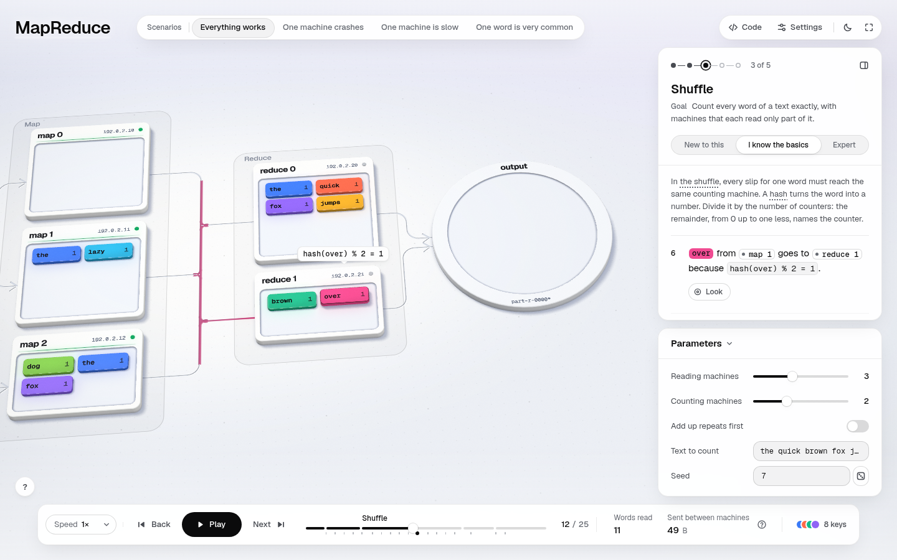 | 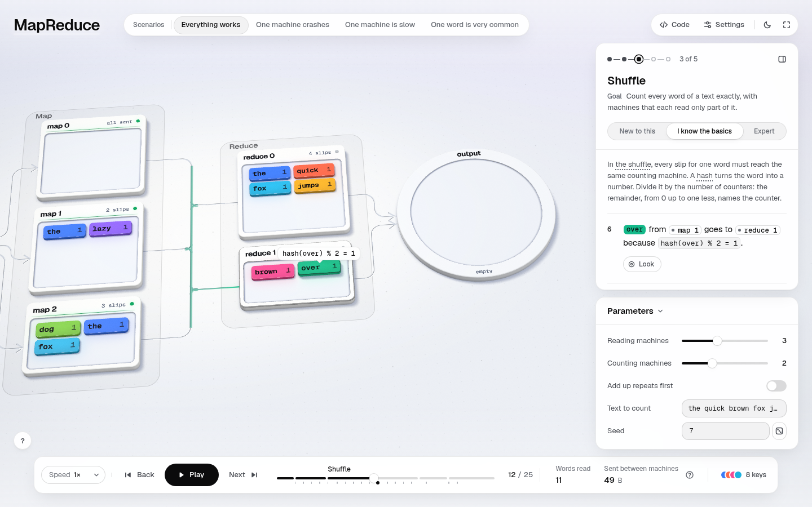 |

**Change.** A record now prints its key and value **as large as its face allows**, from 9 u up to `SIZE.record.fill`
(11.5 u). The size comes from the characters it has to hold (Geist Mono advances 0.6 em per character, with a two-character
gap between key and value), so a long word such as `jumps · 1` never overflows, and a short one such as `the · 1` fills
its slip the way a keycap's legend does. The zone name is 13 u, weight 560, in ink at 66 %. The header sub-label is 8.4 u.
Why this design: it stays in the engine, so every example with records (event-loop, consistent-hashing) gains it too,
and the fit is computed from the text, so nothing has to be tuned per figure.

Close up at 2× (world only, panel hidden):

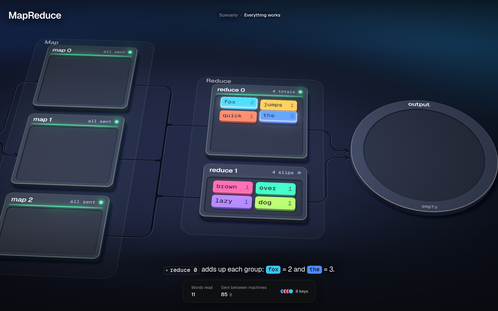

**Files.** `engine/tokens.mjs` (`SIZE.record.fill`, `SIZE.housing.sub`, `WORLD_TYPE.sub`, `WORLD_TYPE.zone`),
`engine/gfx/skin.mjs` (`recordSize`, line 260), `engine/gfx/pack.mjs` (the zone label in ink, on glass and printed).

**Verify by hand.** Open any MapReduce step in the Shuffle chapter at 1440×900: `quick 1` and `jumps 1` are readable
without leaning in. `node scripts/audit.mjs` reports no label overflow.

**Risks.** The slips' type is now larger than the housing's title in some frames. I judged that right, because the slip is
the data. Wide establishing shots still draw header sub-labels at about 6 px. That is a camera limit, not a type one (see
*Next*).

## 2. The world points where the lesson points

**Problem.** The lesson names `look` ids on almost every step (`look m1.s1.w2, r0`, `look r0` …), but the world lit them
only while the reader hovered the Look chip (`runtime.mjs:364`). DESIGN.md 9.4 promised that at Expert "the world still
lights", but nothing lit. With the panel hidden, nothing in the world said which machine the step was about.

**Change.** The timeline adds each step's `look` ids to that step's attention (`engine/scene/timeline.mjs:311`), the same
eased "lit" channel that `s.lit` uses. In the dark theme that is the emissive rim and bloom; in the light theme it is lift
plus an ink rim. They are not *touched*, so the camera's focus does not change, and the light is part of the timeline, so
`renderAt(t)` stays exact under scrubbing. Hovering the chip still adds the hover ring on top.

| Before (world only) | After (world only) |
|---|---|
| 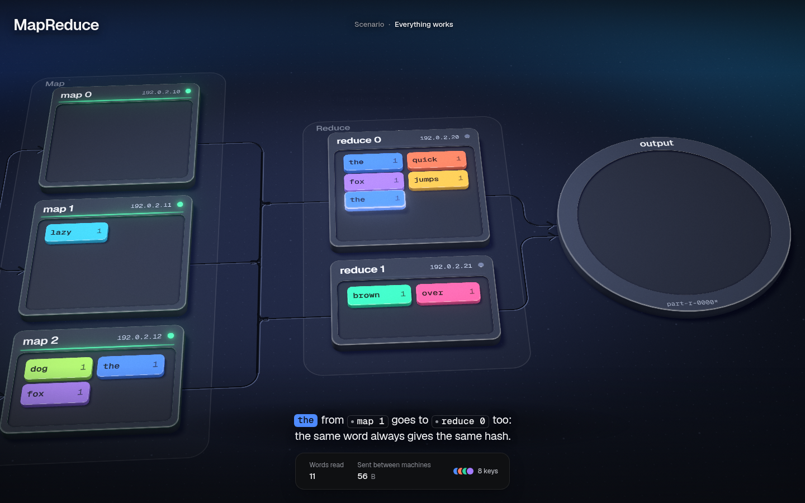 | 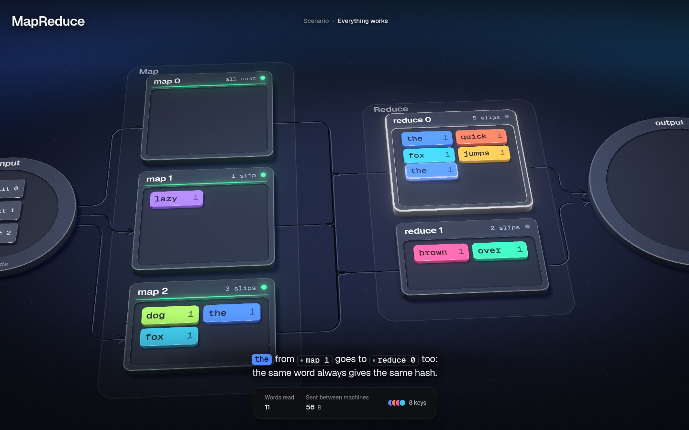 |

**Files.** `engine/scene/timeline.mjs` (3 lines), `DESIGN.md` 9.4 (the Look row).

**Verify by hand.** Hide the panel (E), step through the Shuffle: the counter that receives the step's slip glows. In
the Reduce chapter the counter that is sorting glows.

**Risks.** This affects every example that names `look` ids: a step whose look list is long now lights all of it. I
checked event-loop and btree (shots in `shots/extra/other-*`), and their look lists are short. Light means "watch this"
(DESIGN 3.1), so this is the grammar applied, not a new meaning.

## 3. Cause and effect in one frame

**Problem.** A key step's close-up (the director's *detail* shot) framed the look ids **where they ended**. For "`the`
from map 1 goes to reduce 0 too" (the step the lesson calls the aha), the slip ends in reduce 0, so the shot framed reduce 0
and the empty output disc, and **map 1, where the slip came from, was off-screen**.

| Before (world only) | After (world only) |
|---|---|
| 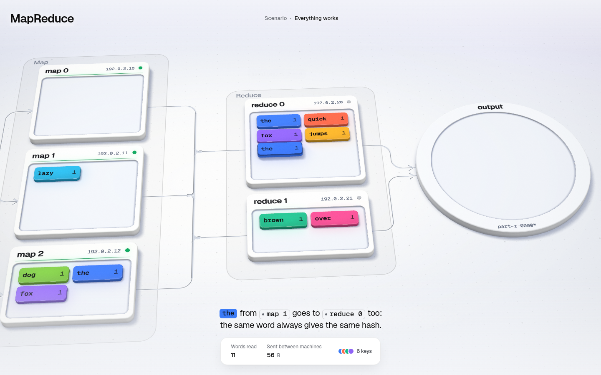 | 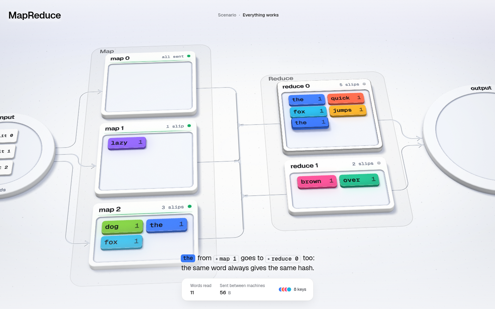 |

**Change.** `marksOf` in `engine/director/shots.mjs` (line 156) now unions each look id's box at the step's start *and*
at its end, so a move's source and target share the frame. A step whose look ids do not move is framed exactly as before.

**Files.** `engine/director/shots.mjs`, `references/tooling.md` (the detail-shot description), the comment on the camera
vocabulary.

**Verify by hand.** Play "Everything works" to step 13 of 25 and let the camera settle: map 1 and reduce 0 are both in
frame.

**Risks.** A slip that travels far makes the detail shot wider, so it is less close. For MapReduce, the widest such shot
still reads (slips at 11.5 u). The phone layout keeps its own hold logic.

## 4. A crash chip that points at the right machine

**Problem.** A housing's tag hangs from its back edge. In a column of machines (18 u apart), that put map 1's "stopped
answering" chip over **map 0's** tray (`../00-baseline/shots/crash-dark-1440x900-005-mid.png`), so map 0 looked like the
machine that crashed.

| Before | After |
|---|---|
| 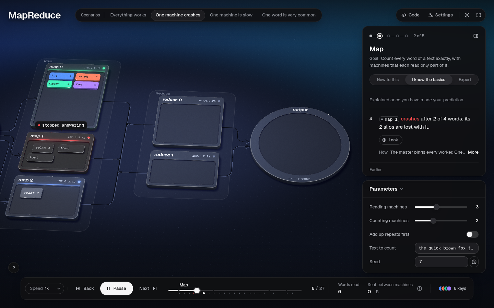 | 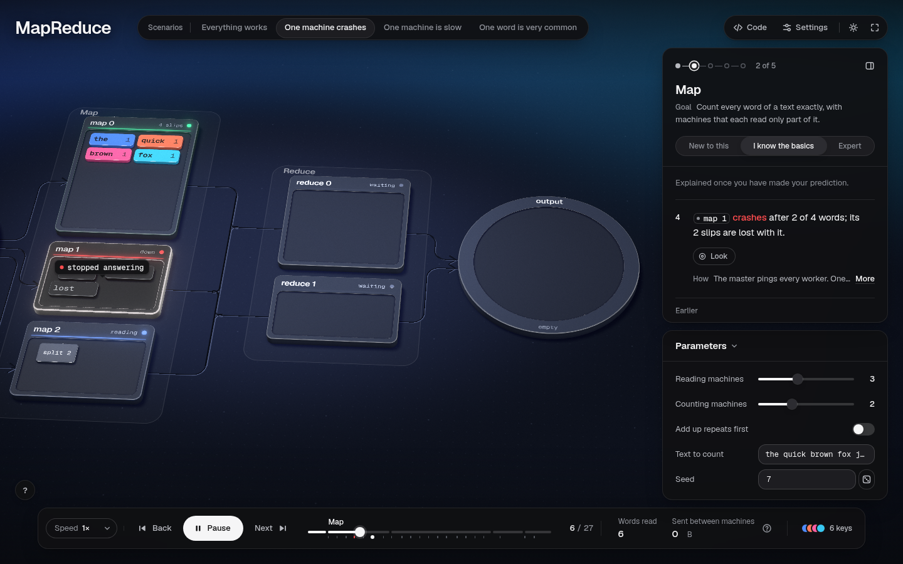 |

**Change.** `tagAnchor` in `engine/scene/sampler.mjs` detects a housing with another one less than 30 u behind it
(`crowded`) and anchors that housing's chip on its own tray, just under the header. A tile's tag inside a crowded housing
stays on the tile instead of blending toward the back edge.

**Risks / trade-off.** On its own tray the chip covers the tray's top row: here, the `split 1` page and one `lost` slip,
while the second `lost` slip stays visible. A slip's hash tag in a crowded housing can briefly cover that housing's title
while the slip leaves (`skew-light-1440x900-013-mid`). Both are better than pointing at the wrong machine, but a sideways
chip would be better still (see *Next*).

## 5. Machines that report the run, and a hot key you can see

**Problem.** Every per-machine sub-label was an IP address (`192.0.2.10`), which never changes and which the lesson never
uses. The facts that matter (how many slips a machine holds, that it is down, that the output is still empty) lived only
in the panel. In the skew story's Output chapter, all three counters looked identical and empty. "reduce 0 got 12 of 14
slips" existed only as words.

| Before | After |
|---|---|
| 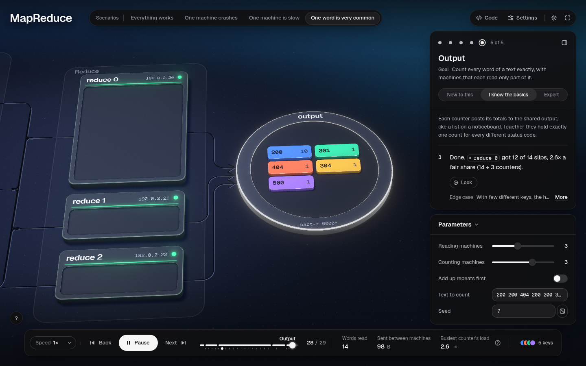 | 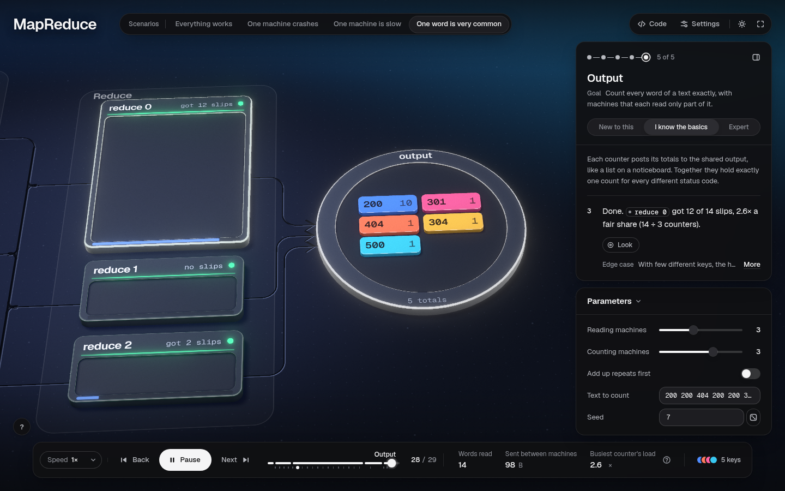 |

**Change (figure only).** Each MapReduce housing's `sub` is set from the run as it happens:

- mappers: `waiting` → `reading` → `N slips` (counted as each slip is written) → during the shuffle `N slips` left to send →
  `all sent`; on a crash `down` then `restarted`; a straggler `stopped` / `unused`
- reducers: `waiting` → `0 slips` when the shuffle opens → `N slips` as each one lands → `sorting` → `N totals` →
  after posting, `got N slips` (its load stays on record) or `no slips`
- output: `empty` → `N totals` as each one is posted
- skew story only: each reducer carries the engine's existing **meter**, its share of all slips sent (`load / slips`)

Every number is a count from the run (`tray`, `load`, `left`, `posted`). Nothing is decorative. The address is still in
each housing's `state.host`, so the inspector shows it.

World only, at the end of the skew shuffle (`12 slips` / `0 slips` / `2 slips`):

| Before | After |
|---|---|
| 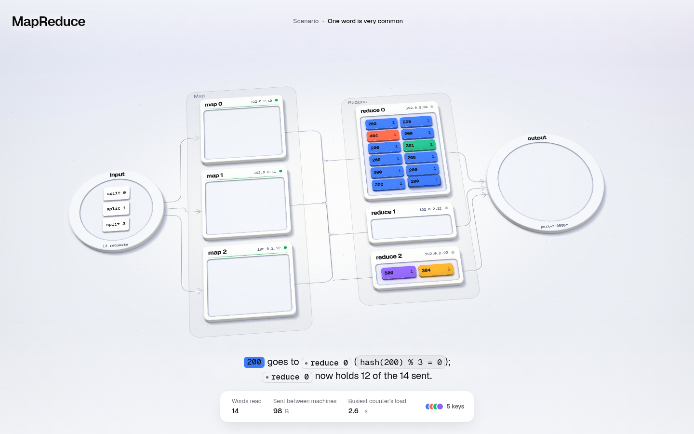 | 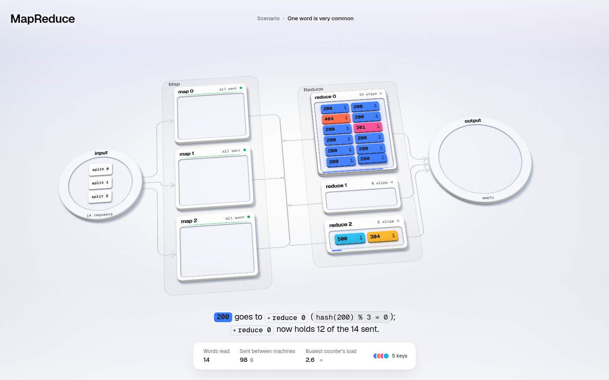 |

**Files.** `examples/mapreduce/figure.mjs`, `DESIGN.md` 5 (the Housing row: prefer live state to an address).

**Verify by hand.** Pick "One word is very common", hide the panel and play: reduce 0's meter fills toward 86 % and its
header counts to 12; reduce 1 stays at `0 slips`, then `no slips`.

**Risks.** The meter uses the engine's standard meter colour (`P.busy`, a blue close to key 0's blue). In the skew story
key 0 is `200`, the hot key itself, so the two blues agree here, but a figure where they don't could mislead. A neutral
meter tone would be an engine token (see *Next*).

## 6. Identity colours that survive red-green colour blindness

**Problem.** I simulated the 8 key colours (Machado 2009, severity 1, CIELAB ΔE; script below). Key 0 against key 3 was
**ΔE 2.8 under protanopia (dark)** and **4.9 under deuteranopia (light)**: effectively one colour. In the default run key 0
is `the` and key 3 is `fox`, the two repeated words that sit side by side in reduce 0 when the lesson says "fox = 2 and the
= 3".

| Before | After |
|---|---|
| 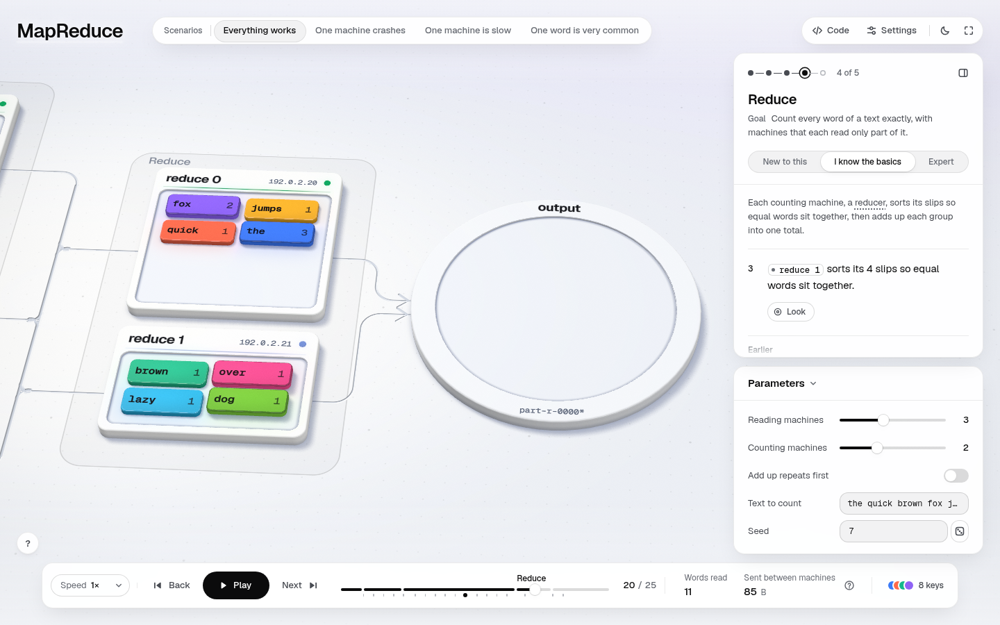 | 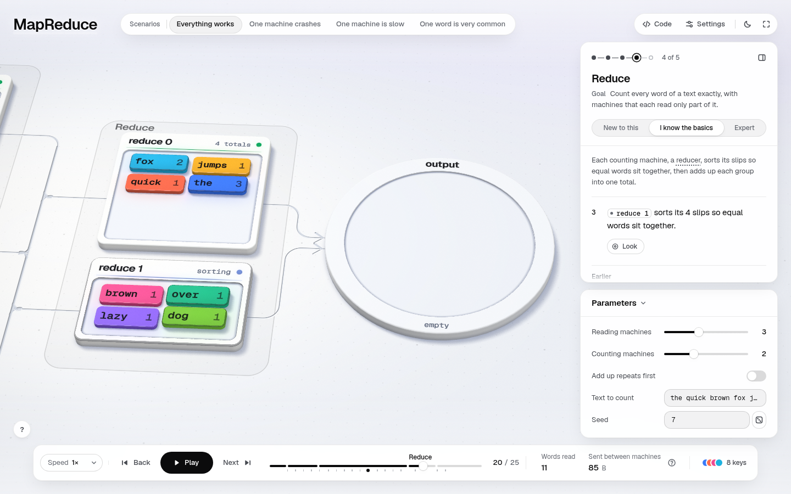 |

**Change.** The same 8 hues in a new order: blue, orange, pink, cyan, amber, then green, violet, lime
(`engine/tokens.mjs` lines 53 and 103). Minimum ΔE among the first five keys:

| | deutan, first 5 | protan, first 5 | all 8 |
|---|---|---|---|
| old dark | 7.4 | 2.8 | 2.8 |
| new dark | **24.4** | **24.7** | 2.8 (key 0 / key 6) |
| old light | 4.9 | 5.6 | 4.9 |
| new light | **24.0** | **24.2** | 4.9 (key 0 / key 6) |

The close pair still exists, but now it is keys 0 and 6, which only a figure with seven or more keys reaches. Words are
printed on every slip, so colour was never the only cue. But colour is what the eye groups by.

**Files.** `engine/tokens.mjs`, `DESIGN.md` 3.1. This is its own commit (`12172f4`), so the owner can drop it
independently.

**Risks.** Every example's colours shift (the same hues, assigned in a new order), so every screenshot in the repo changes.
Spot checks of event-loop and btree are in `shots/extra/other-*`.

---

## Checks

- **verify**: `node scripts/verify.mjs examples/mapreduce/figure.mjs` → `26 run(s), 0 failing, 0 error(s), 0 warning(s)`.
  All 8 examples verify with 0 failing (`verify-after.txt`).
- **unit tests**: 305 tests, 294 pass, **11 fail: the same 11 as on main** (`tests-after.txt`). The baseline's
  `unit-test-failures.txt` lists only 9 names because it was cut off. I re-ran the other two
  (`timeline.test.mjs` "steps: default dur…" and `quicksort.test.mjs` "the figure is deterministic…") on a clean export
  of `BASE_COMMIT`, and they fail there too.
- **lesson words**: `scripts/lesson.mjs` output is byte-identical to `00-baseline/lesson.txt`. No lesson words changed,
  so there is no `lesson-after.txt`.
- **capture**: `shoot.mjs --scenario all --teach`, giving 186 PNGs plus `contact.png`. The capture reports the
  same `--teach` page errors as the baseline (24 against the baseline's 23: questions at steps 6 and 7 never revealed,
  the pick at step 12, no end card). Those come from `shoot --teach` timing out on this slow machine, not from this
  branch; lenses 01 and 02 fix that in `scripts/shoot.mjs`. So some ask, why and end-card shots are missing here, as
  in the baseline. The audit has 1 finding: focus-outside at steps 4, 19 and 22 on the 390×844 phone, the same as the
  baseline. The log is in `shoot-log.txt`.
- **backend**: every capture reports `webgl2` (WebGPU cannot start on this box). WebGPU parity is by construction, not
  by eye.

## Merge notes

- **Shared engine files touched:** `engine/tokens.mjs`, `engine/gfx/skin.mjs`, `engine/gfx/pack.mjs`,
  `engine/scene/timeline.mjs`, `engine/scene/sampler.mjs`, `engine/director/shots.mjs`. None of them is in
  `engine/hud/`, `runtime.mjs` or `lesson.mjs`, so conflicts with the panel-, HUD- and lesson-focused lenses should be
  rare. The likely overlaps:
  - another lens editing `examples/mapreduce/figure.mjs` (the `sub:` fields on `s.housing`/`s.set`, and the `arrive()`
    helper in the shuffle loop)
  - any lens that changes `PALETTE.*.keys` or snapshot-tests colours
  - `DESIGN.md` sections 3, 5, 7 and 9.4
- **Generalises:** changes 1, 2, 3, 4 and 6 are engine changes that every example inherits. Change 5 is MapReduce-only,
  but it is the pattern (sub = live state) that event-loop, btree and consistent-hashing already use.
- The 11 known unit failures are unchanged. Test 42 (housing skin) was already failing and did not change.

## Next (ranked)

1. **A sideways tag chip** (the HUD draws chips only above their anchor). It would let a crowded housing's chip, or a
   slip's hash tag, sit beside the machine instead of over its tray or title.
2. **Read the world at establishing distance.** In wide shots the header sub-labels are about 6 px. Option: hide
   sub-labels below a px/u threshold, or have the director hold the establish shot shorter and push to the stage
   sooner.
3. **The empty output disc** still takes a third of the frame in Reduce-chapter close-ups (`fillShot` slides toward it to
   avoid bare floor). Either let `fillShot` prefer bare floor over an idle solid, or let a store draw small until it
   holds something. Both are layout-policy changes for the owner to decide.
4. **A neutral meter tone** (`P.meter`), so a load meter never borrows a key's hue.
5. **WebGPU check by eye** on a machine with a GPU: glass zones with the inked zone label, and the lit look ids' bloom.
6. A "follow this slip" scrub mode: pick a slip, and the camera keeps it and its hash tag in frame from map to output.
