# Share and teach: links to a moment, a share panel, a handout and a presenter view for a room

## TL;DR

- **A link now opens the exact moment it names, and says so.** The story, step, reader level and changed knobs come
  back from the link. The start card says "Opens at step 14 of 34 · Shuffle", quotes that step and offers *Play from
  step 14* or *From the start*. A bad or old link still opens and lists what it changed. Two old link bugs are fixed:
  knobs that were lost, and unknown knobs that leaked into the run.
- **Share** in the toolbar (on phones, in the title's card) gives a link to this moment, *Save image* (a PNG of the
  frame with the step's own words), an iframe snippet that opens at this step, and the teaching tools. Nothing
  leaves the page.
- **A printable handout, made from the lesson and the real runs:** a student worksheet (9 A4 pages for MapReduce)
  and a teacher guide (12 pages). Each has a picture of every chapter drawn from the run, each question with room
  to answer, and the answers on a page of their own. The teacher guide adds the plan with measured play times, the
  wrong ideas to listen for, a prompt for the room per chapter, and what each wrong option means. Ctrl+P on the page
  prints the worksheet, not a screenshot.
- **The presenter view now serves a room.** It warns one step before each question and gives the answer, shows
  what each wrong answer means, gives each chapter's prompt for the room, and lets the presenter jump to a chapter
  or switch story from the laptop.
- Branch `product/05-share-teach` (3 commits on `9c8b16d`). To try it:

```sh
git fetch origin && git checkout product/05-share-teach
node scripts/build.mjs examples/mapreduce/figure.mjs --out mapreduce.html
open "mapreduce.html#scenario-skew&step-14&p=reducers:4"     # a link to a moment
# then: Share (toolbar) → Copy, Save image, Handout; P for presenter mode → Presenter view
```

**Who it's for.** It serves the people who teach with the page and pass it around: a TA running a section, a
student sending a classmate "look at step 14", a teacher assigning homework, a blogger embedding it, and anyone
making slides. `GOALS.md` has the personas, the baseline audit (A1–A15) and the ranking.

---

## 1. Links that open a moment exactly, and say where

**The problem.** A link such as `#s=skew&t=60` opened at the right step, but behind the generic start card ("Play /
Step through it yourself" over a dimmed world). Nothing told the classmate that the link meant step 11 of "One word
is very common" (A2). A bad link was silent: `#scenario-nope&step-999&level-wizard` opened *Everything works* at its
last step, said nothing, and left `level-wizard` in the address bar (A5). Two real bugs:

- `#scenario-skew&step-5&p=reducers:4` opened with 3 counting machines, because the embed layer's `setScenario`
  reset the knobs after the HUD had applied them (A3).
- `#p=nope:3` put `nope: "3"` (a string) into the simulation's values (A4).

| Before: a shared link, generic card | Before: a bad link, silent |
|---|---|
| 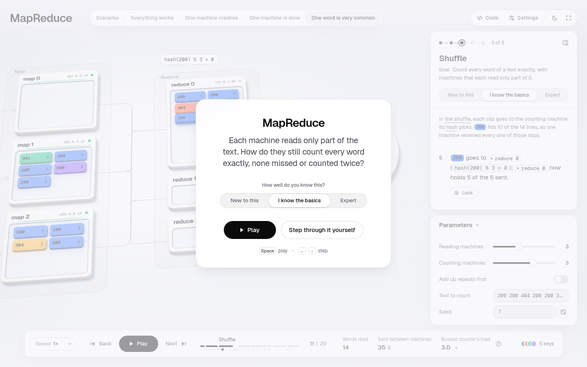 | 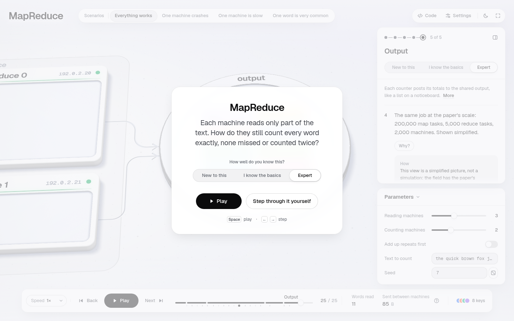 |

**What changed.** A new DOM-free module, `engine/embed/deeplink.mjs`, owns the moment: it reads both spellings, the
readable `#scenario-skew&step-14&level-expert&p=reducers:4` and the HUD's `#s=skew&t=60.3&p=…`. The runtime opens
the moment before the first compile:

1. `parseMoment`, then `resolveMoment` against the figure. The story, level and knobs are checked against the
   figure's own definitions, so each knob is type-checked, clamped to its range and kept only if the figure
   defines it.
2. The first compile.
3. `resolveStep` puts the playhead at the start of that step, like Back.

Whatever the link asked for that the page cannot do is dropped or clamped, and said in one line on the start card.
Then the address bar is rewritten in the HUD's spelling, so a reload opens the same moment. A link opened later (a
hashchange, or a host page setting the frame's hash) goes through the same path (`__internals.openMoment`), and the
embed layer defers to it instead of applying links a second time. That is the fix for A3.

The start card is the arrival. When a link names a step, the card names the story as a chip and says "Opens at step
14 of 34 · Shuffle". It quotes that step's words in place of the hook and offers **Play from step 14** and **From the
start** (the linked story from its first step). The card opens for a link even if this reader dismissed it before,
because the link changed where they are and the card says so. It is shown once: *Replay intro* shows the figure's
own card.

| After: a link to step 14 with 4 counters | After: a bad link opens anyway and says what changed |
|---|---|
| 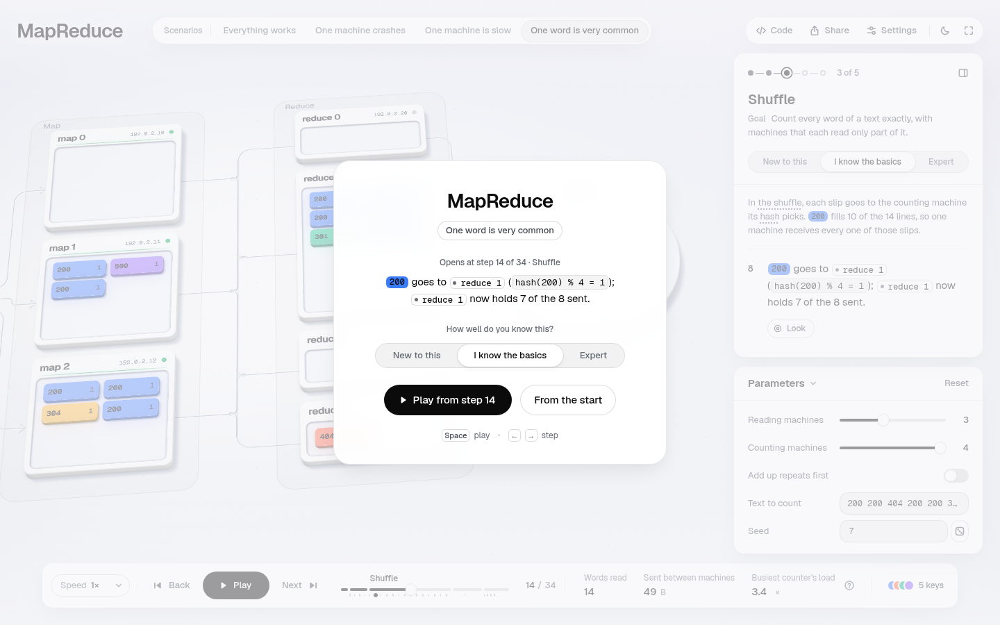 | 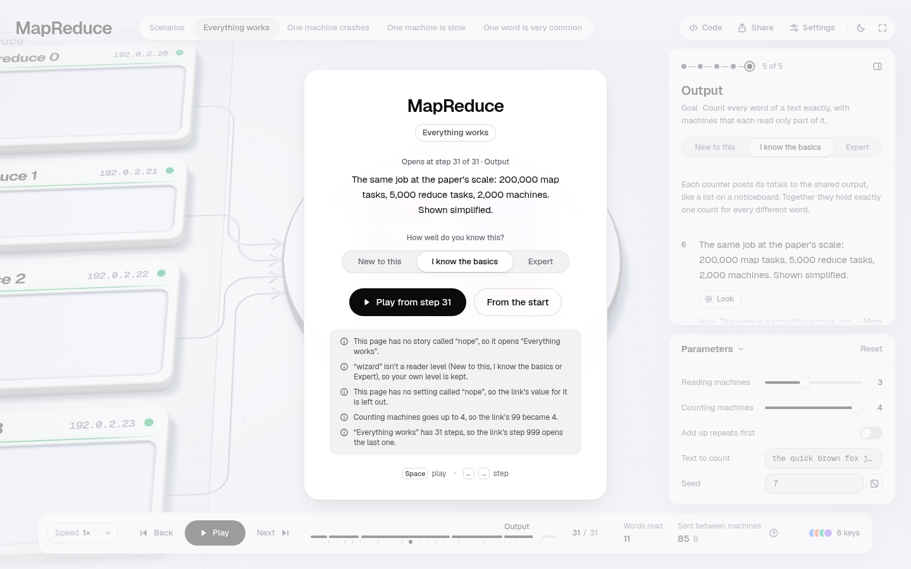 |

The bad link above, `#scenario-nope&step-999&level-wizard&p=nope:3,reducers:99`, gets one plain line per problem:
- no story "nope", so it opens "Everything works"
- "wizard" isn't a level, so the reader's own level is kept
- no setting "nope", so it is left out
- 99 counting machines became 4, the maximum
- step 999 opens the last step, 31

The run's values after it are `{"mappers":3,"reducers":4,…}`, with no `nope` key. With a good link the values are
`{"mappers":3,"reducers":4,…}` and the hash becomes `#s=skew&t=76.2&p=reducers:4` (driver output, kept in the
capture log).

| Phone: a link to step 8 of the crash story | Embed at 800×500 with `?embed=1#scenario-skew&step-5` |
|---|---|
| 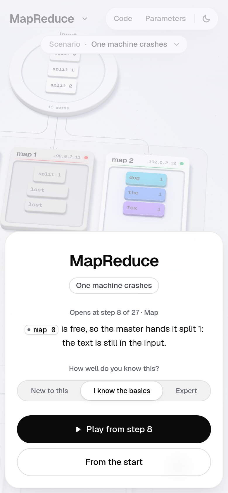 | 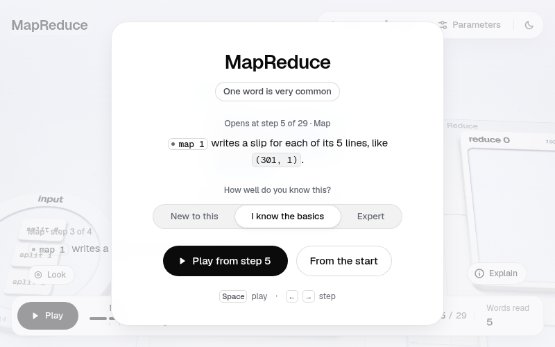 |

Before, the embed opened on the full generic card: 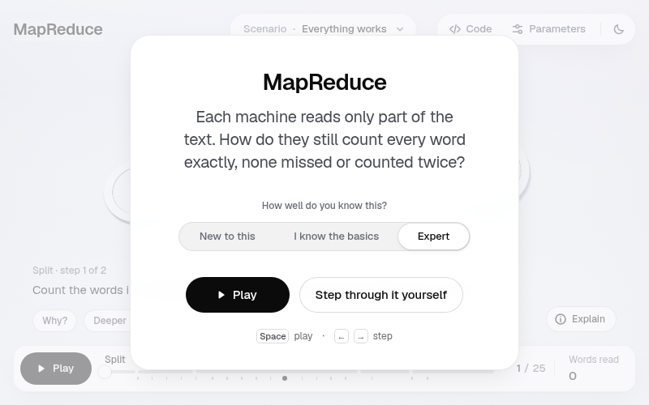

**Files.**
- `engine/embed/deeplink.mjs` (new, plus `deeplink.test.mjs`, 7 tests)
- `engine/runtime.mjs`: `resolveMoment` before the first compile; `arrive()`, `openMoment()`
- `engine/embed/embed.mjs`: defers to `openMoment`
- `engine/hud/hud.mjs`: the arrival start card; `intro(show, link)`
- `engine/hud/hud.css`: `.ix-intro-story`, `.ix-intro-at`, `.ix-intro-quote`, `.ix-intro-notes`

**Check it by hand.** Open `mapreduce.html#scenario-skew&step-14&p=reducers:4`. The card should say step 14 of 34,
and Parameters should show 4 counting machines. Then try `#scenario-nope&step-999&level-wizard&p=nope:3,reducers:99`
and `#s=crash&t=12` (an old link), and run `node --test engine/embed/deeplink.test.mjs`.

**Risks and trade-offs.**
- The arrival card shows for a link even to a returning reader. That is deliberate (the link moved them), but it
  adds one click for a teacher who sends many links. *Play from step N* is the default button, so Space or Enter
  takes them through.
- The address bar is rewritten to `#s=…&t=…`, the HUD's spelling. That keeps reloads exact but changes what the
  reader sees in the address bar.
- On `file://` the link only works on the same computer, and the share panel says so (section 2).

---

## 2. A share panel: link, image, embed, teaching tools

**The problem.** There was no share control anywhere. Links existed only as a hash format in the README, and the
toolbar was `Code · Settings · ☾ · ⛶` (A1). The level was never in a link a reader could get (A6). A reader making
slides had only an OS screenshot with the HUD in it (A12). A blogger had to read `tooling.md` to write an iframe
(A13).

**What changed.** **Share** joins the toolbar, between Code and Settings. It opens a panel in the house style (the
same panel shell as Settings):

- **Link to this moment**: the link, a Copy button ("Copied"; if the clipboard is blocked, the text is selected and
  the button says "Press Ctrl+C"), a toggle for "Open at step 14 of 29 · Shuffle", and an opt-in "Use my level".
  Changed knobs ride along and are named ("With your settings: Counting machines 4."). On a touch device with a
  native share sheet and a real address, a "Share…" button opens it. Session switches (`embed`, `present`, `autoplay`,
  `gfx`, `origin`) are stripped, so a presenter's link doesn't open in presenter mode.
- On `file://` the panel says plainly that the link opens only on this computer, and that the part after `#` opens
  the same moment in any copy of the file. In a sandboxed or `about:srcdoc` frame, with no address of its own, it
  says how to use the hash.
- **Save image**: a PNG of the world as it stands, cropped to its free area, with its tags where the HUD put them.
  Under it is a band with the step's own words and a footer naming the figure, story, chapter and step. It is named
  after the moment (`mapreduce-skew-step-14.png`). The frame is drawn again at capture quality and read back in the
  same task (`engine/hud/still.mjs`). Every pixel comes from the run.
- **Embed on a site**: an iframe snippet at this story and step with `?embed=1`, sized for the compact layout. It is
  hidden on `file://`, where there is no URL to embed.
- **Teach with it**: Handout and Presenter mode.
- A privacy line: "Nothing leaves this page. Links carry only these settings, and the image is made here."

| The panel (hosted page) | Copied |
|---|---|
|  | 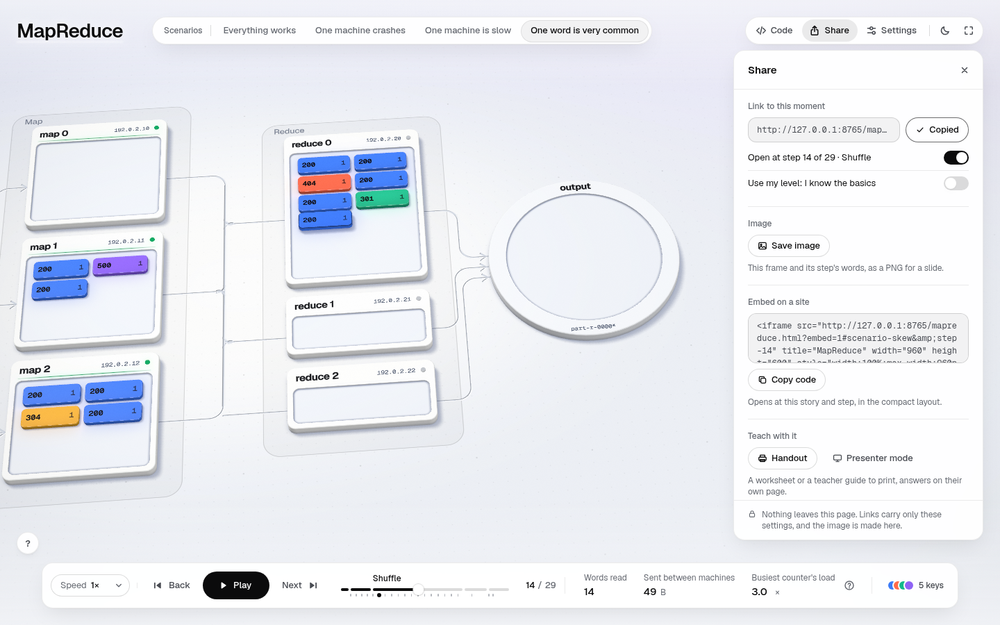 |

| The panel from `file://` | Phone: Share in the title's card |
|---|---|
| 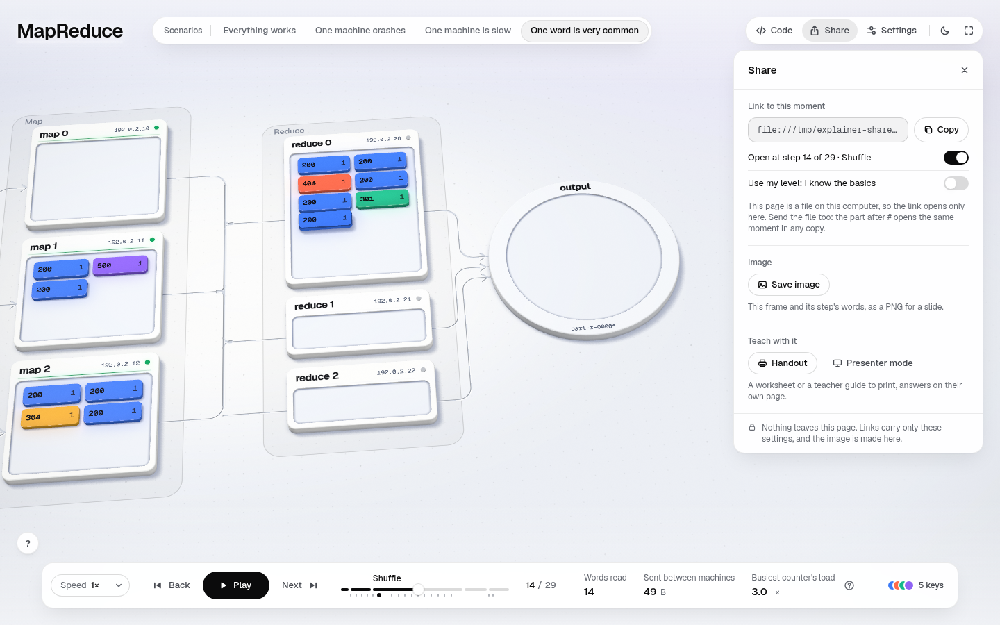 | 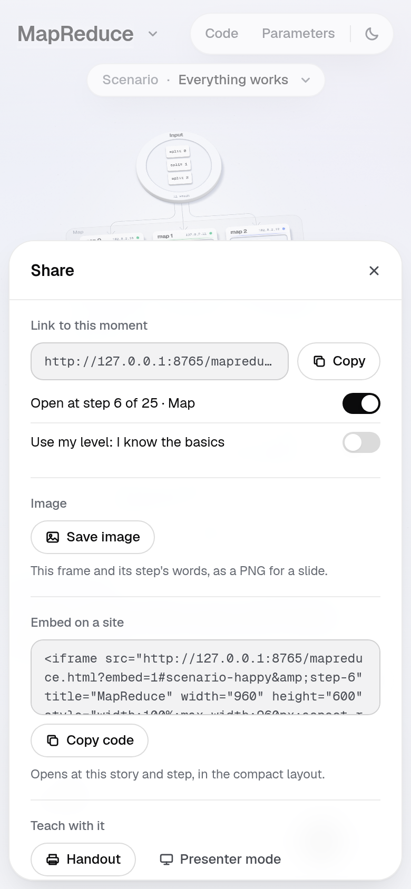 |

*Save image* output for "One word is very common", step 14 (the PNG itself, 2112×1692):

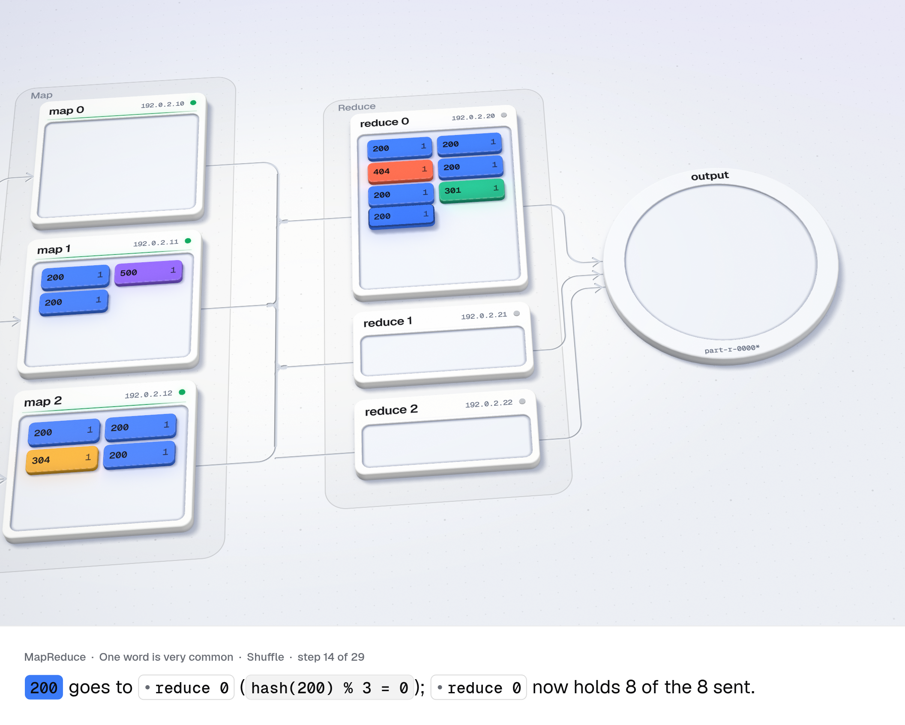

**Files.**
- `engine/hud/share.mjs` (new)
- `engine/hud/still.mjs` (new)
- `engine/hud/hud.mjs`: the toolbar button, the panel, phone entry from the title card
- `engine/runtime.mjs`: `snapshot()` (the HUD's `onSnapshot`) draws the frame again and reads it back
- `engine/hud/hud.css`: `.ix-share-*`

**Check it by hand.** Serve the page or open it as a file, press Share, and Copy. Paste the link into a new tab: it
should land on the arrival card at the same step. Press Save image and open the PNG. Then compare the panel on
`http://` (embed shown) with `file://` (note shown, embed hidden).

**Risks and trade-offs.**
- Save image re-renders the world at 2× in the same task. That takes a moment on software rendering, and the note
  says "Drawing this frame…" meanwhile.
- The image crops to the world's free area, so if the camera at that step frames only part of the world, the image
  matches the screen and not the whole world (the screenshot above cuts the input on the left, as the page does at
  that step).
- The native "Share…" button shows only on touch devices, on a hosted page, where `navigator.share` exists. It was
  not exercised here: headless Chrome has no share sheet, so the phone shot shows the Copy flow.

---

## 3. Teacher notes in the lesson

**The problem.** There was nothing for the TA to say between steps, and no "how long does this take". `lesson.mjs`
prints `25 steps, 140 s at 1x` per story, but the page never told a presenter (A11).

**What changed.** A lesson chapter can carry `teach: { prompt, listen, minutes }`: a question to put to the room,
what a good answer says (or the wrong idea to listen for), and the minutes to give it. It is merged like `about`
and `enter`, including `teach@story` overrides, and documented in `references/teaching.md` §5. The engine only lays
it out: the words are the lesson's. MapReduce has notes for all five chapters, plus story-specific ones for the
crash (Map), the straggler (Map) and the skew (Shuffle). Two examples:

> **Shuffle.** Why not deal the slips out evenly, like cards, so every counter gets the same amount?
> *Listen for:* Copies of one word would land on different counters, and no counter could give that word's full
> count. The hash sends every copy to one counter without any machine asking another. (5 min)
>
> **Map, crash story.** A machine just crashed. Before the question on screen, ask the room: is its part of the
> count gone for good? *Listen for:* "the count comes out short" and "the whole job starts over". (4 min)

The notes show in the presenter view (section 5) and the teacher guide (section 4), never to the reader.

**Files.**
- `engine/scene/lesson.mjs`: `teachOf`, merged per story
- `engine/scene/timeline.mjs`: phases carry `teach`
- `examples/mapreduce/lesson.mjs`
- `references/teaching.md`

**Check it by hand.** Open the teacher guide (Share → Handout → Teacher guide) and read the grey "Ask the room"
boxes. `lesson-after.txt` is unchanged from the baseline, because `scripts/lesson.mjs` does not print teacher notes.

**Risks and trade-offs.** The minutes are a suggestion, written by hand per chapter. The play times beside them are
measured.

---

## 4. A printable handout: student worksheet and teacher guide

**The problem.** Ctrl+P printed the screen: the HUD and the start card, on one page (A7). The plan promised
generated handouts (`docs/next/PLAN.md` §4.3). There was nothing to hand out, no answers to keep back, and nothing
a student could show after the end check (A14).

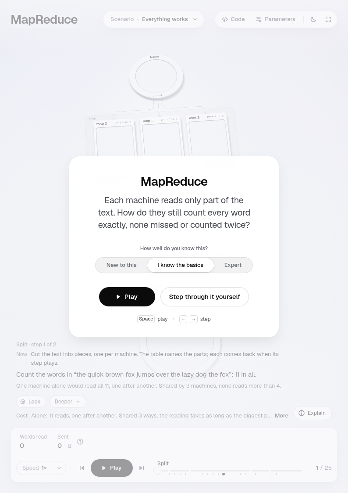

**What changed.** `engine/hud/handout.mjs` builds a document from the lesson and the real runs of every story (the
runtime compiles each one; `handoutData`). None of it is written by hand. It opens over the page as a preview with
a Print button, from Share → Handout. In both versions:
- the question, the goal and objectives (tick boxes on the worksheet), and how to open the page
- the picture (the lesson's analogy table) and the words
- the first story chapter by chapter: its key steps and a picture of the chapter drawn from the run, with the
  world's tags
- what is new in each other story, with its picture
- every prediction and pick where it happens, with two lines for "Why do you think so?"
- the end check, then the recap
- **the answers on a page of their own**, so a teacher can keep them back

The **teacher guide** adds:
- the plan: each story's play time, measured from its run at normal speed with repeats sped through as the page
  plays them; where it opens; its questions; and the talk minutes, 29 min in all for MapReduce
- how to run it in a room
- the lesson's wrong ideas and their fixes
- each chapter's prompt for the room with its play time
- every answer ticked, with what each wrong option means and the wrong idea behind it

If the reader finished the end check this visit, the answers page carries "Check on the page, this visit: 2 of 3
right on the first try…". It is labelled as self-reported, since the page keeps no record.

| Student worksheet, page 1 | Page 2: the first chapters, pictures from the run | Page 9: answers on their own page |
|---|---|---|
| 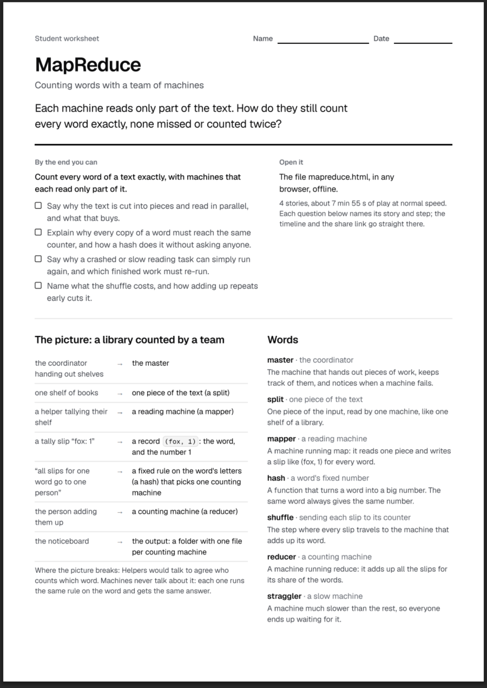 | 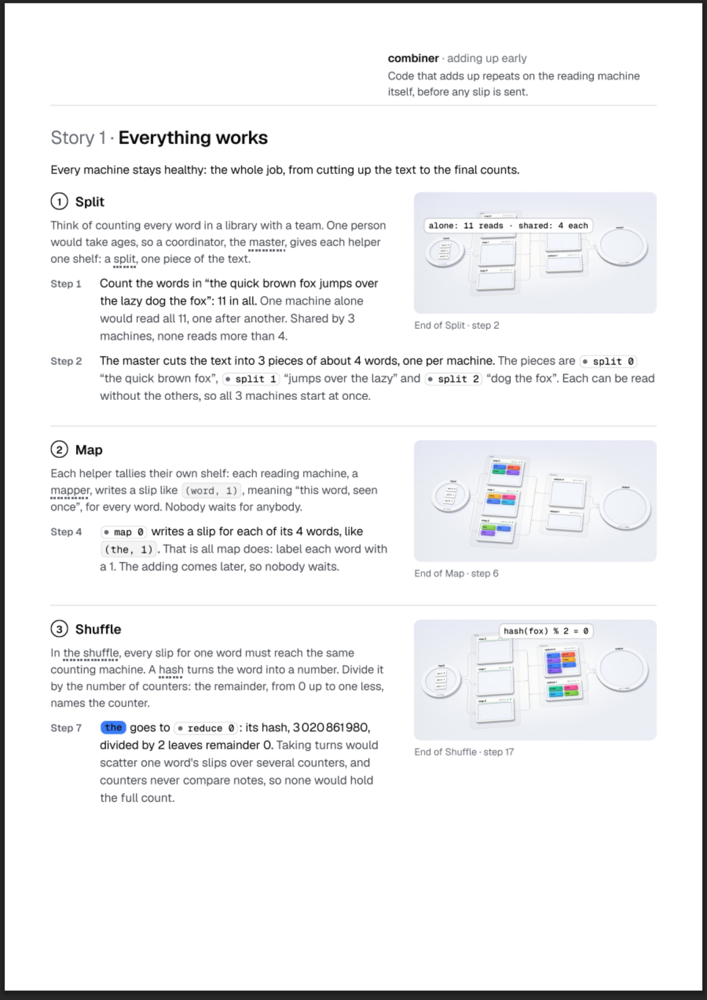 | 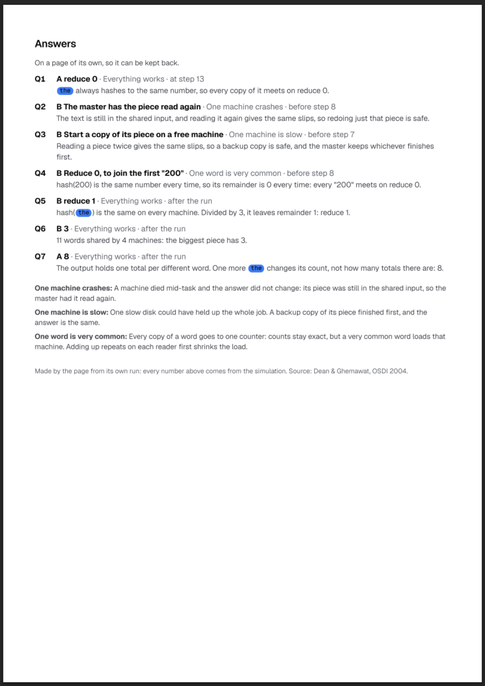 |

| Teacher guide, page 1: the plan | Page 4: prompts for the room, an answered pick | Page 6: what each wrong option means |
|---|---|---|
| 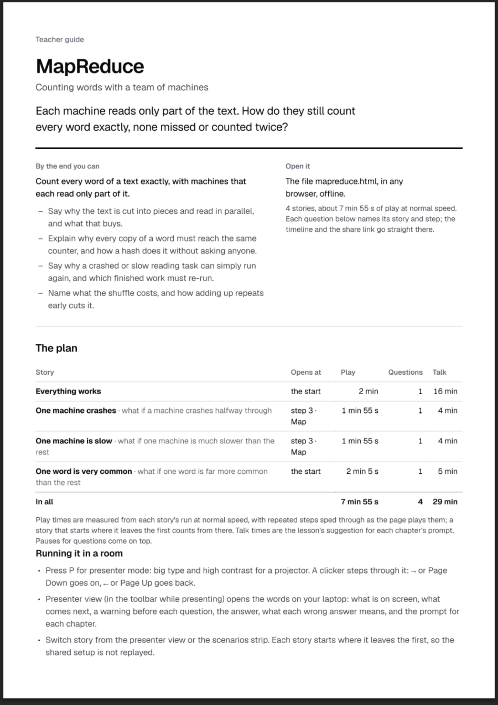 | 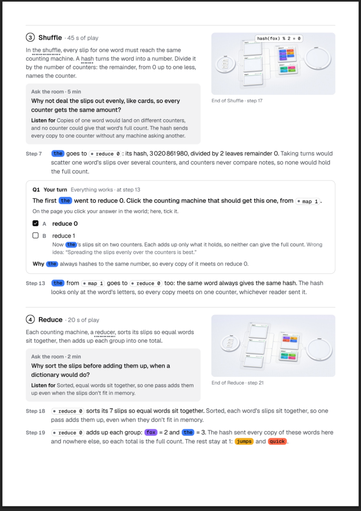 | 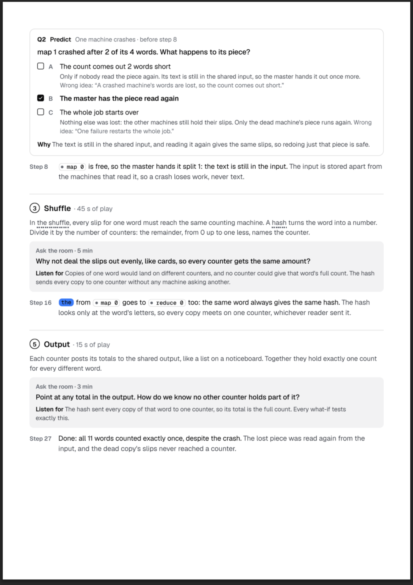 |

All pages: [student, 9 pages](shots/extra/handout-student-all-pages.png) ·
[teacher, 12 pages](shots/extra/handout-teacher-all-pages.png) · the PDFs themselves:
[`handout-student.pdf`](shots/extra/handout-student.pdf), [`handout-teacher.pdf`](shots/extra/handout-teacher.pdf).
They were printed by Chrome (`Page.printToPDF`, A4) from the page's own print stylesheet, and the page PNGs were
rendered from those PDFs.

In the page: the words come first, and the pictures fill in one at a time ("Drawing picture 4 of 8 from the run…").
Print waits until they are done.

| Preview while the pictures draw | A chapter in the preview | Teacher guide in the preview |
|---|---|---|
| 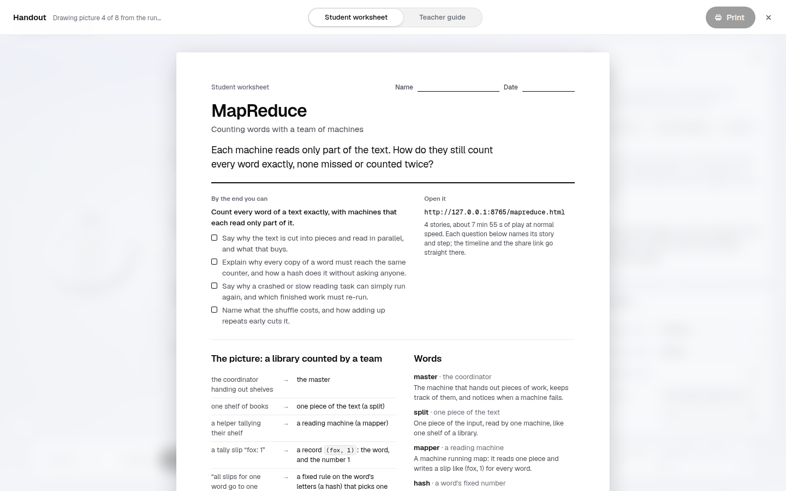 | 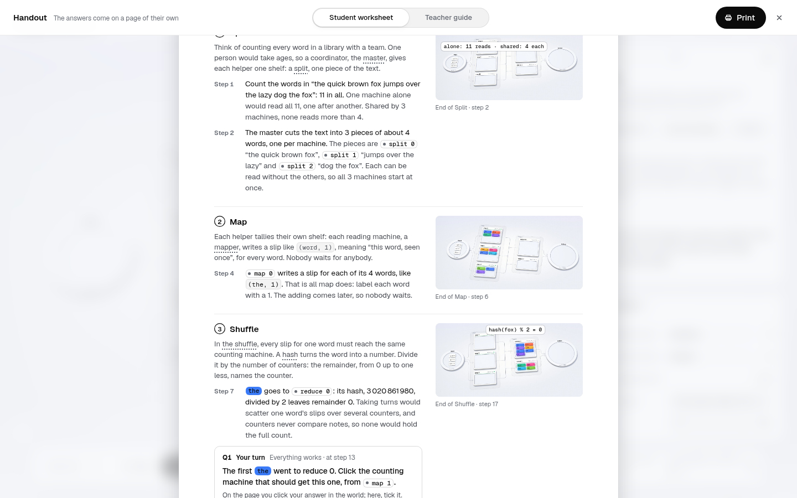 | 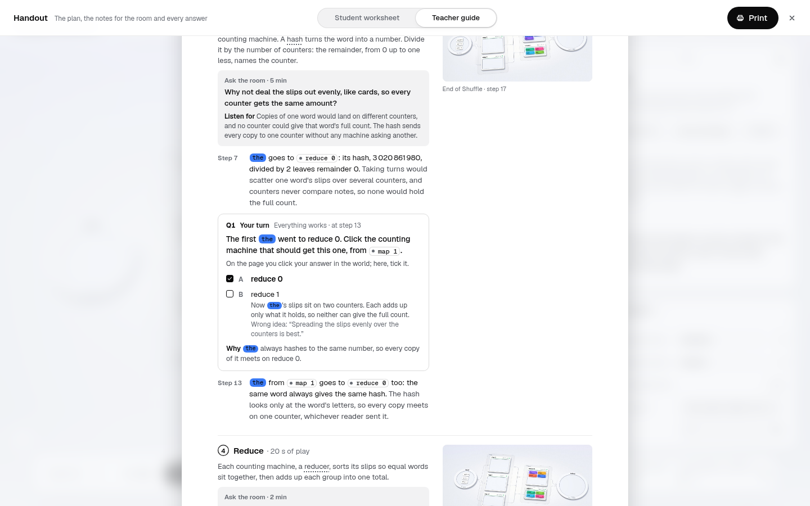 |

Phone: 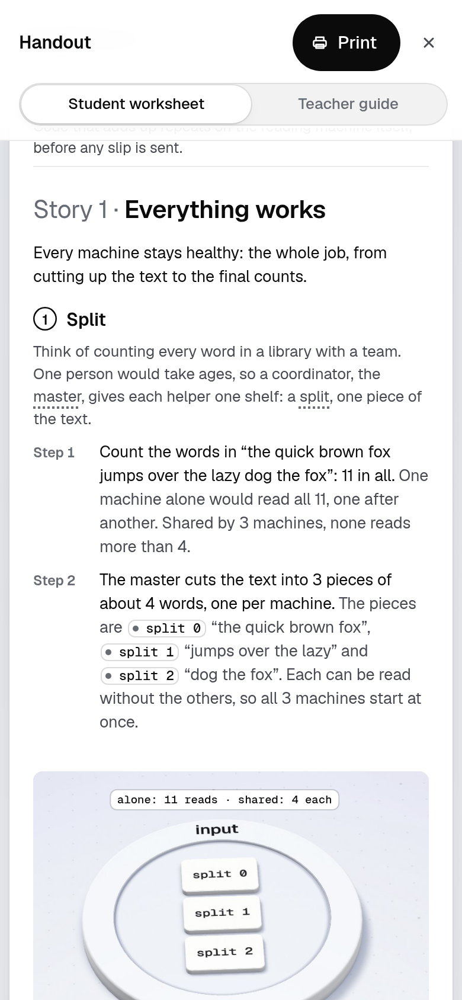

How it is built:
- **Print.** `@media print` shows only the handout. The answers start a new page. A chapter may run onto the next
  page, with its picture floating beside its words, but a step, a question, a prompt or a picture never splits, and
  headings stay with what follows. The paper uses the light theme's inks whatever the page shows.
- **Ctrl+P with the preview shut** prints the student worksheet. `beforeprint` draws it with its pictures, and
  `afterprint` clears it, so the page is back exactly as it was.
- **The page stays usable while pictures draw.** They are drawn one per task (a moment each without a fast GPU),
  and the world stops drawing while the handout is open. A canvas resize is skipped while printing, which fixed a
  framebuffer error seen during the work.

**Files.**
- `engine/hud/handout.mjs` (new)
- `engine/runtime.mjs`: `handoutData` and `drawPicturesSlowly` (one picture per task)
- `engine/hud/hud.mjs`: Share → Handout; `beforeprint` and `afterprint`
- `engine/hud/check.mjs`: `result`
- `engine/hud/hud.css`: `.ix-ho-*` and `@media print`
- `README.md`, `references/tooling.md`

**Check it by hand.** Share → Handout. Switch between Student worksheet and Teacher guide, then Print and choose
"Save as PDF". Separately, with the preview closed, press Ctrl+P: the dialog shows the worksheet.

**Risks and trade-offs.**
- The pictures are small (40% of the column). They show the shape of each chapter's moment, but the slip labels are
  hard to read on paper. The words carry the detail.
- Compiling every story and drawing 8 pictures takes several seconds on software rendering. The words show at once.
- The end check comes from the first story's checks (`handoutData` reads `base.checks`). See Merge notes: main now
  has checks per story.
- Pagination was checked on Chrome's A4 PDF. Other browsers' print engines may break pages a little differently.

**What I fixed in the last round** (seen in the PDF pages):
- Chapters were unbreakable. A chapter that didn't fit jumped to the next page, leaving half a page blank, and
  stranded "Story 1" headings on the page before.
- The handout's reset rule outweighed its own margins, so headings sat tight against their text.
- A world tag at the picture's edge ("alone: 11 reads · shared: 4 each") was cut off. A tag now slides along its own
  width as its anchor nears an edge.
- The teacher guide forced a page break after the plan, leaving one bullet alone on a page.

Before these fixes the PDFs had 9 and 13 pages with those gaps. After them they have 9 and 12 pages, and the chapters
flow.

---

## 5. The presenter view, for a room

**The problem.** This is the presenter's laptop window. On the step before a prediction, "Next step" showed the
*answer's* step ("map 0 is free, so the master hands it split 1"), and nothing said "a question comes first: ask the
room" (A8). An open question showed the options and "Answer B", but not what each wrong option means, though the
lesson has per-option feedback with misconception ids (A9). The TA could not switch story or chapter from the
laptop: the scenario was plain text and the chapter dots were not buttons (A10).

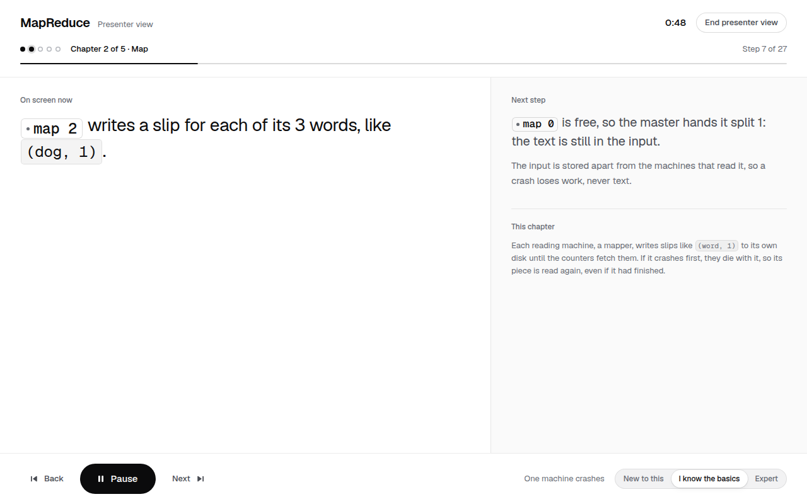

**What changed.**
- **A warning one step ahead.** When the next step opens with a question the reader will see at this level, the
  "Next" column becomes a boxed **"Next, a question: ask the room first"** (or "Next, their turn" for a pick in the
  world). It shows the question, the options and the answer chip. The answer's step moves below, as "Then, once it
  is answered".
- **What each wrong answer means.** Under an open question, each wrong option carries the lesson's feedback and the
  wrong idea behind it.
- **The chapter's prompt for the room**, from the lesson's `teach`, with its minutes.
- **Chapter dots that jump** to a chapter's first step.
- **A story switcher** (a select in the footer, beside the level).

| One step before a pick: the warning and the answer | A prediction open on screen: what each wrong answer means, and the crash story's prompt |
|---|---|
| 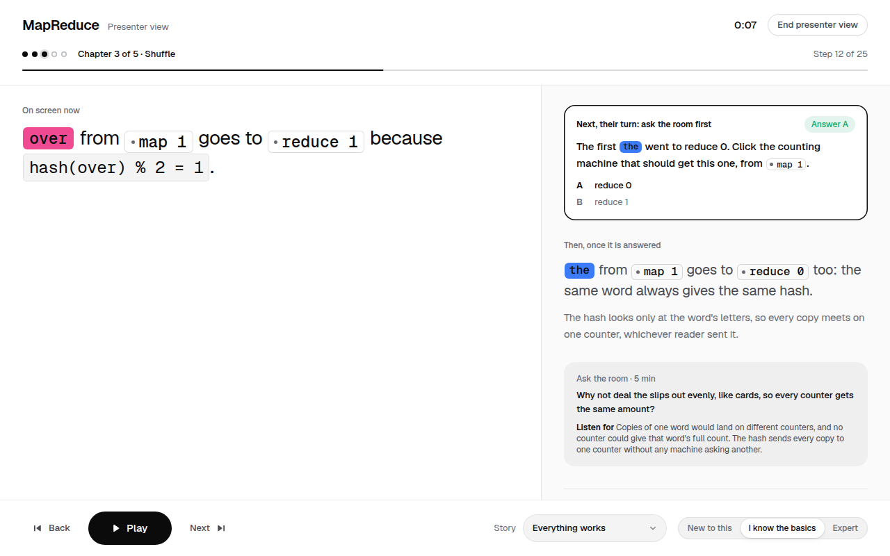 | 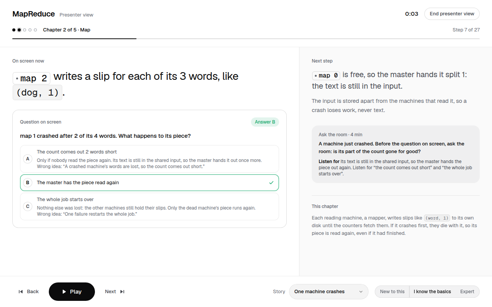 |

The projector side at that moment (the main page): 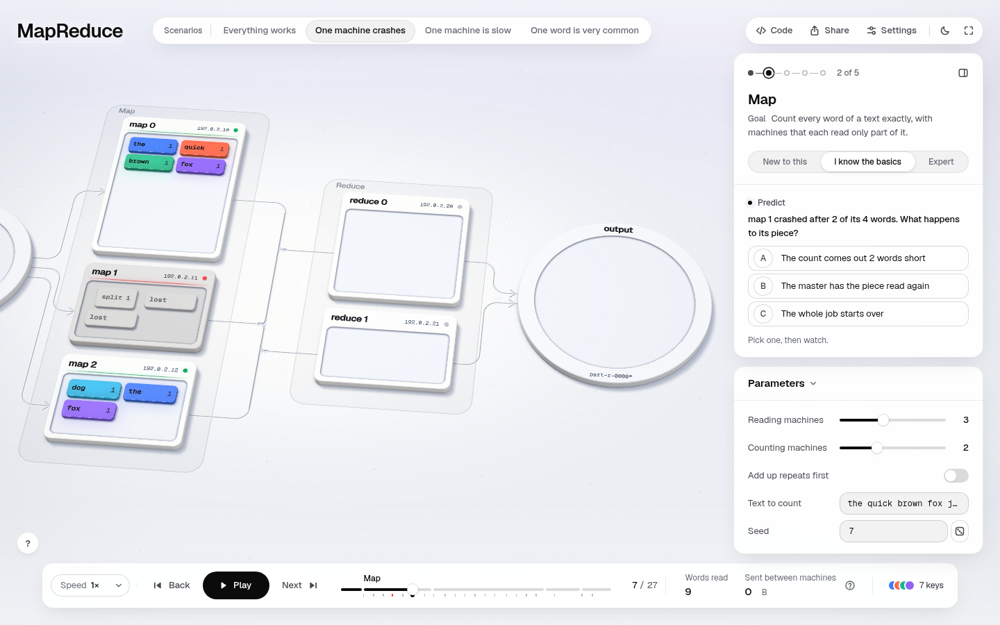

The presenter mode on the projector is unchanged (it was already good:
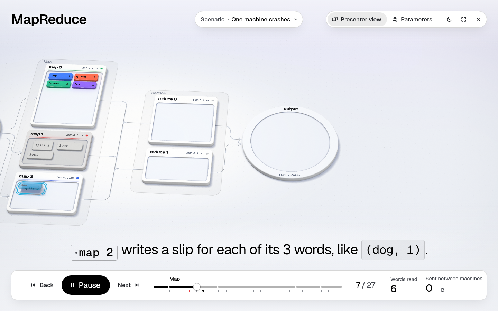).

**Files.**
- `engine/hud/presenter-view.mjs`
- `engine/hud/hud.mjs`: `viewState()` gains `upcoming`, `teach`, `scenarios` and the chapter jump
- `engine/hud/hud.css`

**Check it by hand.** Press P, then Presenter view in the toolbar (allow the pop-up), and step to step 12 of
*Everything works*. The right column should say "Next, their turn: ask the room first" with Answer A. Click a
chapter dot, then switch story in the footer.

**Risks and trade-offs.**
- The warning relies on the level's question policy (`isLive`), so at *New to this* a question that level skips is
  not announced.
- The story select changes the main page's story at once. That is the right thing for a TA, but it is not undoable
  from the laptop except by selecting the story again.

---

## Checked on another example: Raft

Raft has a different world (a cluster of 5 servers), three stories and **no teacher notes** in its lesson. A link to
step 10 of "The leader crashes" opens with the arrival card. The share panel and the handout work, and the handout
simply leaves out the prompts it has no words for.

| Raft: arrival at step 10 of "The leader crashes" | Raft: share panel |
|---|---|
| 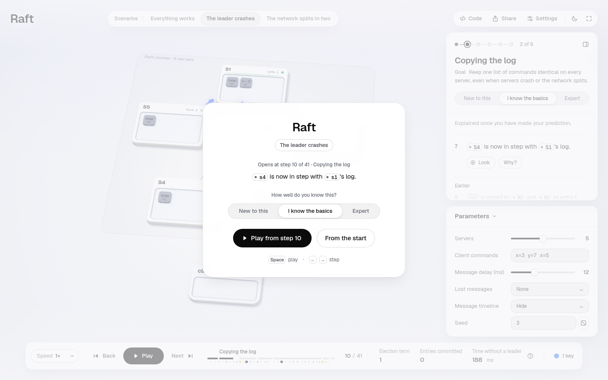 | 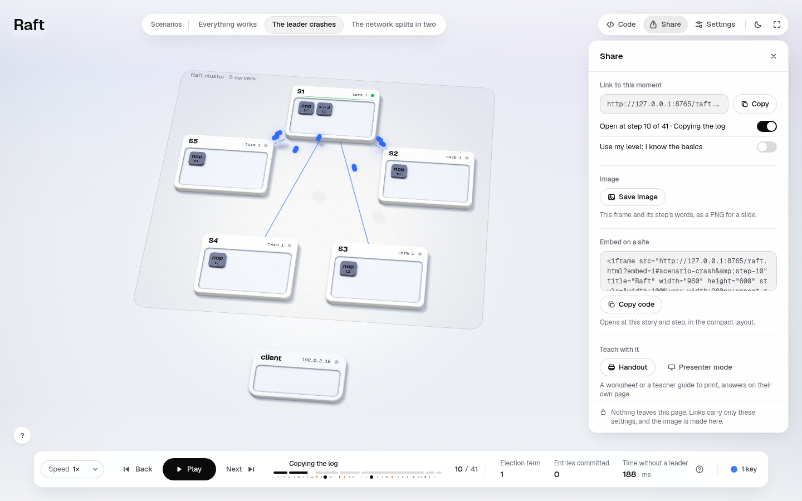 |

Raft's student worksheet, all 7 pages, printed with the same stylesheet (Raft has no end check, so that section is
left out): 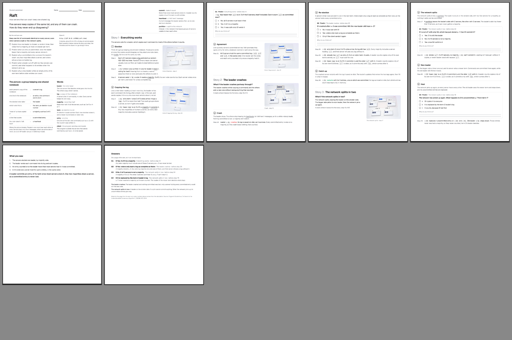

---

## Checks

- **Verify: 0 failing on all 8 examples** (`verify-after.txt`). MapReduce: `26 run(s), 0 failing, 0 error(s), 0
  warning(s)`. btree 17, consistent-hashing 17, event-loop 36, linked-list 15, quicksort 12, raft 24 and
  virtual-memory 12 runs, all 0 failing.
- **Unit tests: 312 tests, 301 pass, 11 fail** (`tests-after.txt`). The 11 failures are the same tests by name that
  fail at the base commit `9c8b16d` (baseline: 305 tests, 294 pass, 11 fail). I checked the two whose names the
  baseline file cut off by running them at the base commit. The 7 new tests (`engine/embed/deeplink.test.mjs`) pass.
- **Capture.** `shots/after/` was made with the baseline's command: `shoot.mjs mapreduce.html --scenario all --teach
  --out shots/after`. I used **main's `scripts/shoot.mjs`** (from `origin/main`, with its `scripts/lib/`), run
  against this branch's built page, because this branch's script times out on teaching cards on a slow machine.
  It made 232 PNGs with **no page errors**. Every teaching card was captured: asks and whys, the pick's wrong
  and right branches, and the end card, check and "You can now" for each story. Main's script captures more card
  states than the baseline run, which lost about 20 cards to timeouts, so 51 shots are new. The capture's audit
  reports one finding, the same as the baseline: `focus-outside` at steps 4, 19 and 22 on the 390×844 phone size
  (`shoot-log.txt`).
  `compare.mjs`: 183 pairs, 105 changed, 78 identical. On desktop the change is the toolbar's new **Share** button
  (compare `skew-light-1440x900-013-mid.png`). The 12 changed phone pairs I opened show no visible difference: the
  phone toolbar is unchanged, and the pixels differ only by render noise. I read the after contact sheets and
  several full shots (desktop mid, end card, a phone wrong-pick branch) and found no regressions.
- **Feature shots** (`shots/extra/`) were taken with a small headless-Chrome driver over this branch's built page,
  served on `http://127.0.0.1` so links read like a hosted page. One shot is from `file://`, for its note. Every image
  in this document was looked at.
- **Audit.** `audit.mjs` was not run separately. The capture reports its own audit findings (above).

## Merge notes

**Files this branch touches that main also changed since `9c8b16d`** (main includes the learner-journey,
active-learning and world-storytelling changes, merged as PR #4):

| File | Trial merge (`git merge-tree HEAD origin/main`) |
|---|---|
| `engine/hud/hud.mjs` | **conflicts, 4 hunks**: imports, the start card's elements, `renderIntro`, `closeIntro`'s doc comment |
| `engine/runtime.mjs` | **conflicts, 1 hunk**: when the start card opens |
| `examples/mapreduce/lesson.mjs` | **conflicts, 1 hunk**: the Shuffle chapter (main reworded `about` and `enter`; this branch added `teach`). Keep main's words and add the two `teach` lines. |
| `references/teaching.md` | **conflicts, 1 hunk**: the lesson table (main changed the End check row and added "What comes next"; this branch added the teacher-notes row). Keep both. |
| `engine/hud/hud.css`, `engine/scene/lesson.mjs`, `engine/scene/timeline.mjs`, `references/tooling.md` | merge cleanly |

**The start card is where the two branches meet.** Main added a "welcome back" card (`journey.mjs`: a returning
reader is offered to pick up where they stopped) and a promise line ("5 chapters · about 3 min · 4 questions · then
3 what-ifs"). This branch turns the same card into a link's arrival. They should coexist like this:

1. **Precedence: link, then welcome back, then first visit.** A link to a moment always wins. Main already says so:
   its `resumeOffer()` returns null under any deep link. But main detects the link from the HUD's own `parseHash`
   (`link.time`, `link.scenario`, `link.params`, `link.rest`). On this branch the runtime parses and resolves the
   link (`deeplink.mjs`) and hands the HUD `arrival = { step, notes }`. In the merge, `resumeOffer()` should return
   null when `arrival` is set. It may keep the hash test as a backstop: a link the runtime fully rejected still has a
   hash, and suppressing the welcome then is the safer choice, because the reader followed a link.
2. **One condition in the runtime.** Main opens the card on `!hud.introSeen || hud.resumable`; this branch on
   `arrival.step != null || arrival.notes.length || !hud.introSeen`. The merged condition is the union, `arrival.step
   != null || arrival.notes.length || !hud.introSeen || hud.resumable`. Call `hud.intro(true, arrival)` so the HUD
   picks the arrival layout first.
3. **One line of context on the card.** On a first visit the card shows main's promise. On a welcome back it shows
   where they stopped. On an arrival it shows "Opens at step N of M · Chapter" and the step's quote. These take the
   same slot (under the title), so only one shows.
4. **Two different "start over" buttons.** Main's `restart` goes to the *first story* from its top. This branch's
   `begin` (*From the start*) plays the *linked story* from its first step. Keep both modes in `closeIntro` and
   `onStart`: they mean different things.
5. **What gets saved.** After an arrival, the journey's `save()` records wherever the reader stops, as it does for
   any visit. A later visit without a link then offers "welcome back" to that place, which is right.
   `arrive()` rewrites the hash to `#s=…&t=…`. On a reload that is still a link, so the arrival card (not the
   welcome) shows again. That matches main's rule that a deep link skips the welcome.

**Other overlaps to watch.**
- `level.mjs`: main still exports `segmented`, which the handout uses.
- Main moved end-check questions to **per-story checks** (`s.check(…, { transfer })`, `lesson.checks[id]: { …,
  options, wrong }`). The handout reads `handoutData().checks` from the first story only. After the merge, collect
  the checks from each story (deduplicated by id) and show main's per-option `wrong` in the teacher guide.
- Main's `explain.mjs` and `chapter-card.mjs` changes don't touch this branch's files. The presenter view reads
  `viewState()`, which both sides edit in `hud.mjs` (main for the journey, this branch for `upcoming` and `teach`).
- The new modules (`share.mjs`, `still.mjs`, `handout.mjs`, `deeplink.mjs`) are new files and won't conflict.

**Does it generalise?** Yes. Everything except the teacher notes is in the engine and works for every example. Raft
is shown above. A lesson without `teach` gets a handout and presenter view without prompts, and the plan's Talk
column shows "–". Only MapReduce's lesson has teacher notes so far.

## Next (ranked)

1. **Resolve the start-card merge** as described above, and capture the three card states (arrival, welcome back,
   first visit) side by side.
2. **Collect per-story checks in the handout** after the merge, with main's per-option `wrong` in the teacher guide.
3. **Teacher notes for the other 7 lessons.** The engine is ready; the words need writing per chapter.
4. **Bigger handout pictures on demand**: a "large pictures" option that gives each chapter's picture the full
   column width, for classes that work from paper.
5. **A QR code** on the presenter view and the handout for the hosted link. It needs a small in-file encoder.
6. **A short clip export** (one chapter, MediaRecorder) for slides. The PNG covers most of it today.
