# 06 · Author pipeline: changes

## TL;DR

An author (Claude running `/explainer`, or a person editing `figure.mjs`) can now go from an idea to a verdict
without the owner explaining the tooling:

- **`doctor`** says up front whether this machine can make figures, how long screenshots will take, and how to fix
  what is missing, per OS.
- **`check`** is the golden path in one command (verify, build, shots with the audit; `--full` adds both themes,
  every teaching card and the audit over every step) and writes a **self-contained report** beside the figure.
- **`shoot --teach` finishes on a slow machine** and shoots the real end card: 80 cards on MapReduce
  (every question with its why, both sides of the in-world pick, the end check, "You can now…" and the end card)
  with no errors, where the baseline capture got 22 cards and 23 errors.
- **Errors teach**: verify names the file, the line and the likely fix, folds a cascade of 67–80 repeated errors
  into one line per mistake, and finds the line of a hung `build()`. Chrome no longer leaks processes or profiles when a run is
  killed. The reader fence fails closed. The 11 failing unit tests are fixed: all 11 were stale, none hid a bug.

Branch **`product/06-author-pipeline`**. Try it in a clone of the repo:

```sh
git fetch origin && git checkout product/06-author-pipeline
node scripts/doctor.mjs                                   # preflight, ~20 s (--quick: no Chrome, under 1 s)
node scripts/new.mjs ~/figs/wc --from mapreduce           # prints the next two commands
node scripts/check.mjs ~/figs/wc/figure.mjs               # quick tier; then open ~/figs/wc/check/report.html
node scripts/check.mjs ~/figs/wc/figure.mjs --full        # ship tier (75 min on a 4-core machine without a GPU)
```

The reports this produced are in [`report/`](report/report.md) (MapReduce, quick tier) and
[`report-full/`](report-full/report.md) (a fresh scaffold, `--full`). Each `report.html` opens offline.

---

## 1. `doctor`: a preflight before any figure is written

**The problem.** `SKILL.md` and the README state the requirements (Node 20.10+, Chrome), and nothing checked them.
Chrome discovery looked at seven fixed paths (no `PATH`, no snap, no Windows, no Playwright or Puppeteer caches), and
a wrong `CHROME_PATH` crashed `shoot` with an unhandled `spawn ENOENT` stack, after the figure was written. No script
said how slow screenshots would be, so an author could not tell a slow machine from a hung one.

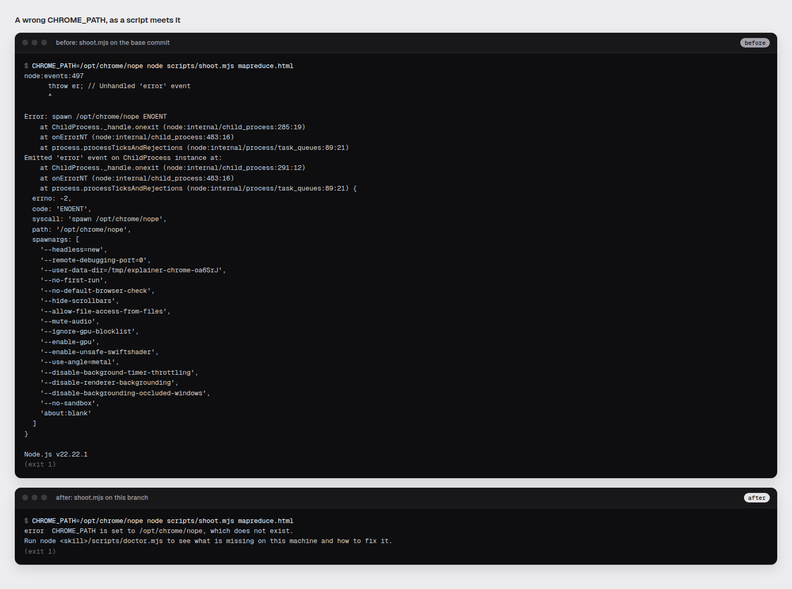

**What changed.** `scripts/doctor.mjs` (new) checks, in order: Node's version (written so an old Node can run it
and say so), the skill's own files and the fonts the build inlines, a writable temp folder with room for Chrome, the
`node` the review fence runs, ffmpeg (optional), the machine's cores and load, and Chrome: found (`findChrome()` in
`scripts/lib/cdp.mjs`: `CHROME_PATH`, the install places on macOS, Linux and Windows, `PATH`, then the Playwright and
Puppeteer caches) and its version; then, unless `--quick`, started headless the way the scripts start it, asked for
WebGPU and WebGL 2 (software rendering flagged), and timed on a settled 1440×900 render of MapReduce. Each problem
gets one `fix:` line for this OS. It exits 1 only when something required is missing. `SKILL.md` now runs it before
step 1 and stops when it fails; its speed line feeds the time estimate the skill gives the user.

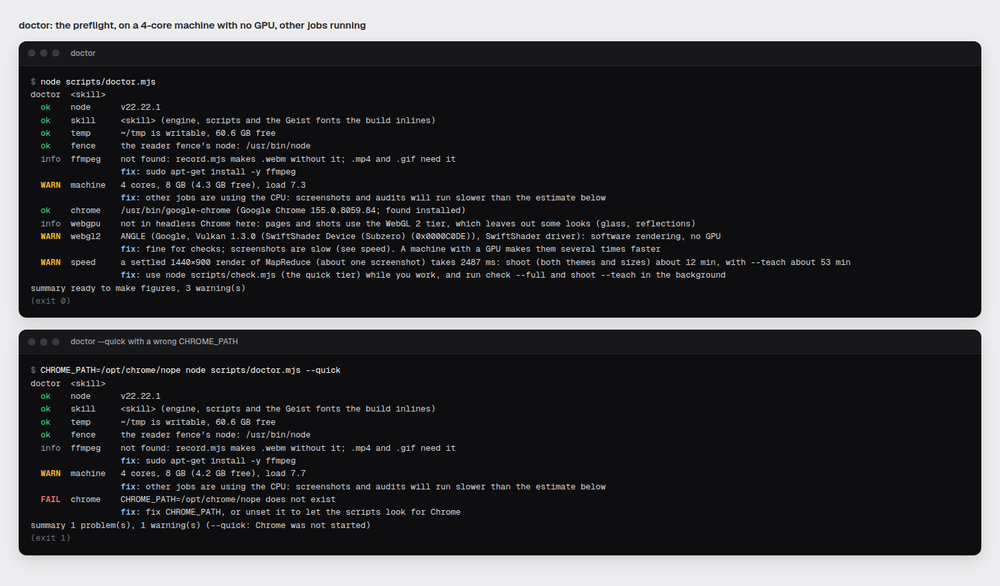

The speed line is calibrated on a measured capture. The first version predicted 239 minutes for
`shoot --scenario all --teach` on this machine; the capture took 57. The model is now fitted to that run
(`doctor.mjs:122-125`: 160 phase shots at 1.7 render-times each, 80 cards at 3 s plus 6.5 shot-times each), and on
the same machine it now says "shoot about 12 min, with --teach about 53 min" against the 12 and 44 measured (and 62 min for the same shots
inside `check --full`, below).

**Files:** `scripts/doctor.mjs` (new), `scripts/lib/cdp.mjs` (`findChrome`, errors that point at doctor).

**Verify by hand:** `node scripts/doctor.mjs`; `node scripts/doctor.mjs --quick` (under 1 s, 463 ms here);
`CHROME_PATH=/nope node scripts/doctor.mjs --quick` exits 1 and names the setting; `CHROME_PATH=/nope node
scripts/shoot.mjs any.html` prints two lines and points at doctor.

**Risks.** The estimate is fitted to one machine (4 cores, SwiftShader, other jobs running); a GPU machine was not
available to check the fast end, where the 0.4 s floor per shot governs. The `fence` line checks the `node` on the
PATH doctor runs with, which can differ from the PATH Claude Code gives hooks.

## 2. Chrome that cannot leak

**The problem.** `cdp.mjs`'s `close()` killed only Chrome's main process and removed the profile from an `unref`'d
300 ms timer, which never fires when the script exits right after; Ctrl-C, `SIGTERM` or a tool's timeout skipped
cleanup entirely. The leftovers are not small: a profile is about 150 MB once a page has drawn, and a killed run left
Chrome itself running (14 processes) with nobody to stop it. While this work was under way, leaked profiles filled
`/tmp` on the shared machine and every command started failing with `EDQUOT`.

The same six endings, on the base commit and on this branch (`TMPDIR` checked 4 s after each):

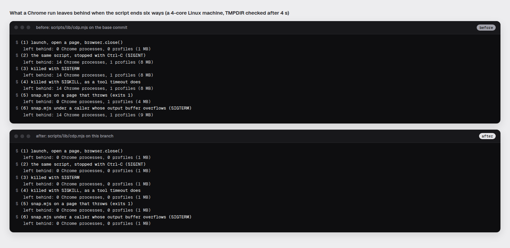

**What changed** (`scripts/lib/cdp.mjs`). Chrome runs in its own process group, so one signal reaches the whole tree.
`exit`, `SIGINT`, `SIGTERM` and `SIGHUP` kill it and remove the profile synchronously. A Chrome that fails to start
leaves nothing. On POSIX a tiny detached watchdog (`/bin/sh`, one `kill -0` a second) kills the group and removes the
profile once the owning process is gone by any means, `SIGKILL` included, or Chrome exits on its own.

**Files:** `scripts/lib/cdp.mjs`. **Verify by hand:** start any `shoot` and press Ctrl-C, or `kill -9` it; then
`ls $TMPDIR | grep explainer-chrome` and `pgrep -f explainer-chrome` are empty.

**Risks.** The watchdog is POSIX only; on Windows the exit handlers are the only cleanup. Because Chrome has its own
process group, a terminal's Ctrl-C reaches it only through the script's handler (which kills it). Chrome's own
`com.google.Chrome.*` scratch folders (a few hundred KB) are still left in `TMPDIR`; they are Chrome's, not the
profile.

## 3. `shoot --teach` finishes on a slow machine, and shoots the real end card

**The problem.** The baseline capture logged **23 teach errors** (questions "never revealed", the pick "never held
its wrong branch", "the run never reached its end card" ×7) and has **no why cards, no pick cards and no real end
card**. They were timeouts, not page bugs: the runtime advances the run by at most 1/20 s a frame
(`engine/runtime.mjs`), so where software rendering takes 1–2 s a frame the page plays 20–40× slower than real time,
and shoot's fixed 15–30 s waits ran out first. And the "end card" was never the end card, on any machine: shoot
clicked one end-check option and stopped, so `…-end-card.png` showed the first end-check question, answered.

Before (`crash-dark-1440x900-026-end-card.png`, baseline):

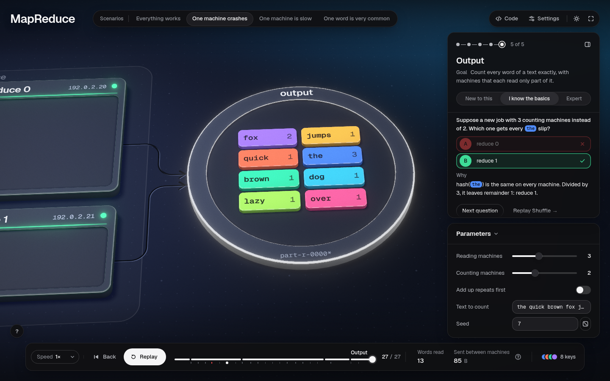

**What changed** (`scripts/shoot.mjs`). The live pass measures the page's frame time first (`framePace`) and, when
it is slower than 20 fps, says so on stderr and paces itself by it: the run travels to the next card at `slow`×
(capped at 16), every wait stretches by the same factor, a question's reveal is reached by seeking to the moment the
HUD reveals it (70% into the step), and a card is shot once the page stops drawing rather than after a fixed 1.4 s.
Every `evaluate` has a timeout and each story's live play is wrapped, so a page that stops answering ends that story
with an error instead of holding a Chrome forever. After the last step it answers the end check (the first question
with a wrong option, shot with its feedback as `-check.png`), goes on to "You can now…" (`-check-done.png`), and
closes onto the recap and takeaway (`-end-card.png`). One progress line per group goes to stderr. At 20 fps or better
`slow` is 1 and the speeds and waits are the old ones. The page is untouched: a page built from this branch is
byte-identical to one built from the base commit.

| `shoot --scenario all --teach`, same machine | baseline (base commit) | this branch |
|---|---|---|
| wall time | 27 min 50 s | 57 min 23 s |
| page errors | 23, all from the teaching pass | none (exit 0) |
| teaching cards | 22: 10 asks, 9 "end cards" that are the end check, 3 end captions | 80: 12 asks, 12 whys, 4 wrong picks, 4 right picks, 8 end checks, 16 "You can now…", 16 end cards, 8 end captions |
| frame time measured by the pass | not measured | 1912 ms at 1440×900, 950 ms at 390×844 |

The after capture in `shots/after/` was made with this branch's `shoot.mjs` as of "Settle teaching cards on the page
going idle" (370ba60); the commits after it change only its progress wording and Chrome's cleanup, not what it shoots.
`check --full` (section 4) later repeated the same capture independently: 240 shots, 80 cards, no page errors, in 62
minutes. Against the baseline, 159 of the 183 paired shots are pixel-identical; of the 24 that differ, 23 are teaching
cards (the ask cards are the same card with the camera and glow at rest a moment later; the end cards are now the
real end card) and one is a frozen phone shot of the scale field, where software rendering is not bit-stable
([`COMPARE.md`](COMPARE.md)).

It takes twice as long because it now plays every card the baseline timed out on. A one-story comparison with the
pacing `main` has since adopted is in the Merge notes.

After: the end of the crash story, "You can now…", then the real end card.

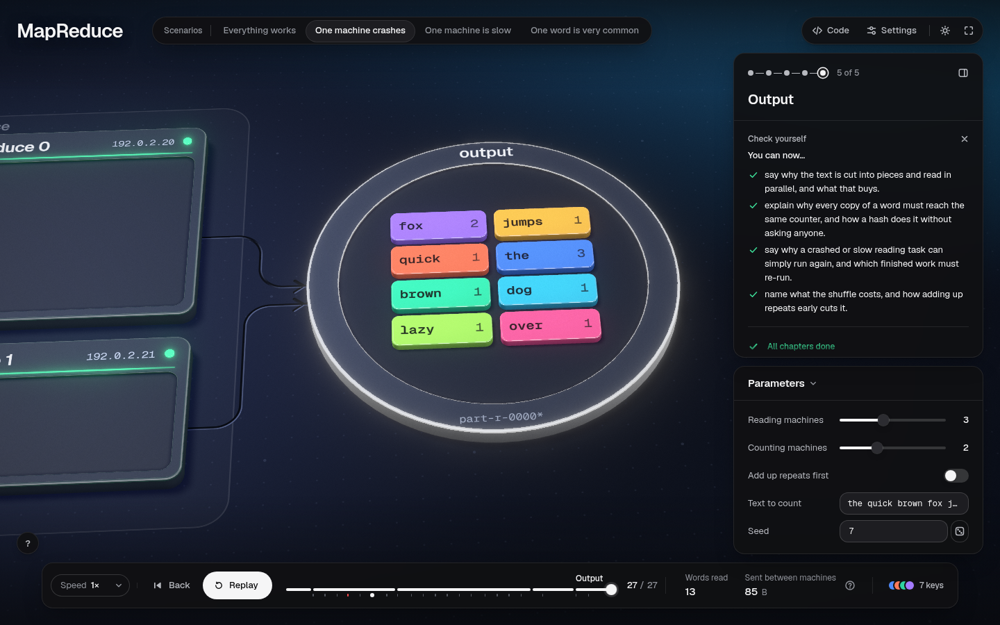


A question revealed with its why, and the pick's wrong detour and right answer (none of these exist in the
baseline):

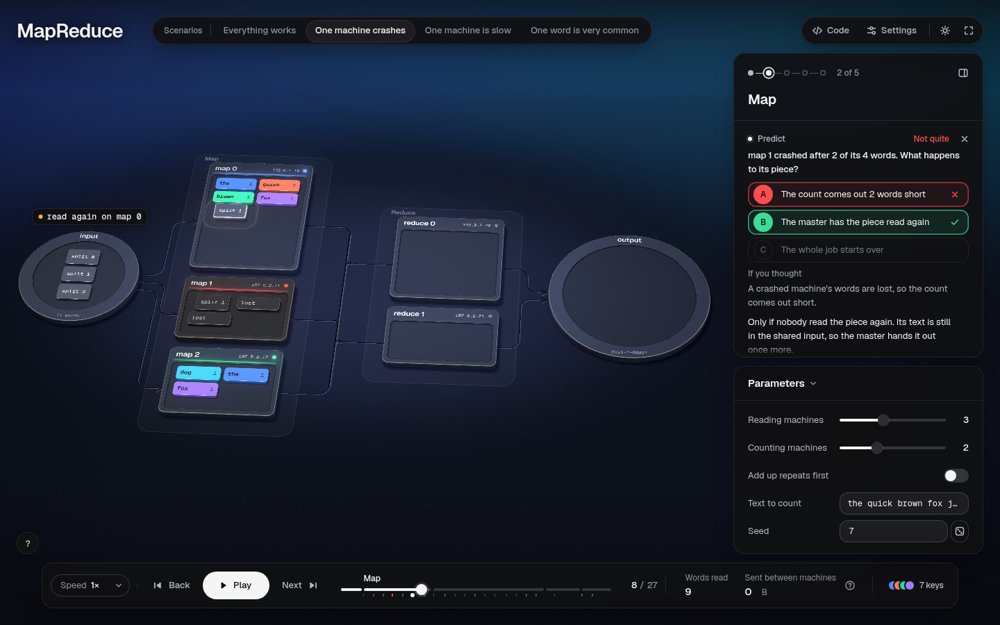
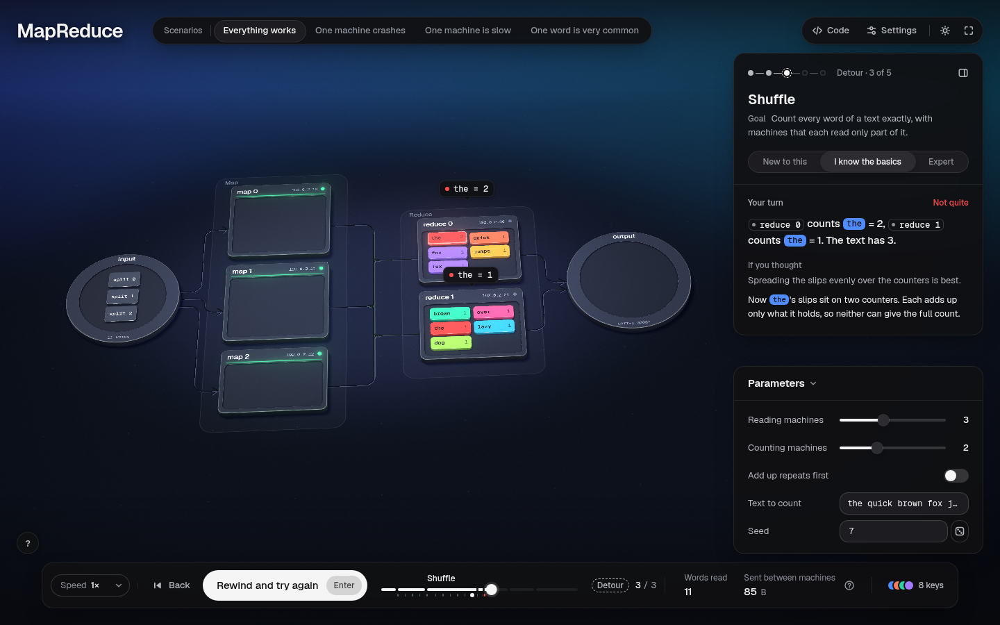
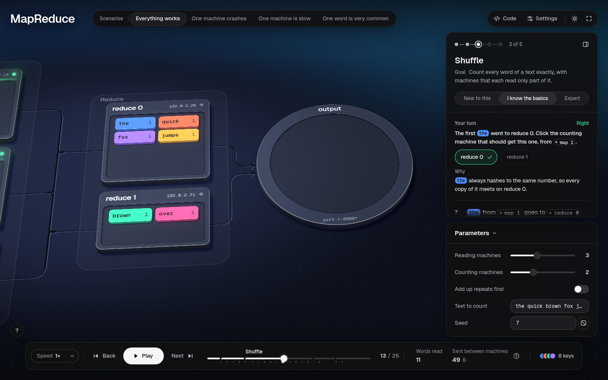

`-check.png` exists only where the reader meets an unanswered end check. The HUD remembers end-check answers for the
page, so after "Everything works" is checked the crash and straggler stories open straight onto "You can now…". That
is the page's real behaviour, so the capture shows it rather than resetting it.

**Files:** `scripts/shoot.mjs`. **Verify by hand:** `node scripts/shoot.mjs <page> --scenario crash --themes dark
--sizes desktop --at none --teach`, and look for the `teach … plays N× slower` line on a slow machine, and for
`-why`, `-check-done` and `-end-card` in the output.

**Risks.** `framePace` samples 1.2 s right after the page opens, so warm-up frames can overstate the slowdown; that
only makes waits longer and travel faster (capped at 16×), never skips a card. The settle waits for the page's render
counter to stop, which relies on the runtime drawing only while something moves.

## 4. `check`: the golden path in one command, and a report beside the figure

**The problem.** The README's "Making your own figure" listed five commands; `SKILL.md` steps 8–10 added `audit`,
`lesson` and `--teach`, and its checklist two sizes and both themes. Nothing said "this page passes", nothing printed
progress during a run that can take an hour, and no single place told the owner whether a page was ready to put in
front of a class.

**What changed.** `scripts/check.mjs` (new) runs verify, the stories' pacing (from the compiled runs), build, and
shoot with the runtime's audit on every shot; `--full` adds both themes, every teaching card and `audit.mjs` over
every step. One progress line per stage goes to stderr; the verdict and the first thing to fix go to stdout; it exits
1 on any failure. It writes `check/report.html` (one self-contained page: fonts and JPEG thumbnails inlined, light
and dark, no network, in the HUD's own tokens), `report.md`, `check.json` and the shots with a contact sheet.
`scripts/lib/report.mjs` (new) renders both formats from one scorecard: Correct, Teaches (with the reading grade
against the level's ceiling), Looks right, Pacing, One file (against the 2.5 MB budget) and Reviewed (from
`review/round-N/scores.json` when the teacher pipeline has run); then each story's chapters to one time scale, every
finding once, grouped by source, and every shot. The verdicts are "Needs work", "Passes the quick check", "Ready for
review" (`--full` passed, no blind review yet) and "Ready to ship". `--page <file>` (added while checking this work)
builds the page somewhere else, so a figure in a folder you cannot write, such as a shipped example, can be checked
without touching it.

The quick tier on MapReduce, as the terminal shows it:

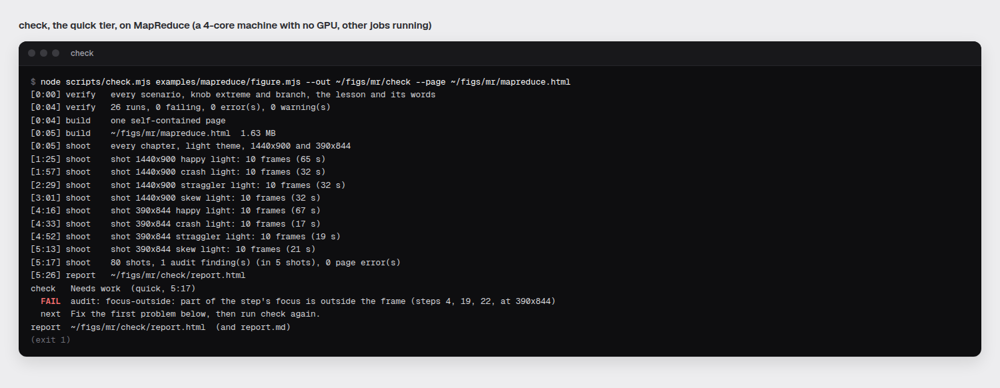

The report, rendered in Chrome (light, dark, phone). Its verdict is honest: **Needs work**, because the audit finds
the `focus-outside` problem at steps 4, 19 and 22 on the 390×844 phone that the baseline already recorded. This work
does not change the page, so it reports that rather than fixing it.

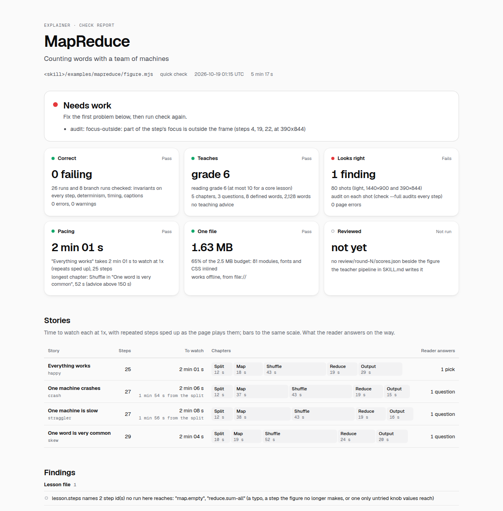
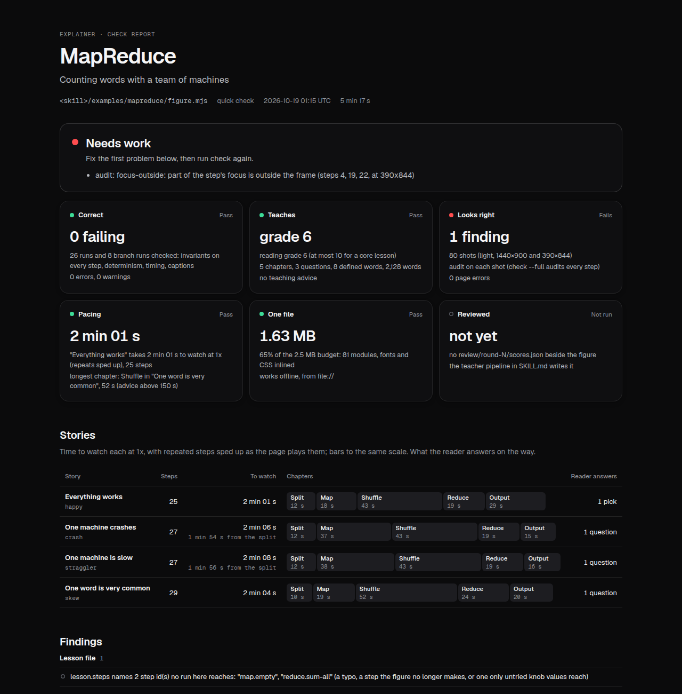
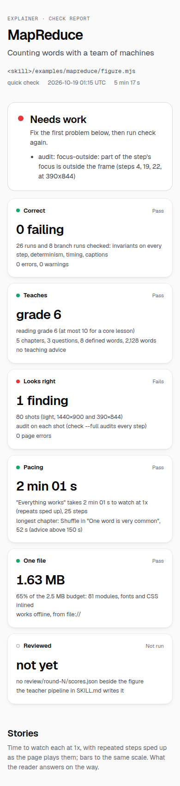

The ship tier, `check --full`, on a fresh scaffold (`new.mjs ~/figs/wc --from mapreduce`, then the `check` command it
prints, plus `--full`): 240 shots in both themes including all 80 teaching cards, the audit over 432 frames, no page
errors. The audit over every step finds what the per-shot audit cannot: the same `focus-outside` problem at steps 6,
7, 9, 12 and 15 at 1440×900. The page is byte-identical to the base commit's and `audit.mjs` is unchanged, so this
is an existing problem in the page, now reported in one place.

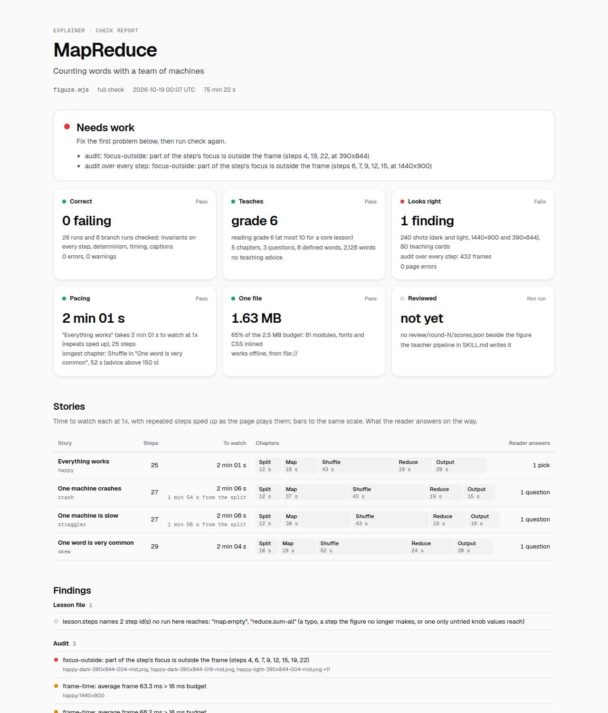

The whole `--full` report in the dark theme: [`report-full-dark.png`](shots/extra/report-full-dark.png). The quick
report's top and shot grid: [`report-light.png`](shots/extra/report-light.png). In the published copies under
[`report/`](report/report.html) and [`report-full/`](report-full/report.html), a thumbnail's link to its full-size PNG
points at the same file name in `shots/after/`, to avoid publishing every shot three times; the thumbnails themselves
are from each check's own run.

**Measured** on a 4-core machine with no GPU while other heavy jobs ran: the quick tier took 5 min 17 s (verify 4 s, build under 1 s, 80 shots 5 min 12 s); `--full`
took 75 min 22 s (240 shots and teaching cards in 62 min, then the audit over every step in 13 min).

**Files:** `scripts/check.mjs`, `scripts/lib/report.mjs` (both new). **Verify by hand:** the commands under TL;DR,
then open `~/figs/wc/check/report.html`; `--no-shots` for a check without Chrome (about 15 s).

**Risks.** The verdicts are new vocabulary for `SKILL.md`'s gate. Lesson and teaching *warnings* do not fail the
verdict (verify's errors do); the teacher gate still refuses them. `check` builds the page beside the figure, as
`build.mjs` does, unless `--page` says otherwise.

## 5. Errors that teach

**The problem.** A copy of MapReduce broken ten common ways, run through the base commit's verify and this branch's.
The base commit missed the file or the line in most cases, never connected a typo to what it meant, buried causes
under cascades of 67–105 errors, and its summary said `0 failing` for a param error or a hang while exiting 1.

| Break | Before | After |
|---|---|---|
| step id typo in `lesson.mjs` (`map.raed`) | a warning that `map.read` has no words, and a separate note listing `map.raed` among unreached ids | `lesson.mjs:144: lesson.steps["map.raed"] names no step the figure makes: did you mean "map.read"?` |
| a var the figure does not pass (`{mapp}`) | 67 errors, one per step, per run, per branch (61 lines) | one: `map.read at steps 3, 4, 5: plain uses {mapp}, which the figure does not pass; did you mean {map}? (lesson.mjs:156)`; the other 18 runs say `(+1 alike)` |
| `Math.random()` in build | `line 176: …` | `figure.mjs:176: … use s.rng …: s.rng.float(), s.rng.int(lo, hi), s.rng.pick(list)` |
| an endless loop in build | `no result within 8 s: an infinite loop in build() (or in the compiler)?` | `still running build() at figure.mjs:175, an endless loop?`, the line with a caret, and what to look for |
| default 9 > max 6; `"2"` for an int | the right message, no line, `0 failing` | `(figure.mjs:52)`, and `1 failing` |
| syntax error in `lesson.mjs` | `the figure failed to import: SyntaxError: lesson.mjs failed to import: Unexpected token '{'` | `lesson.mjs:145: SyntaxError: …`, the line and a caret |
| syntax error in `figure.mjs` | `SyntaxError: Unexpected token '*'` | `figure.mjs:173: SyntaxError: …`, the line and a caret |
| a caption chip naming a missing entity (`mm0`) | 80 errors across runs and branches | one: `map.read at steps 3, 4, 5: its caption has a {ref:…} chip for "mm0", "mm1", "mm2", which do not exist; did you mean "m0", "m1", "m2"? (figure.mjs:302, or a var it passes)` |
| a misspelt name in build (`wrods`) | the error, verify's own stack, then cascades (no caption, no steps, two invariants threw, lesson and teaching warnings): 105 errors, 25 warnings | `build() threw ReferenceError: wrods is not defined (did you mean words?) at figure.mjs:174`, the line and a caret; what follows from it is left out until `build()` runs |

The five a new author meets most, before and after:

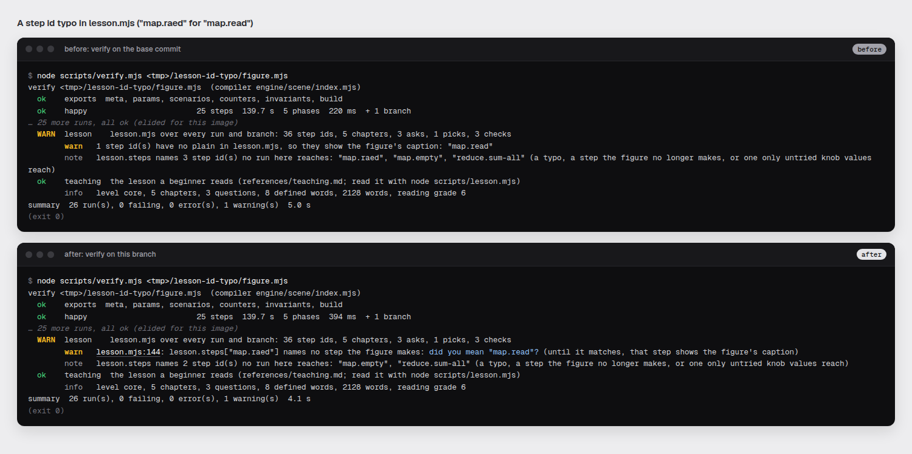
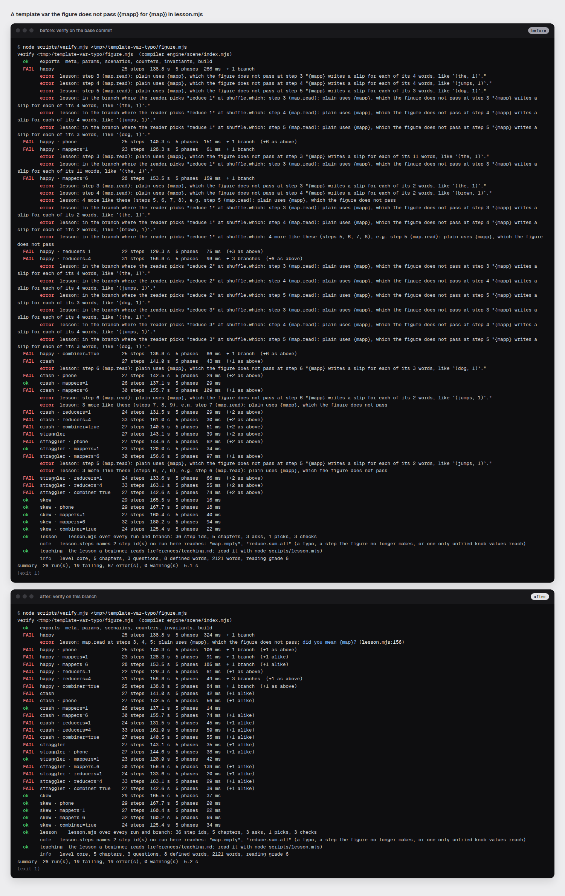
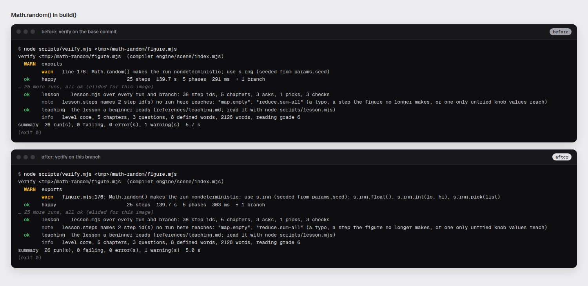
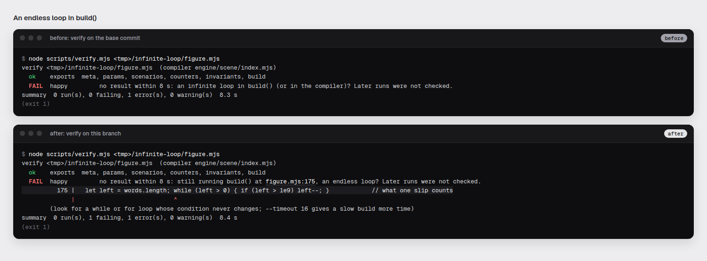
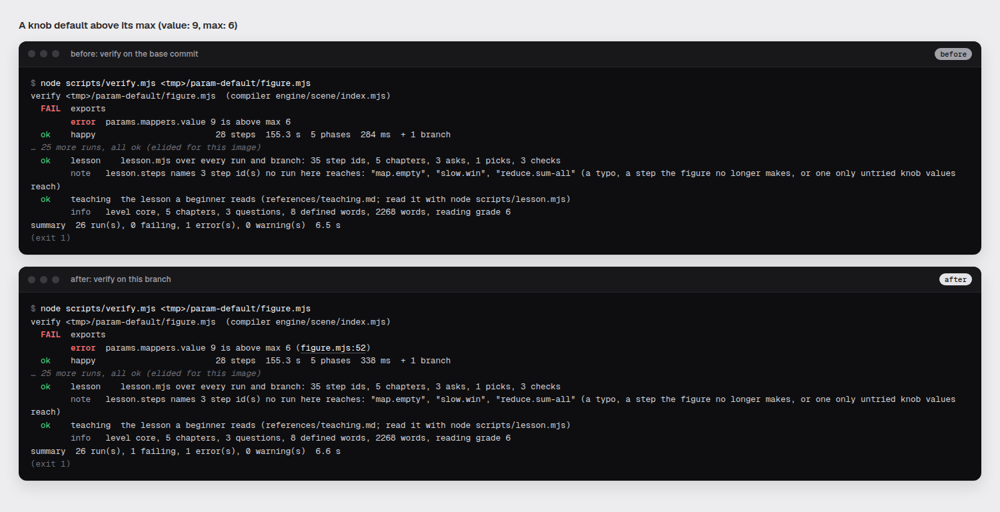

The other five: [`errors-param-type`](shots/extra/errors-param-type.png),
[`errors-lesson-syntax`](shots/extra/errors-lesson-syntax.png),
[`errors-figure-syntax`](shots/extra/errors-figure-syntax.png), [`errors-bad-ref`](shots/extra/errors-bad-ref.png),
[`errors-reference-error`](shots/extra/errors-reference-error.png). Every cited line was checked against the broken
copy: `lesson.mjs:144` is `"map.raed": {`, `lesson.mjs:156` is the `plain` that uses `{mapp}`, `figure.mjs:52` is
the `mappers` param, `figure.mjs:175` is the loop.

**What changed.** `scripts/lib/where.mjs` (new: `keyLine`, `excerpt` with a caret, `frameIn` a stack,
`importFailure`, `editDistance` with swaps, `nearest`) and, in `scripts/verify.mjs`: param lines, determinism smells
with the file, import failures with the line, lesson problems folded per step id with their `lesson.mjs` line and the
var probably meant, typo'd lesson ids connected to the id the run makes, unknown refs folded per step id with the id
probably meant and the figure line, a thrown `build()` reported once with its line and what it short-circuits, a hang
located through the inspector (`NodeWorker` domain, no `--inspect` needed), branch findings that repeat the main run
dropped, findings that differ only in their numbers counted `(+N alike)`, and `failing` that counts the exports, the
teaching lint and a hang. On the eight shipped examples, which are clean, verify's output is the same as before, line
for line (timings aside).

A lesson-id typo stays a warning, not an error: the page still works (that step shows the figure's caption), and the
teacher gate already refuses lesson warnings. What changed is that the warning now says what to type.

**Files:** `scripts/verify.mjs`, `scripts/lib/where.mjs` (new), `scripts/lib/where.test.mjs` (new),
`scripts/verify.test.mjs` (one expectation updated to the more precise hang message, one added for the file name).

**Verify by hand:** copy `examples/mapreduce` with `new.mjs --from`, make any break above, run verify.

**Risks.** "Did you mean" is an edit distance of about one in four letters; it stays quiet when nothing is close.
`(+N alike)` collapses findings whose messages differ only in numbers (and "step"/"steps"), so a second, different
mistake whose message differs only by a number would be counted rather than shown; the first is always shown.

## 6. The reader fence fails closed

**The problem.** `hooks/hooks.json` runs `node …/reader-fence.mjs` for the five pipeline agents (the novice and
expert readers, the scorer, the teacher and the curriculum designer). If `node` is not on the hook's PATH (exit 127)
or the script throws (exit 1), Claude Code treats the hook's failure as non-blocking: the tool call goes through, and
the blind readers are not blind.

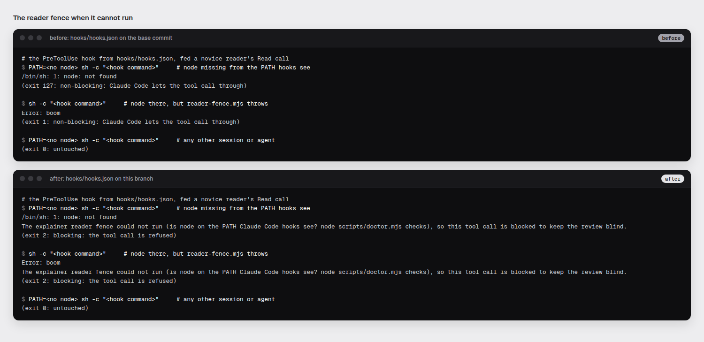

**What changed.** For those five agents only, a failure to run the fence exits 2 (blocking) with a message that says
why and points at `doctor`, whose `fence` line checks for `node`. A fence that runs and denies still answers with its
own JSON (exit 0), so the new branch never masks its reason. Every other session is untouched.

**Files:** `hooks/hooks.json`. **Verify by hand:** pipe a reader's PreToolUse JSON into the hook command with `PATH`
set to a folder without `node`; it exits 2. **Risk:** with no `node`, the teacher and curriculum agents are blocked
too; that is the safe failure, and doctor catches it first.

## 7. `new --from` writes a README that works, and points at `check`

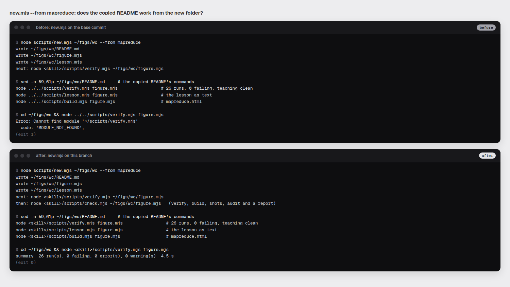

`scripts/new.mjs` rewrites a copied README's `node ../../scripts/…` commands the way it already relocated imports
(relative inside the skill, absolute outside), adds `check` to the template README, and prints `check` as the step
after verify. Tested in `scripts/lib/where.test.mjs`.

## 8. The 11 failing unit tests, and the end-to-end check

All 11 were stale tests left behind by deliberate engine changes. Each was checked against the code it tests before
it was changed, and none hides a product bug:

| Test (file) | Why it failed on the base commit | Stale or bug | Evidence |
|---|---|---|---|
| a docked panel's close-up shows the whole world when it fits (`director.test`) | `Cannot read properties of undefined (reading 'minZ')`: the shot planner reads `tl.world`, each step's `t0`/`dur` and focus; the test's fake timeline had none | stale | `tl.world` is in the timeline contract (`CONTRACTS.md`, "tl.world: bounds of everything the run shows"); every compiled example has it and `_.focusByStep` |
| the last step frames its focus close and large (`director.test`) | same crash, same cause | stale | as above |
| housing title (`skin.test`) | expected weight 600 and `SIZE.housing.title`; the skin now uses `WORLD_TYPE.title` | stale | DESIGN.md: "World type is `WORLD_TYPE` (tokens) … No tracked uppercase anywhere in the world; zone and lane names are sentence case" |
| lane label (`skin.test`) | expected an engraved upper-case name; lane names are printed in sentence case | stale | the same DESIGN.md rule; `worldCase(…, WORLD_TYPE.lane)` |
| zone/bracket label (`skin.test`) | expected `"vpn"` verbatim | stale | `worldCase(…, WORLD_TYPE.bracket)` |
| lanes' real format (`skin.test`) | expected `"leader"` verbatim | stale | `worldCase(…, WORLD_TYPE.lane)` |
| theme variables come from tokens (`hud.test`) | expected `--ix-ink` from `PALETTE`, `--ix-glass`, `--ix-radius: 14px` | stale | the HUD chrome takes the monochrome `UI` tokens (DESIGN.md 9.1); `--ix-glass` and `--ix-radius` no longer exist; the test now checks `--ix-line`, `--ix-shadow` and each `--ix-r-*` |
| MapReduce motion is continuous, two param sets (`fixtures.test`) | "null opacity pops at t=122.583" ×N | stale | the id-less poses are the scale field and its five printed lines (`engine/scene/scale.mjs`); the test keyed them all under `undefined`, so it compared the field (opacity 1) with a text line fading in (0.06). Sampled: the lines fade in over 1 s; no real pop. The test now skips id-less poses, which have no identity to follow |
| steps … ask, line (`timeline.test`) | `ask` gained `id: null` | stale | `builder.mjs:385`: an ask carries its lesson key (null when none) |
| quicksort narration (`quicksort.test`) | the split step's caption | stale | the caption was rewritten in "Teach quicksort in layers" |

Suite: 305 tests with 11 failing on the base commit; **310 with 0 failing** on this branch (the five new tests are
in `scripts/lib/where.test.mjs`). The same test commit applied to current `main` takes it from 298/309 to 309/309.

**The end-to-end check was broken on main too, for the same reason.** `scripts/test/e2e.mjs` (snap, shoot, audit,
record and the dev server on a fake figure) failed 5 of 11 checks on the base commit: the fake scene's timeline had
no `world`, so the director threw on load (the same `minZ` crash as the two director tests). One line in
`scripts/test/fake-scene.mjs` gives it one; e2e now passes 11/11. This matters here because it is what proves the
Chrome lifecycle change did not break snap, shoot, audit or record.

## 9. `SKILL.md`, `references/tooling.md` and the README

- **SKILL.md:** a preflight before step 1 (`doctor`; stop and tell the user when it fails), a "Long jobs" rule (the
  Bash tool stops at 2 minutes by default and 10 at most, so anything that shoots starts in the background), step 8
  on messages that point at the line, step 9 is `check` (with the pieces listed under it), and the checklist starts
  with `check --full`.
- **references/tooling.md:** sections for `doctor` and `check`, verify's new messages and failing count, shoot's
  progress, slow-machine pacing and end check, `new`'s README rewrite, the new libraries, and measured times.
- **README:** "Check your machine" under Install, and `check` / `check --full` as the last two steps of "Making your
  own figure", with what the report holds.

---

## Checks

All run on the branch tip, on a 4-core, 8 GB Linux machine with no GPU (SwiftShader) shared with other heavy jobs.

| Check | Result |
|---|---|
| `verify examples/mapreduce/figure.mjs` | **0 failing**, 0 errors, 0 warnings, 26 runs ([`verify-after.txt`](verify-after.txt)) |
| `verify` on all 8 examples | **0 failing** in every one; the output is line for line what the base commit prints (timings aside) |
| unit tests (`node --test` over engine, sim, scripts) | **310 pass, 0 fail** (base commit: 294 of 305, 11 failing) ([`tests-after.txt`](tests-after.txt)) |
| `scripts/test/e2e.mjs` (snap, shoot, audit, record, serve, new) | **11/11** (base commit: 6/11, see section 8) |
| `shoot --scenario all --teach` (the standard capture) | 240 PNGs, no page errors, 57 min 23 s; audit: `focus-outside` at steps 4, 19, 22 on the 390×844 phone, the same as the baseline |
| `check` (quick) on `examples/mapreduce` | **Needs work**, exit 1, for that one pre-existing audit finding; everything else passes ([`report/`](report/report.md)) |
| `check --full` on a fresh `new.mjs --from mapreduce` scaffold | **Needs work**, exit 1: the phone finding above plus `focus-outside` at steps 6, 7, 9, 12, 15 at 1440×900 from the audit over every step; 80 teaching cards, no page errors ([`report-full/`](report-full/report.md)) |
| `doctor` / `doctor --quick` | exit 0 with 3 warnings (load, SwiftShader, speed) in 20.8 s / exit 0 in 463 ms; with a wrong `CHROME_PATH`, exit 1 naming it |
| the scaffold's copied README | its `verify` command runs from the new folder: 0 failing (base commit: `Cannot find module`) |
| Chrome leaks, six endings | base commit: Chrome left running (14 processes) in four, a profile left in five; this branch: nothing in any |
| the fence, simulated | base commit: exit 127 or 1 (the call goes through); this branch: exit 2 (blocked); other sessions: exit 0 on both |

Both check verdicts are "Needs work" on purpose: the page has real framing problems, and this work changes no page.
`review-packet.mjs`, which runs `shoot --teach` underneath, was not run end to end.

## Merge notes

**Files this branch changes that `main` has also changed since the base commit:** `SKILL.md`,
`references/tooling.md`, `scripts/shoot.mjs`, `scripts/verify.mjs`. A trial merge of this branch into current `main`
conflicts in **`scripts/shoot.mjs`** and **`references/tooling.md`** only. `SKILL.md` and `scripts/verify.mjs` merge
cleanly; with the merged `verify.mjs`, all 8 of `main`'s examples verify with 0 failing and the verify and where tests
pass. `main`'s changes to `scripts/lib/lesson.mjs` and `scripts/review-packet.mjs` do not touch anything here
(`review-packet` picks shots by their `ask`, `why`, `wrong`, `right`, `end` and `end-card` tags, which both branches
keep). The test commit ("Bring eleven stale tests up to date…") applies cleanly to `main` and takes it to 309/309.

**`shoot.mjs`: this branch against `main`.** Both fix the same failure (the runtime's 1/20 s frame clamp makes a slow
page play far slower than real time, so fixed waits run out) and both now walk the end check. They differ in how:

| | this branch | `main` |
|---|---|---|
| speed between cards | measured: the page's frame time / 50 ms, capped at 16×; 1× at 20 fps or better | 16× always |
| waits | each × that same factor (1 on a fast page) | each × 4 always |
| a hung page | every `evaluate` has a timeout and each story is wrapped: that story ends with an error, the run goes on | no timeout: a page that stops answering holds the run and its Chrome |
| shooting at 1× | `setSpeed(1)` before the settle | `snap()`: `setSpeed(1)`, waits until the dock reads "1×", shoots, back to 16× |
| settle | 1.4 s, and on a slow page until the render counter stops (at most 8 frames) | 1.4 s |
| a question's reveal | on a slow page, seek to 70% into the step | play at 16× until revealed |
| end check | the first question answered **wrong on purpose** (the Expert level's transfer question when that is the level) and shot with its feedback (`-check.png`), then every question through to "You can now…" (`-check-done.png`) | option A of the first question answered inside the end wait, whatever it is, and shot (`-end-check.png`), then the rest and "You can now…" (`-end-cannow.png`) |
| progress | one stderr line per group with its time; `check.mjs` relies on it | none |

Measured on the same page, the same story (`--scenario happy --themes dark --sizes desktop --at none --teach`), one
after the other under the same load: **this branch 695 s, `main` 453 s**, both 5 cards and no errors, and the cards
are visibly the same (both sides of the pick, the end check, "You can now…", the end card; the end check happened to
have a wrong option A, so `main` shot feedback too). The extra time here is the settle-until-idle and the longer
waits. `main`'s script also left its 158 MB Chrome profile behind after that clean exit 0, because `main` still has
the old `cdp.mjs`.

**Recommendation: keep `main`'s pacing and add four things from this branch.** `main`'s fixed 16× with 4× waits is
simpler and was a third faster here, and its `snap()` guarantees the dock reads 1× in every card; the measured pacing
and settle-until-idle bought no visible difference on this machine. Keep from this branch: (1) the `evaluate` timeout
and per-story `try/catch`, so a hung page cannot hold a run or a Chrome forever; (2) the progress lines, which `check`
and `SKILL.md`'s long-jobs rule need; (3) the end check answered wrong on purpose, so the first end-check card always
shows the misconception feedback a reviewer needs to read, rather than only when option A happens to be wrong; (4)
`cdp.mjs`'s cleanup, which is independent of `shoot.mjs` and fixes the leak above. Use `main`'s file names
(`-end-check`, `-end-cannow`), which `main`'s `tooling.md` already documents, and keep this branch's other
`tooling.md` additions (doctor, check, verify's messages, measured times). One thing to watch: `main`'s 16× was not
tested on a machine with a GPU here, where a frame is 16 ms and 16× moves the run 0.27 s a frame; the holds stop it at
each card either way, but it is worth one `shoot --teach` on a fast machine after merging.

**Shared files other changes are likely to touch:** `scripts/verify.mjs` (the report and `lessonCoverage`) and
`scripts/lib/cdp.mjs`. Nothing here touches `engine/`, `engine/hud`, `engine/runtime.mjs` or `scripts/lib/lesson.mjs`.

**Does it generalise?** Yes; nothing here is MapReduce-specific. `doctor`, `check`, the report, verify's messages,
the Chrome lifecycle, the fence and `new` work on any figure; verify gives the same output as before on all 8
examples. MapReduce is used as the yardstick for doctor's speed line, and only for timing.

## Next

1. **Run `shoot --teach` on a machine with a GPU** (both this branch and `main`'s pacing) and refit doctor's fast end;
   every timing here comes from one software-rendered machine.
2. **Fix MapReduce's framing** (`focus-outside` at 1440×900 steps 6, 7, 9, 12, 15 and at 390×844 steps 4, 19, 22) so
   the flagship passes its own `check --full`; that is a scene and camera change, outside this work.
3. **Run `review-packet` end to end** on the merged `shoot.mjs`, since the blind review depends on it shooting every
   card.
4. **Make `check` incremental**: reuse shots whose page bytes and size did not change, so a caption edit re-checks in
   seconds instead of minutes.
5. **Show the command that made the report**, `--out` and `--page` included, in its "Re-run" line, and print the
   figure's path relative to where `check` ran rather than to the report folder.
6. **Windows**: the Chrome watchdog is POSIX only; a `taskkill /T` equivalent would close the last leak there.
