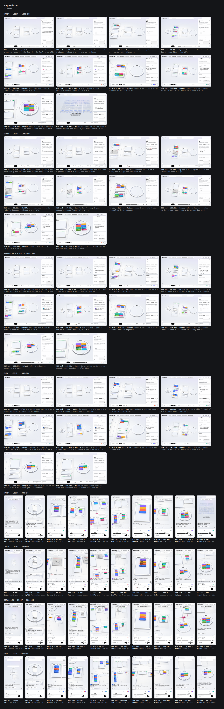

# MapReduce: check report

**Needs work.** Fix the first problem below, then run check again.

- audit: focus-outside: part of the step's focus is outside the frame (steps 4, 19, 22, at 390x844)

`<skill>/examples/mapreduce/figure.mjs` · quick check · 2026-10-19 01:15 UTC · 5 min 17 s

| | | |
|---|---|---|
| ✓ **Correct** | 0 failing | 26 runs and 8 branch runs checked: invariants on every step, determinism, timing, captions; 0 errors, 0 warnings |
| ✓ **Teaches** | grade 6 | reading grade 6 (at most 10 for a core lesson); 5 chapters, 3 questions, 8 defined words, 2,128 words; no teaching advice |
| ✗ **Looks right** | 1 finding | 80 shots (light, 1440×900 and 390×844); audit on each shot (check --full audits every step); 0 page errors |
| ✓ **Pacing** | 2 min 01 s | "Everything works" takes 2 min 01 s to watch at 1x (repeats sped up), 25 steps; longest chapter: Shuffle in "One word is very common", 52 s (advice above 150 s) |
| ✓ **One file** | 1.63 MB | 65% of the 2.5 MB budget: 81 modules, fonts and CSS inlined; works offline, from file:// |
| – **Reviewed** | not yet | no review/round-N/scores.json beside the figure; the teacher pipeline in SKILL.md writes it |

## Stories

| Story | Steps | To watch | Chapters (time to watch each) | Questions | Picks |
|---|---|---|---|---|---|
| Everything works | 25 | 2 min 01 s | Split 12 s · Map 18 s · Shuffle 43 s · Reduce 19 s · Output 29 s | 0 | 1 |
| One machine crashes | 27 | 2 min 06 s (1 min 54 s from where it splits off) | Split 12 s · Map 37 s · Shuffle 43 s · Reduce 19 s · Output 15 s | 1 | 0 |
| One machine is slow | 27 | 2 min 08 s (1 min 56 s from where it splits off) | Split 12 s · Map 38 s · Shuffle 43 s · Reduce 19 s · Output 16 s | 1 | 0 |
| One word is very common | 29 | 2 min 04 s | Split 10 s · Map 19 s · Shuffle 52 s · Reduce 24 s · Output 20 s | 1 | 0 |

## Contact sheet

## Lesson file

- · lesson.steps names 2 step id(s) no run here reaches: "map.empty", "reduce.sum-all" (a typo, a step the figure no longer makes, or one only untried knob values reach)

## Audit

- ✗ focus-outside: part of the step's focus is outside the frame (steps 4, 19, 22) _(happy-light-390x844-004-mid.png, happy-light-390x844-019-mid.png, crash-light-390x844-022-mid.png +2)_

## Steps

- verify: 4 s
- stories: 0 s
- build: 0 s
- shoot: 5 min 12 s

Re-run: `node scripts/check.mjs examples/mapreduce/figure.mjs`
