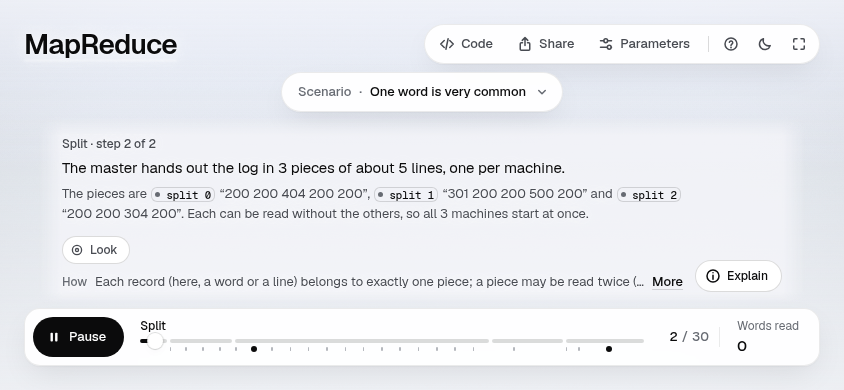

# Visual defects: every frame read

Built from `site/build` (7a635a2: #25 + #26 + #27 on #20's original tile look). Shot with `shoot.mjs --scenario all`,
both themes. Read as 2×2 half-size sheets (desktop sizes) or full-size rows of four (phone), and at full size or
zoomed where something looked off. Only defects are fixed; anything that would change the look is a proposal.

Severity: **high** hides or garbles what the step teaches; **medium** visibly wrong but readable; **low** cosmetic.

## MapReduce (all 4 stories; 1440×900, 390×844, 844×390, 1280×720; light and dark: 320 frames)

| Frame | What is wrong | Severity | Status |
|---|---|---|---|
| `happy-*-1440x900-011-mid`, `crash-*-014-mid`, `straggler-*-014-mid`, and the same steps at 1280×720 and 844×390 | The shuffle's chip ("hash(over) % 2 = 1") sits on reduce 1's header: it hides the header's state ("2 slips") and crowds the "reduce 1" title. The original pages put it in the gap above. Cause: 309ae0e moved a tile's chip off the housing's back edge in a column of machines. | medium | **fixed** (97d66ca) |
| `*-844x390-*` (every story) | On a landscape phone the caption takes most of the height: on Split's steps it covers the world completely, elsewhere the world is a small strip. The original pages were no better (the world was hidden or drawn huge behind the caption). | high | **proposal** (below): a layout change for short screens |
| `skew-*-844x390-001-mid` | The split's tag ("alone: 14 reads · shared: 5 each") and part of the focus are outside the frame (audit: `tag-offscreen`, `focus-outside`). Same cause as the row above. | medium | proposal (same) |
| `*-1440x900-024-end`, `*-026-end`, `*-029-end` (the output's close-up) | The reduce housings at the left are cut by the frame edge ("duce 0"). The original pages frame it the same way. | low | not a regression; left |
| `crash/straggler-*-025-mid` | Totals overlap while they fly into the output ring. A mid-step frame: they land apart. | none | transient, not a defect |
| phone close-ups (`crash-*-390x844-005-mid` and others) | Neighbouring housings are cropped at the screen edge; the world shows faintly behind the transparent header. The step's subject is whole; the original phone shots do the same. | low | not a regression; left |

**Fix check.** MapReduce, all 4 stories, both themes, all four sizes, against `site/build`'s own shots: 18 of 320
frames change, each only in the box where the chip was and is; 300 are byte-identical; 2 (skew, dark, step 1) differ
by 1/255 with nothing visible, as two runs of one build do. At 2×, the fixed moment matches the original pages
(`shots/original-2x-mapreduce-011.png` against `shots/after/mapreduce-2x-011.png`).

### Proposal: the caption on a landscape phone

At 844×390 the caption (step line, why, peek, chips) plus the dock leave about 60 px of world. Options, each a design
decision: on short screens show only the step line and fold the why and peek behind "Explain" (as the panel does on
desktop); or move the caption to a side column in landscape, as the explain panel does at 1280 px and up. Original
pages for comparison: `shots/proposal-landscape-original.png`.

## B+ tree (3 stories; 1440×900 and 390×844; light and dark: 136 frames)

No defects. Pages, keys and links stay clear of each other at both sizes and in both themes; the "height 2 → 3" chip
sits in free space. On the phone, the root split's whole-tree shots are small (six leaves across a 390 px screen), but
every page is in shot and readable when the camera pushes in on the next step.

## Event loop (4 stories; 1440×900 and 390×844; light and dark: 104 frames)

No defects. The only overlap is `yield-*-019-mid`, where "chunk 8" is in flight to its slot over "timeout" and
"chunk 2"; the step's end frame has every chunk in its own slot.

## Raft (3 stories; 1440×900, 390×844, 844×390, 1280×720; light and dark)

No defects at 1440×900, 1280×720 or on the phone: logs, tiles and messages stay inside their servers, the
partition's dashed region and its "cut off" label stay clear. At 844×390 the caption leaves a small strip of world,
the same as MapReduce (see the landscape proposal above).

## Linked list (3 stories; 1440×900 and 390×844; light and dark)

No defects. On the phone the whole-memory column (six nodes, top to bottom) is small, so node addresses are hard to
read until the camera pushes in on the next step; every node is in shot. Low, framing, not a regression.

## Quicksort (3 stories; 1440×900 and 390×844; light and dark)

No defects. The `i` and `j` markers blur only while they move (mid-step frames).

## Consistent hashing (3 stories; 1440×900 and 390×844; light and dark)

| Frame | What is wrong | Severity | Status |
|---|---|---|---|
| `add-*-1440x900-008-mid` | A ring position label ("0xA000_0000") is cut at the frame's left edge during the push-in; the ring, its seats and keys are whole | low | left: the push-in frames the step's subject, not the scale labels |

On the phone the remainder-way table shows faintly through the translucent caption, as the caption is designed.

## Virtual memory (3 stories; 1440×900 and 390×844; light and dark)

No defects. The bit strips' tiny labels are small at both sizes, but legible at the push-in that teaches each step.
