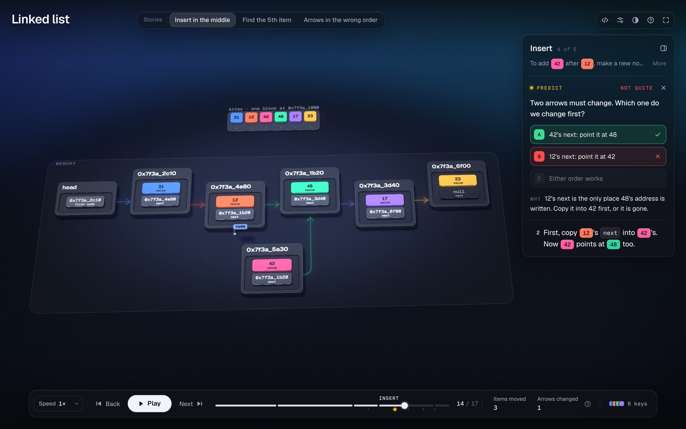
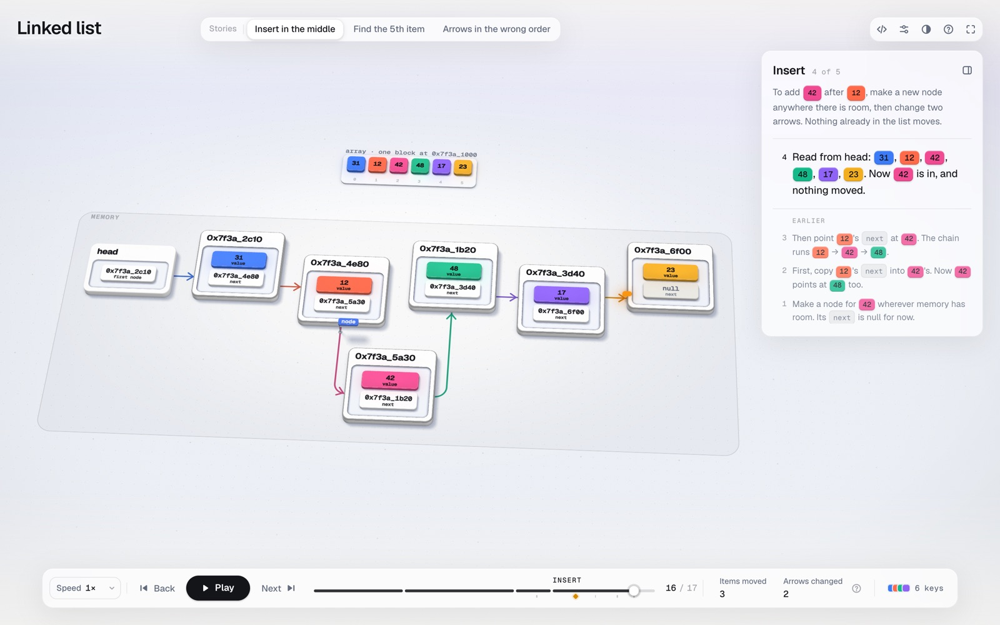
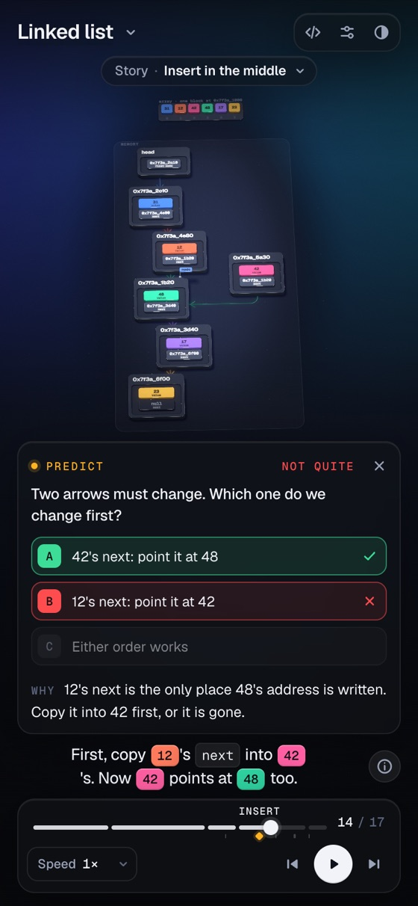
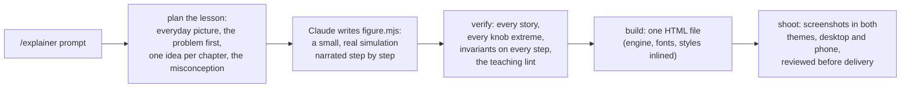

<h1 align="center">Explainer</h1>

<p align="center"><b>Understand a computer-science concept by watching it run.</b><br>
A Claude Code skill: <code>/explainer &lt;concept&gt;</code> writes a real simulation of the idea and hands you one HTML page you can play, rewind and break.</p>

<p align="center">
  <a href="https://sites.irfanali.me/p/random/linked-list.html">Live demo</a> ·
  <a href="#install">Install</a> ·
  <a href="#gallery">Gallery</a> ·
  <a href="#how-it-works">How it works</a>
</p>

<p align="center"><a href="https://sites.irfanali.me/p/random/linked-list.html"></a></p>

---

Most diagrams of distributed systems, operating systems or algorithms are pictures. Explainer builds the thing instead, at small scale: MapReduce really counts the words, Raft really elects a leader, the MMU really walks four levels of page tables. Every step of that run becomes a step on screen, and every number you see comes from the run.

It is written for someone who has only a basic idea. A linked list is taught the way you would teach a friend: first the problem they already know (putting a number in the middle of an array means sliding everything after it), then a scavenger hunt where each clue says where the next one is hidden, then the real thing, with memory addresses, arrows and the bug you get when you change the arrows in the wrong order.

## Install

```sh
npx skills add irfanalimd/explainer -g -a claude-code
```

Or clone it into your skills folder:

```sh
git clone https://github.com/irfanalimd/explainer.git ~/.claude/skills/explainer
```

Then, in Claude Code:

```text
/explainer how Raft elects a leader, and what happens when the leader crashes
```

You need Node.js 20.10+ for the checks and the build, and Chrome or Chromium for screenshots and video. There is nothing to `npm install`.

## Written for beginners

Every figure follows a teaching standard ([`references/teaching.md`](references/teaching.md)), and the checks enforce it:

- **An everyday picture first.** A team counting the words in a library, a group sharing one notebook, one cook with an order rail. The first chapter says which real part each piece stands for.
- **The problem before the solution.** The slow way runs for real first: `hash % N` moves 14 of 16 keys before the ring moves 3.
- **One new idea per chapter**, and the first time the main move happens, every sub-step plays slowly.
- **Plain words.** Each term is defined the first time it appears; hover or tap it to see the definition again. Stories are named the way a learner would ask: "One machine is slow", not "Straggler".
- **Predictions that teach.** At the surprising moment the run stops and asks. The wrong options are real misconceptions, and the answer comes with a reason.
- **A recap** of what you saw, and one sentence worth remembering.

<p align="center"></p>

`node scripts/lesson.mjs figure.mjs` prints any figure's lesson as a plain script, so you can read it the way a beginner would before you look at a single frame.

## Gallery

Every image is a frame of an example in [`examples/`](examples). Click one to open it live (the B+ tree is not online yet; build it with `node scripts/build.mjs examples/btree/figure.mjs`).

<table>
  <tr>
    <td width="50%"><a href="https://sites.irfanali.me/p/random/mapreduce-cluster.html"></a></td>
    <td width="50%"><a href="https://sites.irfanali.me/p/random/raft-consensus.html"></a></td>
  </tr>
  <tr>
    <td><b>MapReduce</b>: a team counts the words of a library. Everything works, one machine crashes, one machine is slow, one word is very common.</td>
    <td><b>Raft</b>: a group keeps one shared notebook. Everything works, the leader crashes, the network splits in two.</td>
  </tr>
  <tr>
    <td><a href="https://sites.irfanali.me/p/random/virtual-memory-page-walk.html"></a></td>
    <td><a href="https://sites.irfanali.me/p/random/javascript-event-loop.html"></a></td>
  </tr>
  <tr>
    <td><b>Virtual memory</b>: apartment numbers and a building directory. A new address, a recent address, a page that isn't in memory, and two programs using the same address.</td>
    <td><b>Event loop</b>: one cook with an order rail. Which runs first, code after <code>await</code>, promises that never stop, taking turns with <code>setTimeout</code>.</td>
  </tr>
  <tr>
    <td><a href="https://sites.irfanali.me/p/random/consistent-hashing-ring.html"></a></td>
    <td><a href="https://sites.irfanali.me/p/random/quicksort-partitioning.html"></a></td>
  </tr>
  <tr>
    <td><b>Consistent hashing</b>: seats around a round table. Add a server (the remainder way moves 14 of 16 keys, the ring moves 3), a server leaves, many seats per server.</td>
    <td><b>Quicksort</b>: a line of people sorted around one chosen person. Shuffled numbers, already sorted input, lots of repeated numbers.</td>
  </tr>
  <tr>
    <td><a href="examples/btree"></a></td>
    <td><a href="https://sites.irfanali.me/p/random/linked-list.html"></a></td>
  </tr>
  <tr>
    <td><b>B+ tree</b>: a library's signposts. Without an index first, then ids in any order, ids that only grow, the top page fills up.</td>
    <td><b>Linked list</b>: a scavenger hunt in memory. Insert in the middle, find the 5th item, arrows in the wrong order. The reference for beginner-level figures.</td>
  </tr>
</table>

<p align="center"><br><sub>Every page has a phone layout of its own.</sub></p>

## What a page gives you

- **Stories.** The normal run, then what breaks: a machine crashes, the network splits, one word is very common, the input is already sorted. All of them sit in a strip at the top; switching jumps to where the stories split.
- **Chapters that wait for you.** The run pauses at the end of each chapter until you press *Continue*. A panel says, in plain words, what the chapter is doing.
- **Predictions.** At the interesting moments it asks what you think happens next, then shows you, and says why.
- **Words you can look up.** Every new term is underlined; hover or tap it for its plain meaning.
- **Rewind.** Drag the timeline anywhere, forwards or back. It is exact, not a replay.
- **Knobs.** Change the number of servers, the latency, the input. The simulation reruns instantly.
- **One file.** About 1 MB, offline, no server. Light and dark themes, phone and desktop. Video export (WebM) if you want it.

## How it works



A figure is a JavaScript module that runs the concept and narrates it through a small builder:

```js
s.spawn("rec7", { from: "m0", in: "m0", of: "record", text: "fox · 1", key: "fox" });
s.step("{ref:m0|map 0} emits `(fox, 1)`");
```

The figure owns the truth: the rules, the numbers and the invariants that must hold on every step. The engine owns everything else: layout, light, motion, camera and controls. That split is why every page shares one look, whatever you ask for, and why a figure can be tested like code.

| Folder | What's in it |
|---|---|
| [`sim/`](sim) | Seeded randomness, instrumented arrays and queues, a message-passing network with crashes and partitions, caches and page tables. |
| [`engine/`](engine) | The scene compiler and timeline, a WebGL 2 renderer (no libraries), the camera, and the controls. |
| [`scripts/`](scripts) | `new`, `verify` (with the teaching lint), `lesson`, `build`, `shoot`, `audit`, `record`. Node built-ins and headless Chrome only. |
| [`examples/`](examples) | Eight complete figures, from a linked list to Raft. Each has a README with its lesson plan and sources. |

The process Claude follows is in [`SKILL.md`](SKILL.md). The teaching standard is in [`references/teaching.md`](references/teaching.md), the visual rules are in [`DESIGN.md`](DESIGN.md), and the builder API is in [`references/builder.md`](references/builder.md).

## Limits

- It is for computing concepts that have a mechanism to run, not for charts or for other sciences.
- Scenes are small on purpose: a handful of servers, a dozen keys. Scale is stated in words, not drawn.
- A good figure takes a real session (about 30–60 minutes), because it is checked and reviewed before you get it.
- Viewing a page needs a browser with WebGL 2.

## License

[MIT](LICENSE) © 2026 Irfan Ali. The bundled Geist fonts are under the [SIL Open Font License](assets/fonts/OFL.txt).
