<h1 align="center">Explainer</h1>

<p align="center"><b>See a computer-science idea run. Then rewind it, break it, and try it yourself.</b></p>

<p align="center">A Claude Code skill. <code>/explainer &lt;concept&gt;</code> writes a small, real simulation of the idea,<br>has a team of agents teach it and test the teaching, and hands you one HTML page.</p>

<p align="center">
  <a href="https://sites.irfanali.me/p/learning/linked-list.html"><b>Live demo</b></a>
  &nbsp;·&nbsp;
  <a href="#install"><b>Install</b></a>
  &nbsp;·&nbsp;
  <a href="#gallery"><b>Gallery</b></a>
  &nbsp;·&nbsp;
  <a href="#how-it-works"><b>How it works</b></a>
</p>

<p align="center">
  <a href="https://sites.irfanali.me/p/learning/mapreduce-cluster.html">
    <picture>
      <source media="(prefers-color-scheme: dark)" srcset=".github/assets/hero-dark.jpg">
      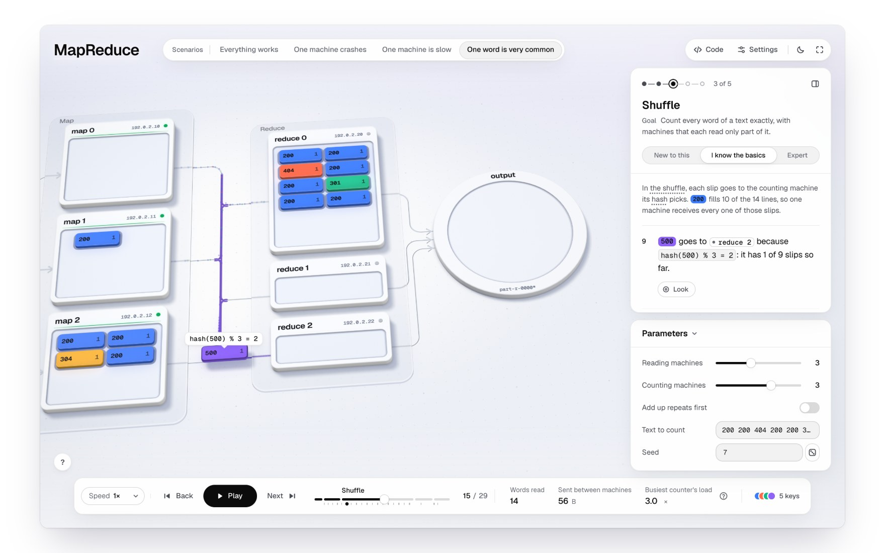
    </picture>
  </a>
</p>

<p align="center"><sub>MapReduce, “One word is very common.” Every slip, byte and count on screen comes from the run.</sub></p>

<br>

## Why this exists

Most diagrams of distributed systems, operating systems and algorithms are pictures, and a picture can be wrong without anyone noticing. Explainer builds the thing instead, at small scale. MapReduce really counts the words. Raft really elects a leader. The MMU really walks the page tables. Each event in that run becomes a step on screen, and every number you see comes from it. We call this **run it, don't draw it**.

Then it teaches the run the way a good teacher would. It starts with a picture you already know and shows the problem before the solution. Each chapter adds one new idea. At the moment that matters, it stops and asks what you think happens next.

<br>

## What a page does

<table>
  <tr>
    <td width="50%" valign="top">
      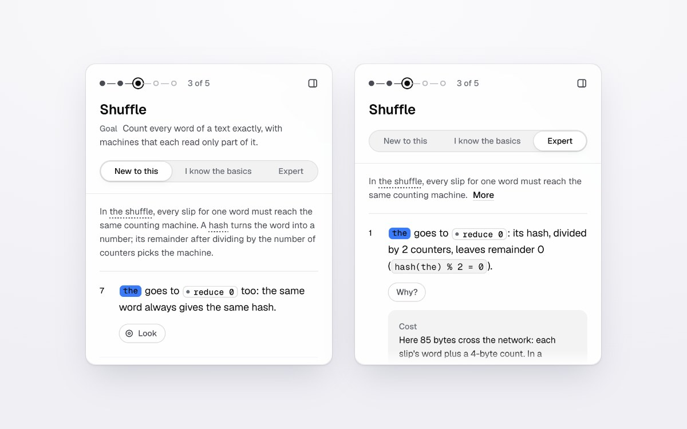
      <h3>A teacher in the panel</h3>
      <p>Each step comes in layers: a plain line, why it matters, <b>Look</b> chips that light the parts in the world, and <b>Go deeper</b>, with the cost, the edge cases and a source. Pick <i>New to this</i>, <i>I know the basics</i> or <i>Expert</i>. The facts stay the same at every level, and only the depth changes.</p>
    </td>
    <td width="50%" valign="top">
      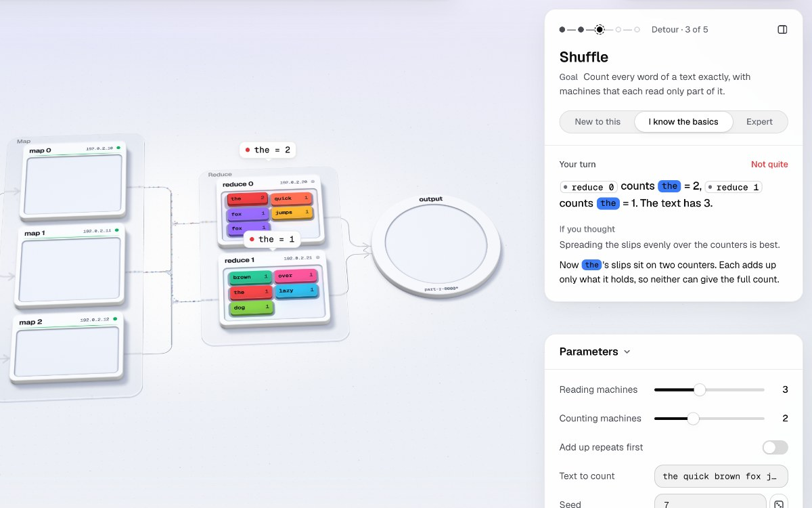
      <h3>Your turn</h3>
      <p>At the key moment you make the call in the world, for example by clicking the machine that should get this word. A wrong pick doesn't just turn red. It plays out for real, here as a count split in two, and the panel names the idea that led there. Rewind and try again. The page ends with a short check.</p>
    </td>
  </tr>
</table>

<table>
  <tr>
    <td width="50%" valign="top">
      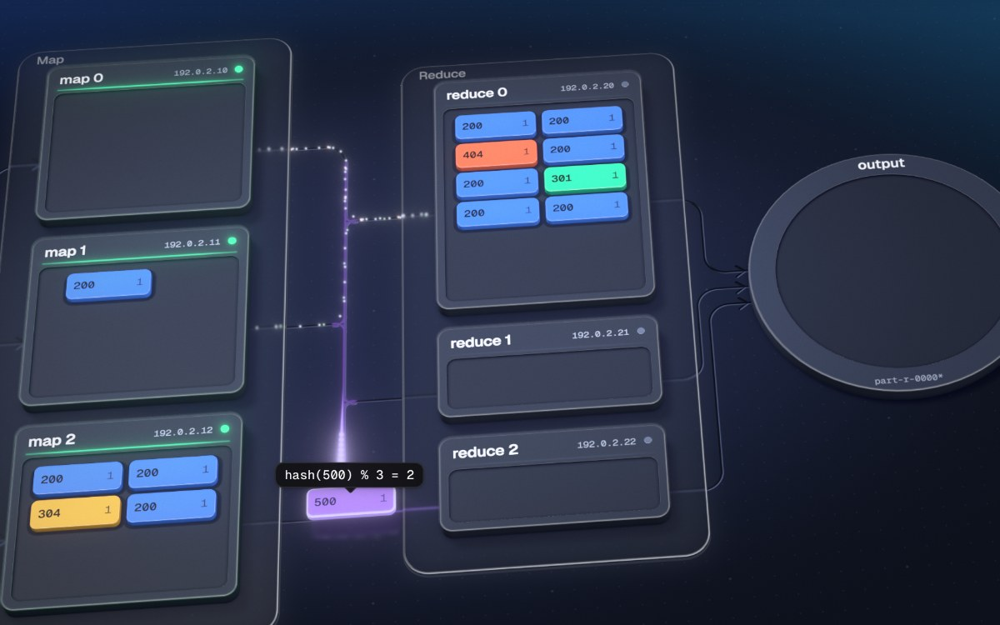
      <h3>Data you can see</h3>
      <p>Rendered with WebGPU: machines on glass plinths, a trail of light behind each moving message, and particle streams with one particle per byte that crossed the wire. Live temporal anti-aliasing keeps edges clean while the camera moves. Browsers without WebGPU get a WebGL 2 renderer and the same page.</p>
    </td>
    <td width="50%" valign="top">
      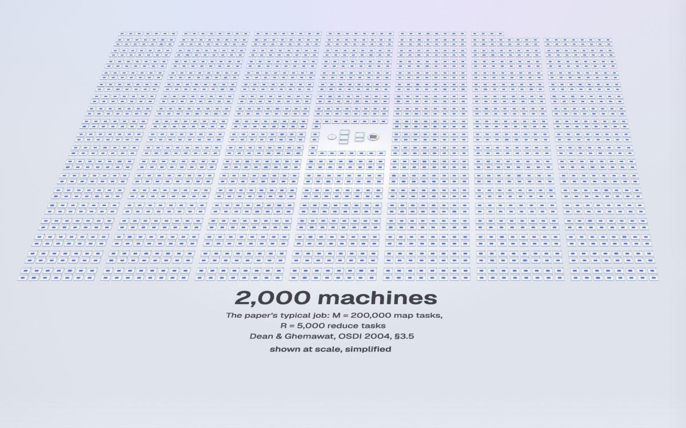
      <h3>The real size</h3>
      <p>When size is the point, the run ends with a powers-of-ten pull-back from the small simulation into the real system, such as the 2,000 machines from the MapReduce paper. It is labelled as a simplified picture, and every number comes from the run or a cited source.</p>
    </td>
  </tr>
</table>

<table>
  <tr>
    <td width="50%" valign="top">
      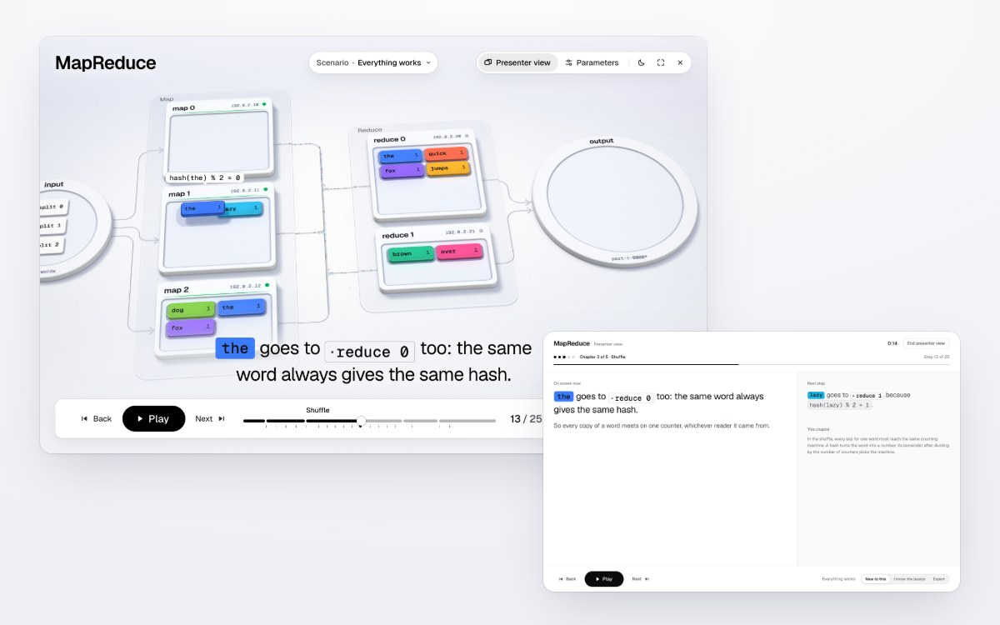
      <h3>Presenter mode</h3>
      <p>Press <kbd>P</kbd> to teach from a projector: big type, high contrast and clicker keys. The presenter view opens in a second window on your laptop and shows the words for the step on screen, the next step, the answer to any open question and a clock.</p>
    </td>
    <td width="50%" valign="top">
      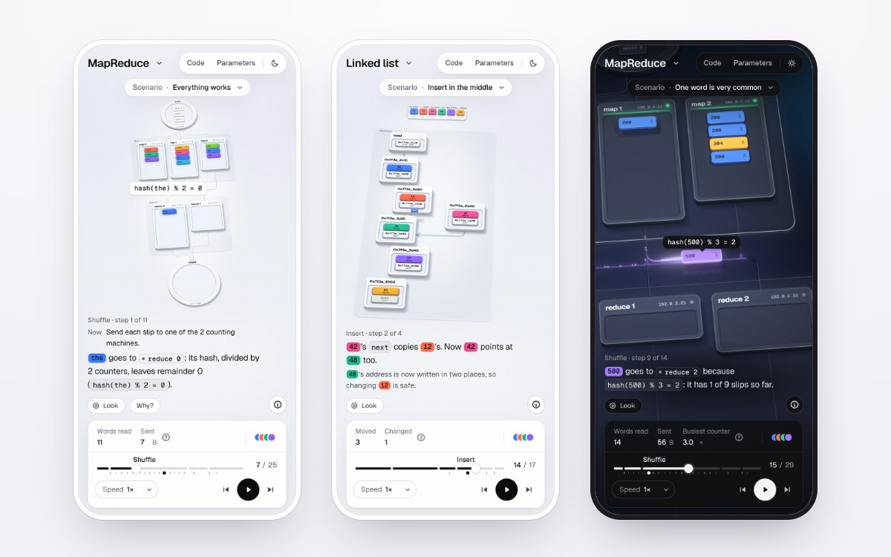
      <h3>Made for every screen</h3>
      <p>Phones get their own layout: the step's words under the world, an Explain sheet and a compact dock. Pages open in the light theme and switch to dark with <kbd>T</kbd>. Each one is a single file that works offline, from <code>file://</code>, with no server.</p>
    </td>
  </tr>
</table>

Also on every page:

- **Scenarios.** You get the normal run, then what breaks: a machine crashes, the network splits, one word is very common, the input is already sorted. Switching jumps to the step where the stories split.
- **Directed camera.** Each chapter gets its own shots: establish, push in, a close detail on the key step, then pull back. Drag to orbit whenever you like.
- **Exact rewind.** Drag the timeline anywhere, forwards or back. It jumps straight to that moment instead of replaying from the start.
- **Parameters.** Change the number of machines, the input or the seed. The simulation reruns at once.
- **Words you can look up.** Every new term is underlined. Hover or tap it to see what it means.

<br>

## Gallery

Every image is a frame of an example in [`examples/`](examples). Click one to open it live.

<table>
  <tr>
    <td width="50%" valign="top">
      <a href="https://sites.irfanali.me/p/learning/mapreduce-cluster.html">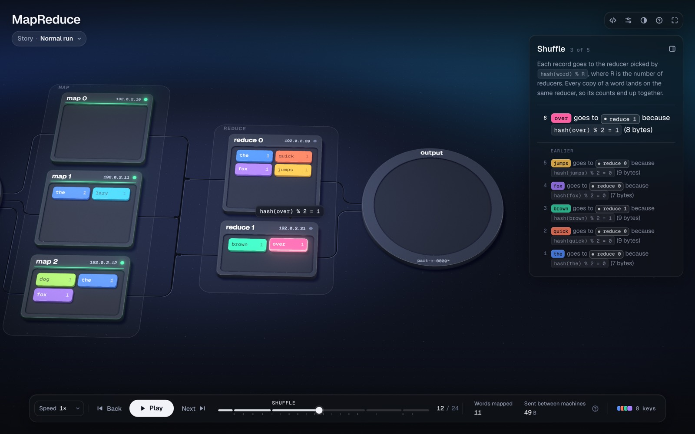</a>
      <p><b>MapReduce</b><br><sub>A team counts the words of a library. Everything works, one machine crashes, one machine is slow, one word is very common.</sub></p>
    </td>
    <td width="50%" valign="top">
      <a href="https://sites.irfanali.me/p/learning/raft-consensus.html">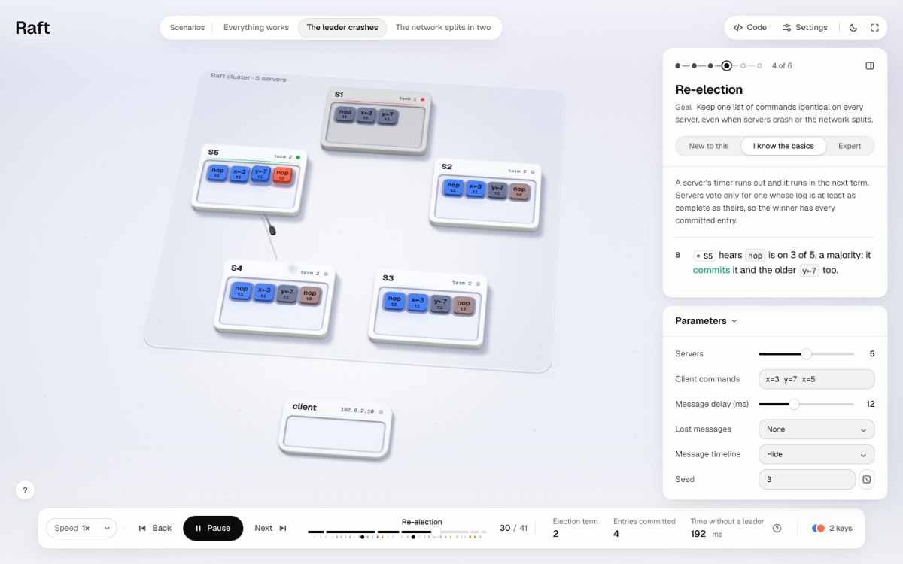</a>
      <p><b>Raft</b><br><sub>A group keeps one shared notebook. Everything works, the leader crashes, the network splits in two.</sub></p>
    </td>
  </tr>
</table>

<table>
  <tr>
    <td width="50%" valign="top">
      <a href="https://sites.irfanali.me/p/learning/virtual-memory-page-walk.html">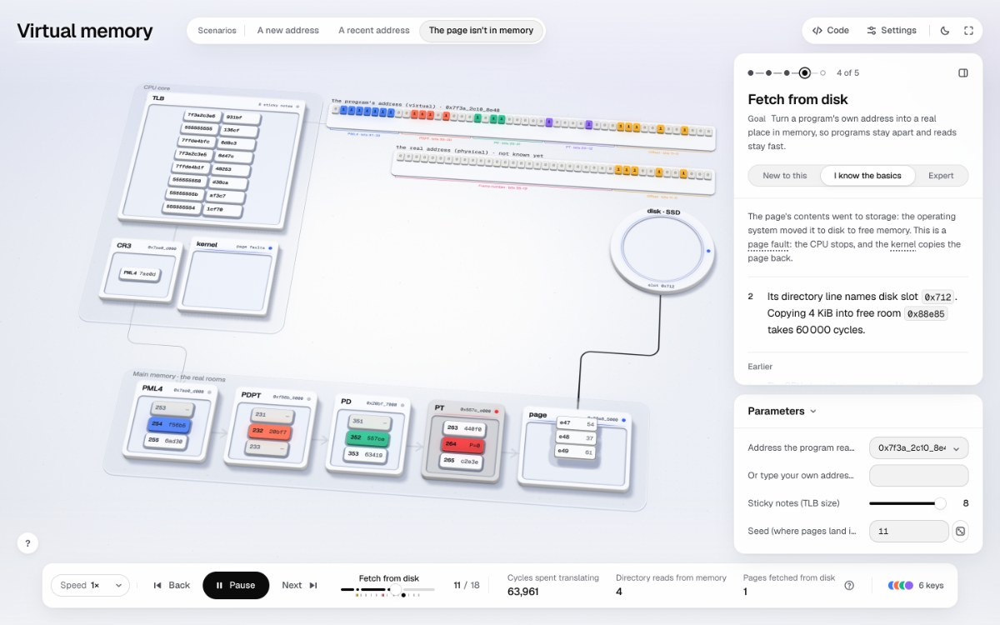</a>
      <p><b>Virtual memory</b><br><sub>Apartment numbers and a building directory. A new address, a recent address, a page that isn't in memory, two programs using the same address.</sub></p>
    </td>
    <td width="50%" valign="top">
      <a href="https://sites.irfanali.me/p/learning/javascript-event-loop.html">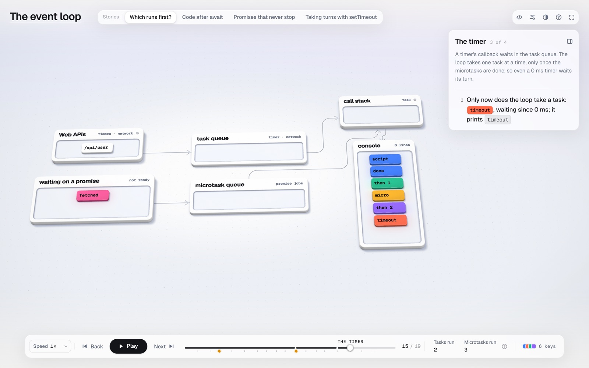</a>
      <p><b>Event loop</b><br><sub>One cook with an order rail. Which runs first, code after <code>await</code>, promises that never stop, taking turns with <code>setTimeout</code>.</sub></p>
    </td>
  </tr>
</table>

<table>
  <tr>
    <td width="50%" valign="top">
      <a href="https://sites.irfanali.me/p/learning/consistent-hashing-ring.html">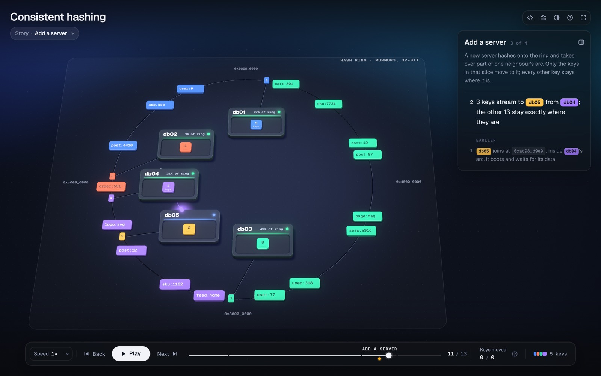</a>
      <p><b>Consistent hashing</b><br><sub>Seats around a round table. Add a server (the remainder way moves 14 of 16 keys; the ring moves 3), a server leaves, many seats per server.</sub></p>
    </td>
    <td width="50%" valign="top">
      <a href="https://sites.irfanali.me/p/learning/quicksort-partitioning.html">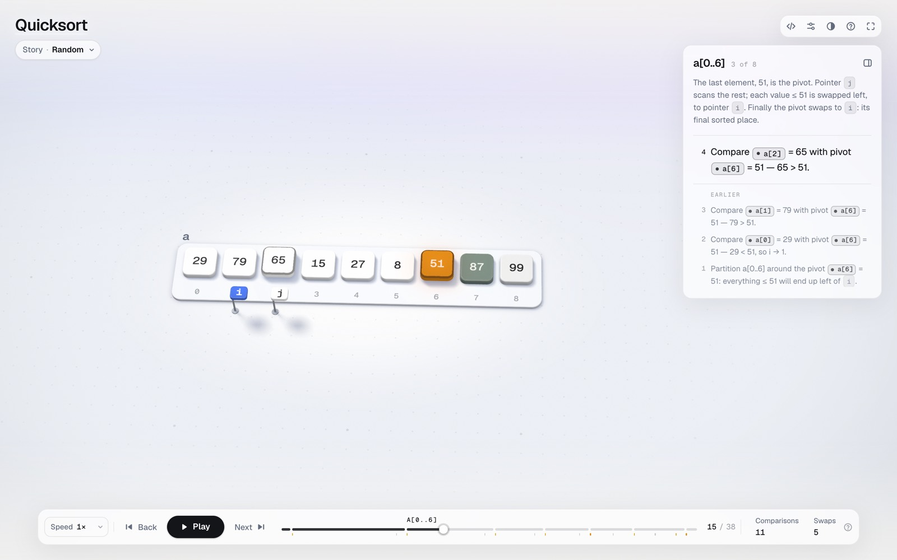</a>
      <p><b>Quicksort</b><br><sub>A line of people sorted around one chosen person. Shuffled numbers, already sorted input, lots of repeated numbers.</sub></p>
    </td>
  </tr>
</table>

<table>
  <tr>
    <td width="50%" valign="top">
      <a href="https://sites.irfanali.me/p/learning/b-plus-tree.html">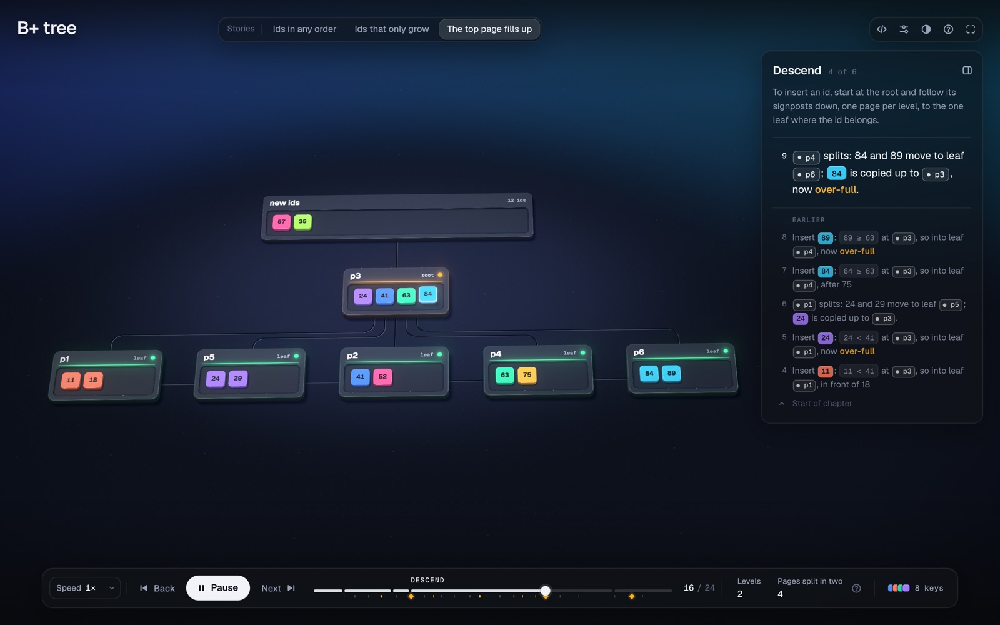</a>
      <p><b>B+ tree</b><br><sub>A library's signposts. First without an index, then ids in any order, ids that only grow, and the top page filling up.</sub></p>
    </td>
    <td width="50%" valign="top">
      <a href="https://sites.irfanali.me/p/learning/linked-list.html">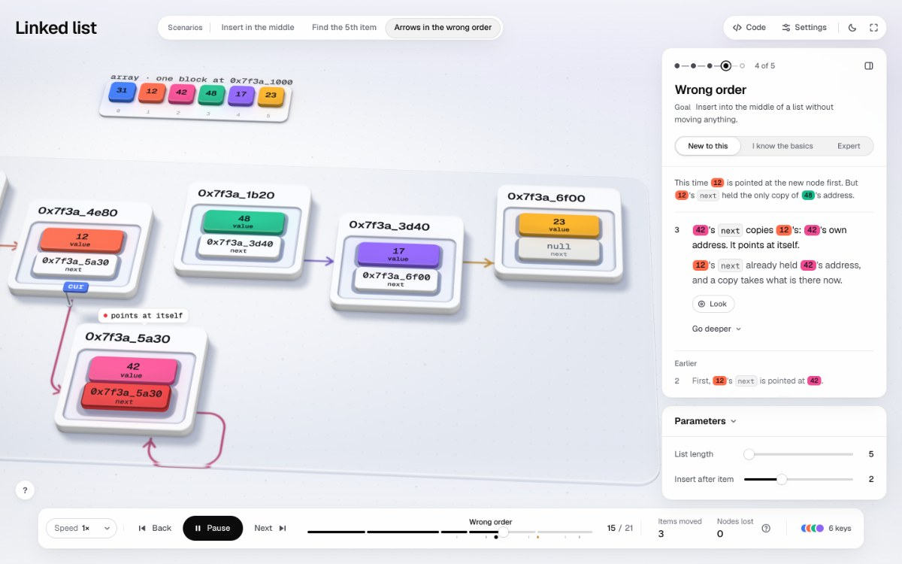</a>
      <p><b>Linked list</b><br><sub>A scavenger hunt in memory. Insert in the middle, find the 5th item, arrows in the wrong order. The model for beginner lessons.</sub></p>
    </td>
  </tr>
</table>

<br>

## How it works

A figure has three owners. **`figure.mjs`** owns the truth: a small, deterministic simulation with the real rules, the real numbers and the invariants that must hold at every step. **`lesson.mjs`** owns the words, keyed by step id and filled in from the run's own values. **The engine** owns everything else: layout, light, motion, camera, controls and accessibility. That split gives every page the same design language, and it means a figure can be tested like code.

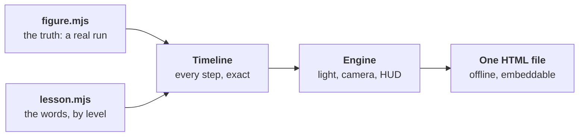

A step in a figure is one call. It carries the values the words need:

```js
s.step("{ref:m0|map 0} emits `(fox, 1)`", {
  id: "map.read",
  vars: { map: { ref: "m0", text: "map 0" }, w: { key: "fox" } },
});
```

Before anything ships, `verify` runs every scenario and every knob at its extremes, checks the invariants on every step, and checks the lesson and its wording. It must end with `0 failing`.

### The teacher pipeline

With the plugin installed, a figure isn't done just because it runs. A team of agents plans the lesson, writes it, and has it read cold by readers who have never seen it. It isn't shipped until those readers understand it.

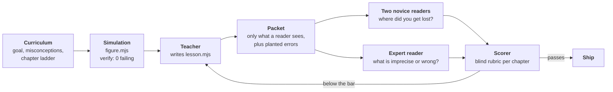

- **The readers are blind.** They see only the packet: each chapter's words and key frames, never the source, the ids or the history. A hook enforces this.
- **Every packet has planted errors.** The novices get an undefined jargon word and the expert gets a wrong number. A report that misses its plant doesn't count, and that reader runs again.
- **The scorer never knows the round or who wrote what.** A lesson passes when every chapter scores at least 4 for both novices and no "wrong" or "misleading" finding is left open. There are at most three revision rounds; after that, the open findings go to you instead of being shipped quietly.

<br>

## Install

Pick one. Both give you `/explainer`, the `/explainer:teacher` skill and the agents that write and review each lesson.

**As a Claude Code plugin** (updates with `claude plugin update explainer`). In Claude Code:

```text
/plugin install explainer --marketplace irfanalimd/explainer
```

On older versions, add the marketplace first: `/plugin marketplace add irfanalimd/explainer`, then `/plugin install explainer@irfanalimd`.

**With the skills CLI:**

```sh
npx skills add irfanalimd/explainer -g -a claude-code
```

Or clone it into your skills folder:

```sh
git clone https://github.com/irfanalimd/explainer.git ~/.claude/skills/explainer
```

Don't install it both ways. If you do, Claude Code loads the plugin copy and reports the other as not loaded. Other agents (`-a codex` and the like) get the skill without the agents, so the skill runs the whole pipeline itself and marks the reviews as not blind.

**Requirements:** Node.js 20.10+ for the checks and the build, and Chrome or Chromium for screenshots and video. There's nothing to `npm install`. Viewing a page needs a browser with WebGPU or WebGL 2.

<br>

## Quick start

In Claude Code:

```text
/explainer how Raft elects a leader, and what happens when the leader crashes
```

Claude tells you how big the figure will be and roughly how long it will take. It plans the lesson, writes and verifies the simulation, has the lesson reviewed, and hands you the HTML file. A typical figure takes 30–60 minutes, because it's checked and reviewed before you get it.

To open one of the examples, run this from the skill folder:

```sh
node scripts/build.mjs examples/mapreduce/figure.mjs   # writes examples/mapreduce/mapreduce.html
```

<br>

## Making your own figure

From the skill folder:

```sh
# start from an example: figure.mjs, lesson.mjs and a README
node scripts/new.mjs my-figure --from mapreduce

# every scenario, knob extremes, invariants, the lesson and its wording
node scripts/verify.mjs my-figure/figure.mjs

# read the whole lesson as a plain script, the way a beginner would
node scripts/lesson.mjs my-figure/figure.mjs

# a live-reloading page while you work
node scripts/build.mjs my-figure/figure.mjs --serve

# every chapter, question and pick, in both themes, desktop and phone
node scripts/shoot.mjs my-figure/figure.mjs --teach
```

Read the lesson before you look at a single frame. The process Claude follows is in [`SKILL.md`](SKILL.md), the teaching standard is in [`references/teaching.md`](references/teaching.md), the visual rules are in [`DESIGN.md`](DESIGN.md), and the builder API is in [`references/builder.md`](references/builder.md).

<br>

## For teachers

- **Reader levels.** *New to this*, *I know the basics* and *Expert* change how much the panel explains and how many questions it asks, never the facts. The level can be set on the start card or in the panel (<kbd>L</kbd>), and the page remembers it.
- **Presenter mode.** Use <kbd>P</kbd>, `?present=1` or Settings → Presenting. A clicker works with <kbd>→</kbd>, <kbd>Page Down</kbd> and <kbd>Space</kbd>. The presenter view, a second window on your laptop, runs from `file://` too. It warns you one step before each question so you can ask the room first, shows what each wrong answer means, gives each chapter's prompt for the room (the lesson's `chapters[id].teach`), and lets you jump to a chapter or switch story.
- **Share.** The toolbar's **Share** (on phones it is in the title's card) gives a link to this moment (story, step, your level if you want it, and any knobs you changed), *Save image* (this frame and its step's words as a PNG), an iframe snippet that opens at this step, and the handout. Nothing leaves the page.
- **Handout.** Share → Handout opens a printable **student worksheet** or **teacher guide**, made from the lesson and the real runs: a picture of each chapter, every question with room to answer, the end check, and the answers on a page of their own. The teacher guide adds the plan (each story's measured play time), the wrong ideas to listen for, the talk prompts and what each wrong option means. <kbd>Ctrl</kbd>+<kbd>P</kbd> on the page prints the worksheet.
- **Deep links.** `#scenario-crash&step-4`, `#level-expert` or `#p=reducers:4` opens a page exactly where you want the class to start. The start card says where the link opens and offers *From the start*; a link that asks for something the page can't do (an unknown story, a knob out of range) opens anyway and says what it changed.
- **Embedding.** `?embed=1` gives an iframe layout, designed for 800×500 and up. The page speaks a versioned `postMessage` API: you can drive it with `play`, `pause`, `seek`, `step`, `scenario`, `level` and `theme`, and it reports progress, answers and completion as xAPI statements, ready for an LMS.

```js
// host → figure
frame.contentWindow.postMessage(
  { type: "explainer", version: 1, command: "scenario", value: "crash" },
  figureOrigin,
);

// figure → host
// { type: "explainer", version: 1, event: "ask-answered", statement: { verb, object, result, … } }
```

Allowed origins are set with `?origin=` or `meta.embed.origins`. [`references/tooling.md`](references/tooling.md) has the full protocol.

<br>

## Accessibility

- **A described scene.** Behind the canvas, a hidden list describes what's on screen in words ("map 1, busy, 4 records"). A polite live region says what each step changed, after the caption, without repeating it.
- **A keyboard path into the world.** <kbd>Tab</kbd> reaches the scene. The arrow keys move to the nearest thing in that direction, and <kbd>Enter</kbd> opens its details or makes your pick. Every control is a real button with a visible focus ring.
- **Readable by default.** All HUD text meets 4.5:1 contrast in both themes. Colour is never the only cue, because keys are printed on their tiles. Reduced motion is respected. Single-key shortcuts can be turned off in Settings.
- **No blank pages.** Without a GPU, the controls and captions still work.

<br>

## Project layout

| Folder | What's in it |
|---|---|
| [`engine/`](engine) | The scene compiler and timeline, the WebGPU and WebGL 2 renderers (no libraries), the camera director, the HUD, the described scene and the embed API. |
| [`sim/`](sim) | Seeded randomness, instrumented arrays and queues, a message-passing network with crashes and partitions, caches and page tables. |
| [`scripts/`](scripts) | `new`, `verify`, `lesson`, `build`, `serve`, `shoot`, `audit`, `record`, and `review-packet` / `review-check` for the blind reviews. These use only Node built-ins and headless Chrome. |
| [`agents/`](agents), [`skills/teacher/`](skills/teacher), [`hooks/`](hooks) | The teacher pipeline: curriculum designer, teacher, novice and expert readers, scorer, and the hook that fences them. |
| [`examples/`](examples) | Eight complete figures, from a linked list to Raft. Each one has a README with its lesson plan and sources. |

<br>

## Limits

- It's for computing concepts that have a mechanism to run. It isn't for charts or for other sciences.
- Scenes are small on purpose: a handful of servers, a dozen keys. The real scale is shown only as a labelled, simplified picture, never simulated.
- Some looks, like the glass plinths and particle streams, need WebGPU. The WebGL 2 renderer draws the same world without them.

<br>

## License

[MIT](LICENSE) © 2026 Irfan Ali. The bundled Geist fonts are under the [SIL Open Font License](assets/fonts/OFL.txt).
