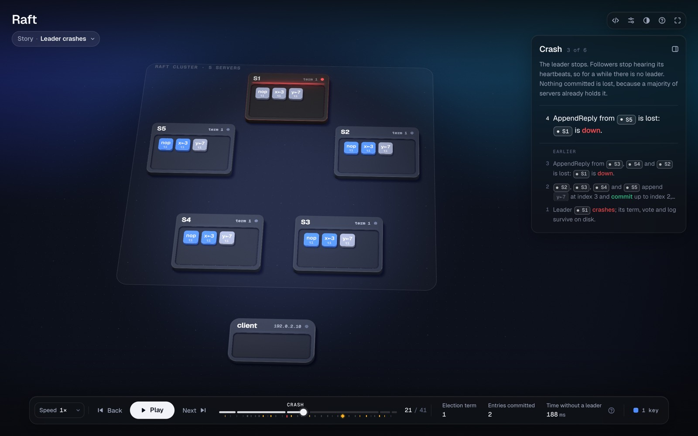
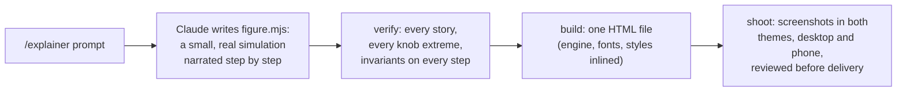

<h1 align="center">Explainer</h1>

<p align="center"><b>Understand a computer-science concept by watching it run.</b><br>
A Claude Code skill: <code>/explainer &lt;concept&gt;</code> writes a real simulation of the idea and hands you one HTML page you can play, rewind and break.</p>

<p align="center">
  <a href="https://sites.irfanali.me/p/random/raft-consensus.html">Live demo</a> ·
  <a href="#install">Install</a> ·
  <a href="#gallery">Gallery</a> ·
  <a href="#how-it-works">How it works</a>
</p>

<p align="center"></p>

---

Most diagrams of distributed systems, operating systems or algorithms are pictures. Explainer builds the thing instead, at small scale: MapReduce really counts the words, Raft really elects a leader, the MMU really walks four levels of page tables. Every step of that run becomes a step on screen, and every number you see comes from the run.

## Install

```sh
npx skills add irfanalimd/explainer -g -a claude-code
```

Or clone it into your skills folder:

```sh
git clone https://github.com/irfanalimd/explainer.git ~/.claude/skills/explainer
```

Then, in Claude Code:

```text
/explainer how Raft elects a leader, and what happens when the leader crashes
```

You need Node.js 20.10+ for the checks and the build, and Chrome or Chromium for screenshots and video. There is nothing to `npm install`.

## Gallery

Every image is a frame of an example in [`examples/`](examples). Click one to open it live.

<table>
  <tr>
    <td width="50%"><a href="https://sites.irfanali.me/p/random/raft-consensus.html"></a></td>
    <td width="50%"><a href="https://sites.irfanali.me/p/random/mapreduce-cluster.html"></a></td>
  </tr>
  <tr>
    <td><b>Raft</b>: election, replication, a crashed leader, a network partition.</td>
    <td><b>MapReduce</b>: split, map, shuffle by <code>hash(word) % R</code>, reduce; a worker dies, a straggler, a hot key.</td>
  </tr>
  <tr>
    <td><a href="https://sites.irfanali.me/p/random/virtual-memory-page-walk.html"></a></td>
    <td><a href="https://sites.irfanali.me/p/random/javascript-event-loop.html"></a></td>
  </tr>
  <tr>
    <td><b>Virtual memory</b>: a TLB miss, a four-level page walk, a page fault.</td>
    <td><b>Event loop</b>: why a promise beats <code>setTimeout(0)</code>, and how microtasks can starve rendering.</td>
  </tr>
  <tr>
    <td><a href="https://sites.irfanali.me/p/random/consistent-hashing-ring.html"></a></td>
    <td><a href="https://sites.irfanali.me/p/random/quicksort-partitioning.html"></a></td>
  </tr>
  <tr>
    <td><b>Consistent hashing</b>: add a server and 3 keys move; with <code>hash % N</code>, 14 of 16 would.</td>
    <td><b>Quicksort</b>: Lomuto partitioning, one comparison at a time, including the worst case.</td>
  </tr>
</table>

<p align="center"><br><sub>Every page has a phone layout of its own.</sub></p>

## What a page gives you

- **Stories.** The normal run, then what breaks: a crash, a partition, a skewed key, the worst case. Switching jumps to where the stories split.
- **Chapters that wait for you.** The run pauses at the end of each chapter until you press *Continue*. A panel says, in plain words, what the chapter is doing.
- **Predictions.** At the interesting moments it asks what you think happens next, then shows you.
- **Rewind.** Drag the timeline anywhere, forwards or back. It is exact, not a replay.
- **Knobs.** Change the number of servers, the latency, the input. The simulation reruns instantly.
- **One file.** About 1 MB, offline, no server. Light and dark themes, phone and desktop. Video export (WebM) if you want it.

## How it works



A figure is a JavaScript module that runs the concept and narrates it through a small builder:

```js
s.spawn("rec7", { from: "m0", in: "m0", of: "record", text: "fox · 1", key: "fox" });
s.step("{ref:m0|map 0} emits `(fox, 1)`");
```

The figure owns the truth: the rules, the numbers and the invariants that must hold on every step. The engine owns everything else: layout, light, motion, camera and controls. That split is why every page shares one look, whatever you ask for, and why a figure can be tested like code.

| Folder | What's in it |
|---|---|
| [`sim/`](sim) | Seeded randomness, instrumented arrays and queues, a message-passing network with crashes and partitions, caches and page tables. |
| [`engine/`](engine) | The scene compiler and timeline, a WebGL 2 renderer (no libraries), the camera, and the controls. |
| [`scripts/`](scripts) | `new`, `verify`, `build`, `shoot`, `audit`, `record`. Node built-ins and headless Chrome only. |
| [`examples/`](examples) | Seven complete figures, including a B+ tree. Each has a README with its sources. |

The process Claude follows is in [`SKILL.md`](SKILL.md). The visual rules are in [`DESIGN.md`](DESIGN.md), and the builder API is in [`references/builder.md`](references/builder.md).

## Limits

- It is for computing concepts that have a mechanism to run, not for charts or for other sciences.
- Scenes are small on purpose: a handful of servers, a dozen keys. Scale is stated in words, not drawn.
- A good figure takes a real session (about 30–60 minutes), because it is checked and reviewed before you get it.
- Viewing a page needs a browser with WebGL 2.

## License

[MIT](LICENSE) © 2026 Irfan Ali. The bundled Geist fonts are under the [SIL Open Font License](assets/fonts/OFL.txt).
